# SP-338 transcription — S.T.U.N. Runner (Atari Games TM 238)

A clean transcription made from the **rendered page images** in
`/tmp/stunrunner_pages/page-NN.png`, *not* from
`reference/manuals/stunrunner-ocr.txt`.

## Why the OCR is not used for schematics

It fails in two independent ways, and both have already cost us time:

1. **Its page markers do not bound its own text.** It credits `34010-50` to
   SP-338 Page 9; Page 9 is the ADC and shifter sheet.
2. **Tables lose their alignment and schematic text degrades to noise** —
   designators, net names and pin numbers arrive as isolated letters.

It remains useful for body prose. It is superseded for anything tabular,
schematic, or address-bearing.

## Page mapping

| What | PDF page |
|---|---|
| SP-338 Page *N* | **47 + *N*** for numbered pages — verified from Page 10 = 67 and Page 15 = 72. SP-338 Sheet 11 is PDF 68 but is titled “Sheet 11,” not “Page 11.” |
| Manual body pages | the manual's own numbering, offset differs by chapter — PDF 29 = page 3-5, PDF 17 = page 2-7 |

## Status

| SP-338 page | PDF | Title | State |
|---|---|---|---|
| 1 | 58 | Main Wiring Diagram | transcribed |
| 2–4 | 59–61 | Main PCB power, 68010, decode | transcribed below |
| 5–8 | 62–65 | Main PCB ROM/serial/bus/DIPs | transcribed below |
| 9 | 66 | Multisync Game PCB (ADC / shifter) | still to transcribe |
| 10 | 67 | Multisync Game PCB (video) | transcribed |
| 11–14 | 68–71 | option/sync, SA Audio II, power | transcribed below |
| 15 | 72 | Main Board Memory Map | transcribed |

---

## 1. The board at a glance

From SP-338 Pages 1 and 10. This is the top-level picture the rest of this
document fills in.

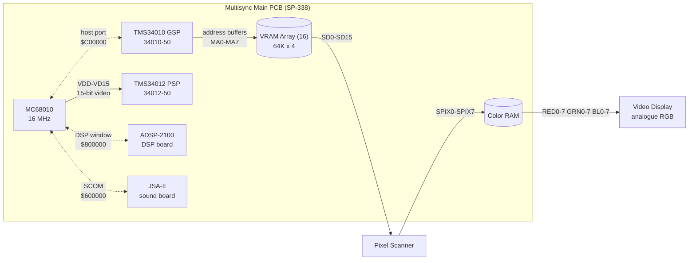

**The single most important structural fact on this page:** the GSP writes VRAM
through address buffers and does **not** scan out. A separate TMS34012 serialises
its 15-bit video; the Pixel Scanner shifts VRAM out and Color RAM produces RGB.

That is why the MC68010 can draw text without any cooperation from the GSP: the
glyph words are composed entirely in the 68010's domain and land in VRAM over
the host port. The GSP is never asked to interpret text.

---

## 2. SP-338 Page 1 — Main Wiring Diagram (PDF 58)

Board-level interconnect: power supply, video display, coin mechanism, control
panel.

### 2.1 The modified flight control

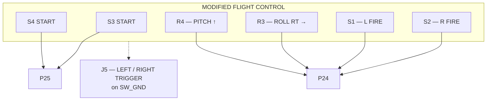

**Two START buttons, two FIRE buttons (left and right), and two potentiometers —
one roll, one pitch.** Chapter 3's prose agrees: the handle assembly gives
vertical motion, the flight control assembly gives horizontal, which maps onto
pitch and roll.

### 2.2 Connector nets

`J5` control-panel header:

| pin | net | | pin | net |
|---|---|---|---|---|
| 1 | `TEST` | | 7 | `F IN` |
| 2 | `GND` | | 8 | `GND` |
| 3 | `AUD OUT` | | 9 | `+5V` |
| 4 | `AUD F` | | 10 | `+5V` |
| 5 | `KEY` | | 11 | `+5V` |
| 6 | `OUT` | | | |

`J9`:

| pin | net |
|---|---|
| 1 | `KEY` |
| 4 | `+5V` |
| 5 | `STEERING POT` |
| 6 | `AIM POT` |
| 11 | `GND` |

**A second analogue pair exists on `J9`**, separate from the R3/R4 pair on the
flight control. The board therefore expects at least four analogue axes before
any ADC is considered: roll, pitch, steering, aim. MAME carries two ADC axes.

`J5`, right-hand group:

| pin | net |
|---|---|
| 1 | `RIGHT TRIGGER` |
| 4 | `KEY` |
| 7 | `START` |
| 8 | `LEFT TRIGGER` |
| 10 | `SW_GND` |
| 11 | `GND` |

**`LEFT TRIGGER` and `RIGHT TRIGGER` sit on `SW_GND`, so they are switches, not
analogue.** This is the hardware confirmation, from wiring rather than prose, of
the gap in `docs/hardware-contract.md` §5: the self-test menus that the manual
says are navigated with "the right or left trigger" are driven by two of the
sixteen external switch inputs at `$A80000`, where MAME models three bits and
marks thirteen `IPT_UNUSED`.

`JSCOM` sound-board header: `TEST, GND, DATA, F IN, KEY, OUT, CLK, GND, GND, +5V, +5V`.

`P6`: `GND, SELF TEST, CON CNTR 1, CON CNTR 2, GND, KEY, CON CNTR 1, CON CNTR 2`
— two coin mechanisms with separate counters, plus an explicit `SELF TEST` line.

### 2.3 Board switches

| ref | function | where |
|---|---|---|
| `S11` | `TEST SW` — the self-test switch | on `P29`, main board |
| `R1` | `VOLUME CONTROL` | on `P29` |
| `R3`, `R4` | roll, pitch potentiometers | modified flight control |
| `P35` | `COIN COUNTER` | `P100` / `P55` coin interface |

The self-test switch is a **physical switch on the main PCB** (`S11`), routed to
`P6`'s `SELF TEST` line, and readable by the 68010 at `$60C000` bit 5. The
manual's memory map and MAME's `PORT_SERVICE(0x20)` describe the same switch;
neither is wrong.

### 2.4 Power and video

* Power supply wiring diagram `046989-01`: `+SENSE, +5V, +5V, +5V, GND, GND, -SENSE`
  — a three-wire sense arrangement, so the +5 V rail is remotely sensed.
* Video display connector: `BK, GN, BN` / `R, BK, GN` — analogue RGB to the
  monitor, separate from the digital GSP side.
* Speaker `LS1` via `P30`, driven from the sound board through `P29`.

---

## 3. SP-338 Page 10 — Video (PDF 67)

Signal flow, as printed:

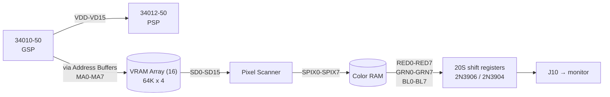

**Jumper settings printed on the sheet:**

| Jumper | Setting |
|---|---|
| `Speed` | `A, B` |
| `BCLK` | `QB` |
| `VCLK` | `QB/2` |

**Clocks on this sheet:**

| Source | Value | Feeds |
|---|---|---|
| `XO-SCH` | `40MHZ` | pixel scanner |
| crystal `15.00Y 0.11431B 12` | via LS374 divider | `4 MHz` / `16 MHz` domains |
| MC68010 clock pin | **`8MHZ`**, Page 3 `U68010 CLK(15)` | main CPU |

Page 10 lists clock domains but does not say that the CPU pin uses 16 MHz. Page 3
is the direct connection: `8MHZ` reaches `U68010 CLK` pin 15. Do not collapse
these two facts into “68010 = 16 MHz”; the clock tree still needs reconciliation.

**Output stage:** three `20S` 8-bit shift registers driven from `RRV`, `CRV` and
`BRV`, each clocked by `BCLK` / `/BLANK4`, feeding `2N3906` / `2N3904` output
stages and the `RED` / `GREEN` / `BLUE` nets to `J10`. `Q6` and `Q7` are `2N37100`
synchronous 16-bit counters for red and blue.

---

## 4. SP-338 Page 15 — Main Board Memory Map (PDF 72)

The authoritative memory map. Reproduced in full, with the MAME comparison, in
[`docs/hardware-contract.md`](hardware-contract.md) §1.

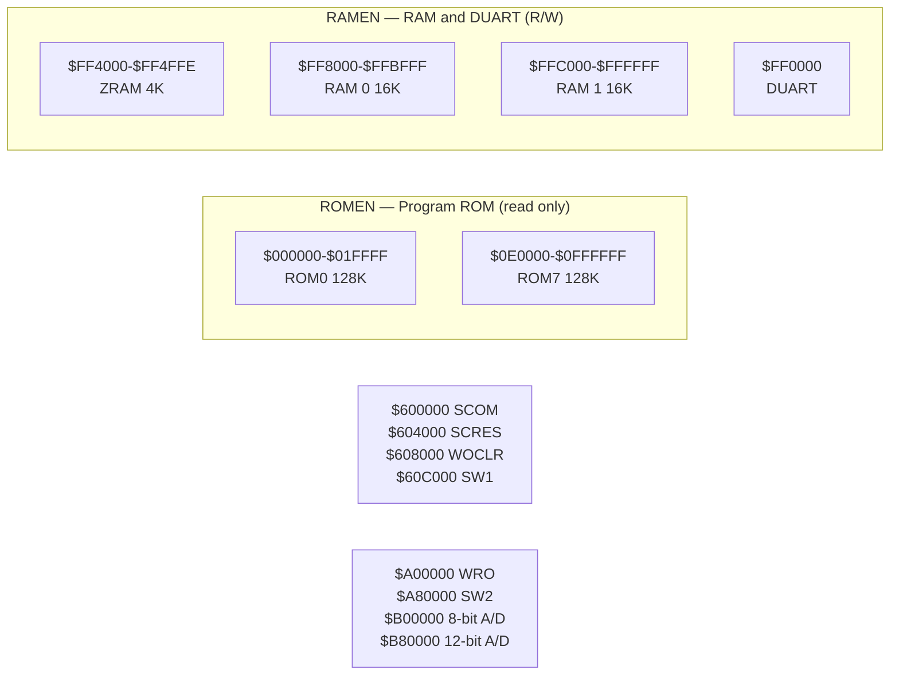

---

## 5. The boot chain, for context

Not from the manual — from our own ROM transcription, recorded here because the
manual's `$C00000` gap is the reason we care about these pages.

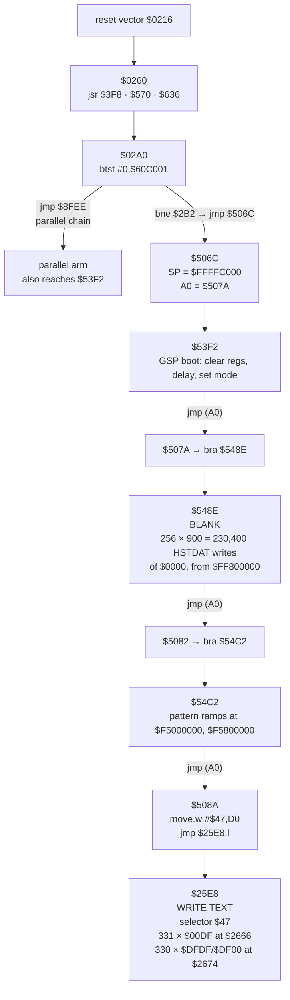

Measured frame ranges: blank ≈ frames 0–45; text `$47` at frames 45–47;
`$43`/`$50`/`$51`/`$52` at frames 165–167. GSP program upload frames 396–405,
release at frame 405.

---

---

## 7. Self-test screens and their order (manual pages 2-6, 2-7 — PDF 16, 17)

Table 2-4, *Summary of All Screens Appearing in the Self-Test*, transcribed in
full. This is the document that identifies what we have been decoding.

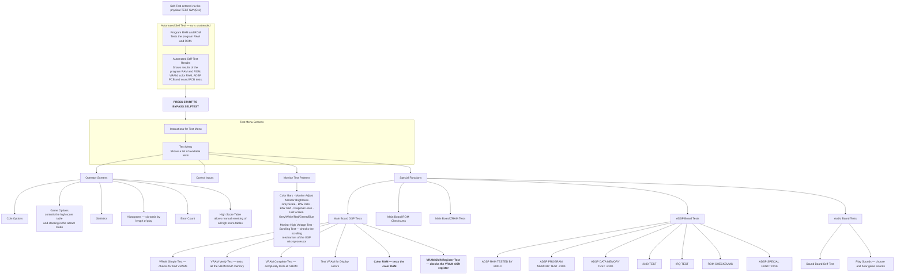

### 7.1 What this identifies in our own captures

| Our capture | Manual screen | Confidence |
|---|---|---|
| frames 45–47, selector `$47`, `PRESS*START*TO*BYPASS*SELFTEST` | the bypass prompt between the automated self-test and the test menu | exact string match |
| frames 165–167, selector `$43`, `PROGRAM*ROM*OK` | a line of the **Automated Self-Test Results** screen | string match; the manual names that screen as showing program RAM and ROM, VRAM, colour RAM, ADSP and sound results |
| frames 165–167, selectors `$51`/`$52`, `200` and `210` | unexplained | **not matched** |
| frames 165–167, selector `$50`, `Y*X*W*V*U*T*S*R` | unexplained | **not matched** |

**`Y X W V U T S R` is eight consecutive letters descending (R=18 … Y=25).** It
is not menu prose, and the test menu has four top-level items, so a one-to-one
mapping to menu entries does not exist. The nearest documented screen is the
**Control Inputs** screen, which exists precisely to verify the controls, but
nothing in the manual describes it and we have not captured it. **This stays
unidentified.** Do not let a plausible story fill the gap.

### 7.2 Three entries that bear directly on open questions

* **"Color RAM — tests the color RAM."** A named, separately testable device.
  This corroborates the Page 10 block diagram and confirms that
  `docs/gsp-display-scanout-contract.md`'s "two 1024-entry 16-bit planes" is
  describing something the hardware does not plainly have. There is a real
  Color RAM and it is testable on its own.
* **"VRAM Shift Register Test — checks the VRAM shift register."** The
  schematic's Pixel Scanner is the shift register. So the path VRAM → scanner →
  Color RAM is independently exercisable.
* **"Game Options — controls the high score table and steering in the attract
  mode."** The attract sequence has a steering-driven element, and the high
  score table is operator-editable — which is the NVRAM path we already have a
  slice for.

### 7.3 The option tables, from page 2-5 (PDF 15)

These are stored in RAM and edited through the screens, not by DIP.

**Coin options (Table 2-2)** — ◆ marks the manufacturer's recommended setting:

| Option | Settings |
|---|---|
| Coin Mode | 1 coin/1 credit · **2 coins/1 credit ◆** · 3 coins/1 credit · 4 coins/1 credit |
| Right Mech Multiplier | **1 coin counts as 1 coin ◆** · as 4 · as 5 · as 6 |
| Left Mech Multiplier | **1 coin counts as 1 coin ◆** · as 2 |
| Bonus Adder | **No bonus adder ◆** · 2→1 extra · 4→1 extra · 4→2 extra · 5→1 extra · 3→1 extra · **Free Play** |

Note the default is **two coins per credit**, so any replay harness that inserts
a single coin does not reach gameplay.

**Game options (Table 2-3)**:

| Option | Settings |
|---|---|
| Game Difficulty | Very Easy · Easy · Medium Easy · **Medium ◆** · Medium Hard · Hard · Very Hard · Nasty |
| Continue is One Coin Less Than Start | **Off ◆** · On |
| Sounds in Attract | **Yes ◆** · No |
| Auto Reset High Scores | Off · **On ◆** |
| High Score Name Censor | **Strict ◆** · Easygoing ◆ |
| T-Shirt Contest | **Disabled ◆** · Enabled ◆ |
| Continue Advances to Next Level | **After 1 Retry ◆** · After 2 Retries · Always · Never |

**Screen layout**, from Figure 2-6 (Game Options). Each option is a title line
followed by an indented value line, then a four-line footer:

```text
GAME OPTIONS
GAME DIFFICULTY
    MEDIUM
CONTINUE IS ONE COIN LESS THAN START
    OFF
...
    Hit LEFT/RIGHT Triggers to move UP/DOWN
    Hold a Coin Switch and hit Triggers to cycle through choices
    Hold a Coin Switch and press START to restore original setting
    Just press START to save this setting and exit
```

That title/value/footer shape is the layout our `$25E8` descriptors encode, and
it gives the colour convention the manual states explicitly: *an option is
enclosed in a blue box; the **default** setting of each option is **green**; other
settings are **blue** when selected and **white** when not.* Selector `$47` carries
colour byte `DF` and `$43` carries `FF`, so the descriptor colour field is a
palette index, not a brightness.

---

## 8. Figure 2-1 — the ROM test screen (manual page 2-3, PDF 13)

This identifies `Y*X*W*V*U*T*S*R`, `200` and `210`, which section 7.1 had to
leave unmatched. The screen, as printed:

```text
BAD PROGRAM ROM IS BLANK BOX
      Y  X  W  V  U  T  S  R
200    ·   ▣   ▢   ▣   ▣   ▣
210    ▣   ▢   ▣   ▣   ▣
ROMS AT 200R AND 210R
CONTAIN THE SELF-TEST PROGRAM
─────────────────────────────
PROGRAM RAM OK

PRESS START TO BYPASS SELF-TEST
```

> The top of the screen shows the ROM test result. The **numbers on the left and
> the letters at the top** of the screen show the **locations of the ROMs on the
> main PCB**. If a white box appears, then the ROM at that location is good. If
> an **empty box** appears (as shown at 200U and 210U), then the ROM at that
> location is bad. If nothing appears, then nothing was tested there.

### 8.1 The identification

`Y X W V U T S R` is **not menu text**. It is the **column axis of a ROM-location
grid**: rows are the ROM part numbers (`200`, `210`, …) and columns are the
suffix letters (`R`, `S`, `T`, `U`, `V`, `W`, `X`, `Y`). The boxes are the
per-location test results — filled for good, empty for bad, absent for untested.

Our decode lands exactly on this:

| Selector | ROM descriptor | Text | What it is |
|---|---|---|---|
| `$50` | `$06D41` | `Y*X*W*V*U*T*S*R` | the **column legend** |
| `$51` | `$06D54` | `200` | a **row label** |
| `$52` | `$06D5B` | `210` | a **row label** |

The `*` characters are the blank glyph (§20.6, font entry at `$1FBC` is all zero),
which is why the strings read as spaced. Eight columns and the first two rows are
the minimum the screen needs before any result can be drawn.

The suffixes line up with the ROM set itself, which carries exactly these
markings on the main CPU region: `2101`/`2102` (`210r`), `2103`…`2106`
(`210s`…`210t`), `2107`…`2112` (`200r`…`200w`). So `200` and `210` are the two
*families* the game ROMs come from, and the grid covers both.

### 8.2 This is a VRAM oracle, and it is the good one

Figure 2-1 predicts **VRAM content we can check**, not just text: a grid of
filled rectangles at known row and column positions, one cell per ROM location.
On a machine whose ROMs are all good, every box is filled; the illustrated screen
is the failure case with `200U` and `210U` empty.

That makes the ROM test screen the right target for the thing section 33.8 left
open. Unlike a frame of scrolling geometry, this screen is:

* **static** — it is drawn once and left, and the manual says it stays for only
  a few seconds, so it is both easy to catch and easy to hold;
* **geometrically predictable** — a rectangle grid, so row stride and column
  stride can be read straight off the VRAM image;
* **known-answer** — every box filled is the expected result for a good ROM set;
* **free of the open palette question** — filled versus empty is a binary, not a
  colour match.

§30.3 already established the descriptor geometry for this exact draw: character
advance `0x40`, glyph row stride `0x1000`, 8 rows per glyph, base `$FF800040` for
this group. So the grid's screen positions are already known to us from the ROM
side. What is missing is the VRAM-side read-back, which is exactly the §33.9
inconsistency.

### 8.3 Timing, and where our captures sit

> This screen disappears after a few seconds and the self-test continues.
> However, the screen with the results of the complete self-test, shown in
> Figure 2-2, will show the message *Bad Program ROM* (or *Bad Program RAM*) if it
> found an error in the program ROMs or RAMs.

> It tests the video RAM and color RAM in the GSP microprocessor system, the ADSP
> board, and the sound board. **The test takes four to five minutes.**

Our two draws sit well inside that window: frames 45–47 is the bottom line of
this screen (`PRESS START TO BYPASS SELFFTEST`, selector `$47`), and frames
165–167 is the grid legend plus row labels. Figure 2-2's first result line is
`PROGRAM ROM OK`, which is selector `$43` in the same frame group — so the
frame-165 draw carries both the Figure 2-1 grid header and the Figure 2-2 result
line, consistent with the automated test running straight from one into the next.

### 8.4 Test menu navigation, precisely

> To move down the menu, press the right trigger switch. To move up the menu,
> press the left trigger switch. **You can choose the test menu item with the
> white letters by pressing START.**

So the four test-menu items are individually highlighted, and the highlighted one
is rendered in **white** while the others are another colour. That is a
predictable colour difference between four descriptors on one screen, and the
same white letters mark the selectable item on the operator screens. It is also
a second, independent reason the left and right triggers must reach the game —
see `docs/hardware-contract.md` §5.


---

# Detailed page transcriptions

The following appendices are transcribed from the rendered page images. They
retain the lane-specific uncertainty annotations; schematic claims should be
read with those notes, not detached from them.

## Appendix A — SP-338 Pages 2–4 (PDF 59–61)

# SP-338 (Atari TM 238) — transcription of Pages 2, 3, 4

Source images (read directly, no OCR file used):

| Drawing page | PDF page | Image |
|---|---|---|
| SP-338 Page 2 | 59 | `/tmp/stunrunner_pages/page-59.png` |
| SP-338 Page 3 | 60 | `/tmp/stunrunner_pages/page-60.png` |
| SP-338 Page 4 | 61 | `/tmp/stunrunner_pages/page-61.png` |

`reference/manuals/stunrunner-ocr.txt` was **not** consulted. All text below
was read from the rendered images, most of it at 500–1400% crop magnification
using ImageMagick.

**Reading conventions used by this drawing set** (established by observation,
not documented on the sheet):

* A chip's *designator* is printed straddling the top edge of its symbol box
  (`120K`, `140H`, `170K`, `110K`, `200M`, `175W`, …).
* A *function symbol name* is printed inside the box (`LS161`, `ALS138`,
  `ALS32`, `LS74`, `F74`, `AS00`, `OC`, …).
* Both strings are reproduced verbatim below. Where it is not possible to tell
  which string is the designator and which is the part number, both are given
  and the ambiguity is noted rather than resolved by guessing.
* Atari "part" codes seen on gates: `F04` (inverter, 74LS04), `F11`
  (triple 3-input AND, 74LS11), `F74` (D flip-flop, 74LS74), `LS14`
  (inverter, 74LS14), `ALS32` (quad OR, 74LS32), `ALS139`, `ALS138`,
  `ALS161`, `AS00`, `AS08`, `OC` (open-collector buffer).
  These mappings are consistent with the drawn pin numbers but the **sheet
  does not print a manufacturer part number anywhere** — only Atari codes.

---

# SP-338 Page 2

**Title block (verbatim):**

```
S.T.U.N. Runner™ Multisync Game PCB Schematic Diagram
044998-11 B                    SP-338 Page 2
1st printing                   © 1989 Atari Games Corporation
```

A boxed notice at lower right reads (partially legible):

```
NOTICE TO ALL PERSONS RECEIVING THIS DRAWING
CONFIDENTIAL: Reproduction, the specific written permission of Atari
out the specific written permission of Atari Games Corporation, Milpitas,
Games Corporation, Milpitas, ... is only conditionally issued and ...
nor possession thereof confers ... right in, or license to use, the ...
the drawing or any design or ... tion shown thereon, nor any ...
```

## Page 2 — content

This page is **power distribution and the edge/option connectors**. There is
no CPU, no memory device and no bus logic on this sheet.

### Connector `J1` (main board / harness connector)

Pin groups exactly as drawn (each group is internally shorted together):

| Group | Pins on the sheet |
|---|---|
| upper | `J1-2`, `J1-3`, `J1-10`, `J1-11` |
| lower | `J1-1`, `J1-5`, `J1-8`, `J1-12` |
| AC-ish pair | `J1-4`, `J1-9` |
| negative rail pair, annotated `POWER` | `J1-6`, `J1-7` |

* `C1` `100-35V` (electrolytic) hangs off the upper group.
* Test-point / ground labels on the lower group, left to right:
  `GND1`, `GND2`, `GND3`, `GND4`, `GND8`, `GND9`.
  *(The two trailing digits — `GND8`, `GND9` — were read at 1400%; they are
  clearly not `5`/`6`. The numbering skips 5, 6 and 7, which is as drawn.)*
* Annotations `MOUNTING HOLE` and `MOUNTING HOLES` point at groups of open
  circles drawn on the board.

### +15 V / +12 V rail (from `J1-4`, `J1-9`)

```
J1-4 ─┬
      ├─ test point  "+15V1"
J1-9 ─┘
      ├── C128  10-35V     (to GND, + terminal up)
      ├── C130  .1         (to GND)
      ├── CR8   1N4002     (series diode, +15V → +12V)
      └──► U7812 Q4   triangle, pins I / O / C, "7812" printed inside
              output ──► test point "+12V1"
              C127 10-35V  (to GND)
              C129 .1      (to GND)
```

### −22 V / −5 V rail (from `J1-6`, `J1-7`, marked `POWER`)

```
J1-6 ─┬   J1-7 ─┘   (shorted together; annotation "POWER")
      ├── test point  "-22V1";  net arrow labelled  "-22V"
      ├── C126  10-35V    (to GND)
      ├── C115  .1        (to GND)
      ├── CR5   1N4002    (series diode, -22V → -5V)
      └──► U7905 Q3   triangle, pins I / O / C, "7905" printed inside
              output ──► test point "-5V1"
              C125 10-35V  (to GND)
              C114 .1      (to GND)
      note near this rail:  "NOT LOADED"
```

### +5 V pull-up bank

Eight one-kilohm resistors, all to `+5V`, appearing as a row:

| Label | Value |
|---|---|
| `PR1` | `R134` `1K` |
| `PR2` | `R125` `1K` |
| `PR3` | `R126` `1K` |
| `PR4` | `R127` `1K` |
| `PR5` | `R128` `1K` |
| `PR6` | `R129` `1K` |
| `PR7` | `R131` `1K` |
| `PR8` | `R130` `1K` |

Associated passives read on the same sheet: `C124` `.1`, `C309` `.1`,
test points `+5V1` and `+5V2`, `R76` `220`, `CR6` `MV5053`.
*(The last four were read at 380–550% magnification and are lower confidence
than the items above.)*

### Connector `J12` — the `SOUND` connector (boxed, right of sheet)

| Pin | Net | Decoupling shown |
|---|---|---|
| `J12-4` | `+15V` | `C320` `.1` to GND |
| `J12-6` | `+12V` | `C316` `.1` to GND |
| `J12-5` | `+5V` | — |
| `J12-9` | `GND` | — |
| `J12-1` | `GND` | — |
| `J12-2` | `-5V` | `C315` `.1` to GND |
| `J12-3` | `-22V` | `C318` `.1` to GND |
| `J12-7` | `-22V` | — |
| `J12-8` | *(drawn as a short unconnected stub, no net name)* | — |

Box annotations: `SOUND` (above), `NOT LOADED` (below the box).

### Page 2 signal flow

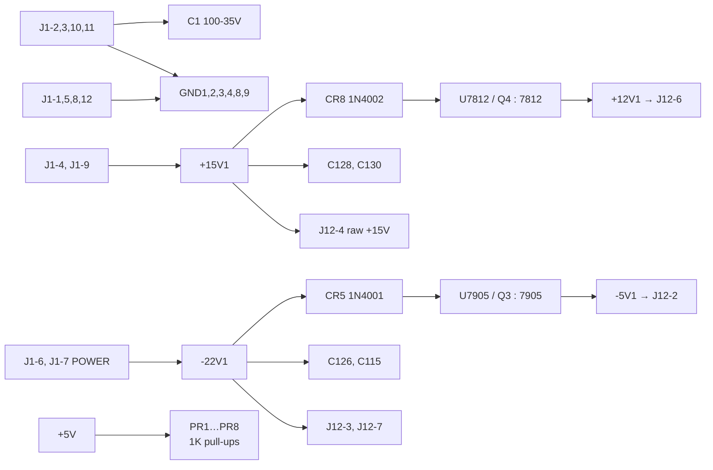

---

# SP-338 Page 3

**Title block (verbatim):** same drawing title and number as Page 2, with

```
SP-338 Page 3
```

## Page 3 — this is the 68010 CPU page

### Clock source

* `XOSC1` — labelled `32MHZ`. Drawn as a four-pin oscillator/crystal block:
  pin `1` (unconnected stub), pin `14` (top, to `C195` `.1` → `+5V`),
  pin `8` (right, to the clock divider), pin `7` (bottom, to ground).
* `C195` `.1`.

### Clock divider `170K` (`ALS161`)

```
  +5V ─ PR6 ─┬──────────────────────────────────────────┐
             ├─ CD (pin 9)                             │
             ├─ A  (pin 3)                             │
             ├─ B  (pin 4)                             │
             ├─ C  (pin 5)                             │
             ├─ D  (pin 6)                             │
             ├─ ENT (pin 10)                           │
             ├─ ENP (pin 7)                            │
             └─ CLR (pin 1)                            │
                                                          │
XOSC1 pin 8 ──────────────────────► CK (pin 2)           │
                                                          ▼
  DA (pin 14) ──►  16MHZ
  DB (pin 13) ──►   8MHZ
  DC (pin 12) ──►   4MHZ
  DD (pin 11) ──►   2MHZ
  RCO (pin 15) ──►  (unlabelled stub)
```

The four output labels, top to bottom on the sheet, are exactly
`2MHZ`, `4MHZ`, `8MHZ`, `16MHZ`; the pin-to-label mapping above was resolved
by following the four riser lines at 900% magnification and is a
straight ÷2/÷4/÷8/÷16 cascade of the 32 MHz source.

### Frequency divider chain — four `LS161` counters

Designators, in drawing order top to bottom: **`120K`, `120K`, `140H`, `140H`**.

| Stage | Designator | clock input | outputs (pin: label) |
|---|---|---|---|
| 1 | `120K` | pin `1` (`A`) ← `2MHZ`; pin `2` (`C`) ← counter clear bus | `DD`(6) → `125KHZ`; `DC`(5) → `( 250K )`; `DB`(4) → `( 500K )`; `QA`(3) → `1MHZ` |
| 2 | `120K` | pin `13` (`A`) ← `125KHZ`; pin `12` (`C`) ← clear bus | `DD`(8) → `7.8KHZ`; `DC`(9) → `( 15.6K )`; `DB`(10) → `( 31.2K )`; `QA`(11) → `( 62.5K )` |
| 3 | `140H` | pin `13` (`A`) ← `7.8KHZ`; pin `12` (`C`) ← clear bus | `DD`(8) → `488HZ`; `DC`(9), `DB`(10), `QA`(11) → labels not legible at the magnification used |
| 4 | `140H` | pin `1` (`A`) ← `488HZ`; pin `2` (`C`) ← clear bus | `DD`(6) → `30HZ`; `DC`(5), `DB`(4) → unlabelled stubs; `QA`(3) → `( 244HZ )` |

* The common "clear bus" is driven by a `75H` / `LS14` inverter, pins `1`→`2`.
  Its input comes from the left; nearby resistors `R82` `470` and `R83` `470`.
* Stage 3's three remaining output labels and stage 4's two remaining output
  labels are marked `[illegible]` above rather than guessed.

### Interrupt priority encoder `170K` (`LS148`, 74LS148)

Left-side input pins and the nets drawn on them:

| Pin | Net |
|---|---|
| `4` | *(unlabelled line; pull-up `R144` `10K`)* |
| `3` | `/OUIRQ` |
| `2` | `/IRQ` |
| `1` | *(unlabelled line)* |
| `13` | *(unlabelled line)* |
| `12` | *(unlabelled line)* |
| `11` | *(unlabelled line)* |
| `10` | `PR7` |

Pull-up bank to `+5V` on the incoming request lines, left to right:
`R86` `10K`, `R87` `10K`, `R86` `10K`, `R85` `10K`, `R84` `10K`, `R144` `10K`.

Right-side outputs: `A2` pin `6`, `A1` pin `7`, `A0` pin `9`, `GS` pin `14`,
`EO` pin `13`. `EO`(13) is drawn going to the net **`/IRQS`**.

`A2`, `A1`, `A0` run right, drop, and arrive at the 68010 as `IPL2`, `IPL1`,
`IPL0` — verified at 800% by following the three risers with no crossings
between them (topmost output → `IPL2`).

### Reset / watchdog chain

```
75H / LS14 (1 -> 2)   input from left, output to counter clear bus

140K (LS74)   D(12) ─┬── 1.4HZ-ish source [see note]
                 P(10) ─── /PCLR
                CLR(13) ─── PR7
                Q(9)  ──┬──► "OC / 110C / U6" buffer input pin 1
                      └──► (node)
                    /Q(8) ──► (node)

"OC"  /  "110C"  /  "U6"   two non-inverting buffers (open collector)
      buffer A : pins 1 -> 2   ──► net "8MHZ"
      buffer B : pins 3 -> 4   ──► net "/RESET"
      pull-ups: R61 4.7K and R78 4.7K to +5V
      (both gate symbols carry a third pin labelled "110C" — enable/strobe)

F11 (74LS11, triple 3-input NAND)
      1 <- /VPA
      2 <- /RESET
      3 <- /DTACK
     12 ──► joins the CLR(13) node of the 140K flip-flop above
```

Also drawn in this region: `R77` (value read as `4.7`, truncated at the crop
edge), pulling a node down to `GND`; a terminal on that node is labelled
`WO-DIS` with `GND` beneath it. `+5V` rail markers and `/MSPIRQ` appear at
the top of the same region.

### `U68010` — the CPU symbol

Designator `U68010` printed vertically inside the box. The address and data
stubs run off the right edge of the sheet into a bus bracket (off-page).

Left-hand pins (pin name, pin number, net):

```
  VCC  14  ─► +5V
  IPL2 23  ◄── (from 170K / LS148 A2 pin 6)
  IPL1 24  ◄── (from 170K / LS148 A1 pin 7)
  IPL0 25  ◄── (from 170K / LS148 A0 pin 9)
  CLK  15  ◄── 8MHZ
  HALT 17  ──► (net label not legible)
  RESET 18 ◄── /RESET
  R/W   9  ──► RWN          (drawn exiting to the right of the box)
  UDS   7  ──► /UDS
  LDS   8  ──► /LDS
  AS    6  ──► /AS
  DTACK 10 ◄── /DTACK
  BG    11 ──► (stub, no net drawn)
  BGACK 12 ◄── PR6
  BR    13 ◄── PR6
  E     20 ──► (stub, no net drawn)
  VMA   19 ──► (stub, no net drawn)
  BERR  22 ◄── /BERR
  VPA   21 ◄── /VPA
  FC2   26 ◄── FC2
  FC1   27 ◄── FC1
  FC0   28 ◄── FC0
  GND   16  ──► GND
```

Right-hand pins:

```
  VCC  49 ──► +5V
  A23  52 ... A19 47, A18 46, A17 45, A16 44, A15 43, A14 42, A13 41,
  A12  40, A11 39, A10 38, A9 37, A8 36, A7 35, A6 34, A5 33, A4 32,
  A3   31, A2 30, A1 29      ──► off-sheet bus bracket
  D15  66, D14 65, D13 64, D12 63, D11 62, D10 57, D9 56, D8 55,
  D7   54, D6 53, D5 52(?), D4 51, D3 50, D2 49(?), D1 48, D0 47(?)
  GND  53  ──► GND
```

> **Honest note on the D-bus pin numbers.** The row of D-bus pin numbers is
> partly overstruck by the address-bus stubs in the rendering, and the D15/D14
> rows are close to the top edge of the box where they collide with `VCC 49`.
> The **pin names and their order** (D15 → D0, descending) are certain; the
> **individual numbers** on D5, D2, D1 and D0 are `[illegible]` and have not
> been filled in from datasheet knowledge.

### Other logic on Page 3 (lower half) — lower confidence

Read at 300–350% magnification; transcribed as seen, not re-verified at higher
zoom:

* `190E` / `AS00` OR gate, pins `1`,`2` → `3`, driven by `/PCLR` and
  `/NDCLR`, with `R80` `1K` as a pull-up on `/PCLR`. Its output drives the
  `C` inputs of a pair of `190C` (`LS393C`) dual counters.
* `135M` (`LS74`): `/S4` appears on one output; `PR4` and `F11`-related
  nodes feed the other.
* `ALS161` with pins `7`, `1` (`CL`) and `CK` shown; `2MHZ` on one input.
* A `LS123` monostable pair with `C314` `.01`, `C323` `.01`, `R75` `12K`.
* A block marked `(RUN)` driving `U6` output buffers via `R73` `220` and
  `CR12` `MV5053`.
* A `RESET` push-button symbol drawn near the top-left of the clock area.

> **Not on this page:** there is **no** 34010/GSP symbol, **no** host-port
> block, and **no** HSTADR / HSTCTL / HSTDAT register names anywhere on
> SP-338 Pages 2–4. `HSBUS`, `RHSBUS`, `GSPWAITB`, `MSPWAIT`, `GSP`, `MSP`
> appear as *net names only* on Page 4.

---

# SP-338 Page 4

**Title block (verbatim):** same drawing title and number, with

```
SP-338 Page 4
```

Page 4 is the **address / chip-select decoding and bus-control page**.

## `200M` (`ALS138`, 74LS138) — ROM decode, lower left

```
A23 ─► [160M / F04 inverter : 1 -> 8] ─► C1  (pin 6)
A22 ─────────────────────────────────► C2A (pin 5)
A21 ─────────────────────────────────► C2B (pin 4)
A19 ─────────────────────────────────► SELC (pin 3)
A18 ─────────────────────────────────► SELB (pin 2)
A17 ─────────────────────────────────► SELA (pin 1)

Y7 (7)  ─► /ROM7
Y6 (9)  ─► /ROM6
Y5 (10) ─► /ROM5
Y4 (11) ─► /ROM4
Y3 (12) ─► /ROM3
Y2 (13) ─► /ROM2
Y1 (14) ─► /ROM1
Y0 (15) ─► /ROM0
```

`A23`, `A22`, `A21`, `A19`, `A18`, `A17` arrive at this decoder from a
bracket-style **bus** notation (the triple-slash bus entry marks on the left),
not as individually drawn wires. **No other address line is drawn into this
decoder.** `A20` is conspicuously absent here and is used instead by `110K`
below.

## `110K` (`ALS138`, 74LS138) — ADSP / ADLC write-strobe decode

```
PR6    ─► C1   (pin 6)
/RVAS  ─► C2A  (pin 5)
/LSBUS ─► C2B  (pin 4)
RWNB   ─► SELC (pin 3)
A20    ─► SELB (pin 2)
A19    ─► SELA (pin 1)

Y7 (7)  ─► /ADC12
Y6 (9)  ─► /ADC8
Y5 (10) ─► /SH2
Y4 (11) ─► (/RD0)        <- printed in parentheses, as drawn
Y3 (12) ─► /WR3
Y2 (13) ─► /WR2
Y1 (14) ─► /WR1
Y0 (15) ─► /WR0          (a second "AD…" label continues to the right, cut off)
```

## `180C` (`ALS138`, 74LS138) — sound-controller / reset-control decode

```
PR7     ─► C1   (pin 6)
/NBUS   ─► C2A  (pin 5)
/RVARS  ─► C2B  (pin 4)
RWNB    ─► SELC (pin 3)
AB15    ─► SELB (pin 2)
AB14    ─► SELA (pin 1)

Y7 (7)  ─► /SW1
Y6 (9)  ─► (stub, NO net name drawn)
Y5 (10) ─► /SCRES
Y4 (11) ─► /SCRD
Y3 (12) ─► /IRQCLR
Y2 (13) ─► /NDCLR
Y1 (14) ─► /NWR
Y0 (15) ─► /SCWR
```

## `180E` (`ALS139`, 74LS139) ×2 — low-byte RAM / processor selects

```
180E #1:   AB15 ─► B (3)     AB14 ─► A (2)     /RAMEN ─► C (1)
           T3 (7) ─► /RAM1
           T2 (6) ─► /RAM0
           T1 (5) ─► /ZRAM
           T0 (4) ─► /DUART

180E #2:   AB15 ─► B (13)    AB14 ─► A (14)    /RHSBUS ─► C (15)
           T3 (9)  ─► (stub, no net name)
           T2 (10) ─► (stub, no net name)
           T1 (11) ─► /MSP
           T0 (12) ─► /GSP
```

## `150K` (`LS20`, 74LS20) ×2 — function-code and bus-grant decode

```
150K gate 1 (4-input NAND):
    FC2 ─► (pin 4)      FC1 ─► (pin 5)      FC0 ─► (pin 1)
    4th input ← from the vertical line that also feeds the F74 clock
    out pin 6 ─► joins the vertical stub labelled "/VPA"

150K gate 2 (4-input NAND):
    RVA    ─► (pin 12)   /HSBUS ─► (pin 10)   /DUART ─► (pin 13)
    4th input ← same vertical line
    out pin 8 ─► (net label cut off at the crop edge)
```

## `190E` (`AS00`) OR gate and neighbours, upper left

```
190E / AS00 (OR):   /GSPWAITB ─► (pin 1)
                    /MSPWAIT  ─► (pin 2)
                    out (pin 3) ─► /RHSBUS

a second AS?? OR gate (designator cut off in the render):
                    /RDUART  ─► (pin 4)
                    /DUDTACK ─► (pin 5)
                    out (pin 6)

a third gate "AS??" further right, designator starts "13…":
                    out pin 1 ─► fed from /RHSBUS
```

Note the net is spelled **`/GSPWAITB`** on this sheet.

## `160M` (`F04`) inverters ×3, `160H` (`ALS32`) ×2

```
160M / F04 :  /AS  ─► (pin 5 -> 8)   output node fans out to
                                   - the 135C F74 CK (pin 11)
                                   - the 150K LS20 4th inputs
160M / F04 :  RWNB ─► (pin 9 -> 8)   output ─► /RWNB
160M / F04 :  A23  ─► (pin 1 -> 2)   output ─► 200M C1  (see 200M above)

160H / ALS32 :  /UDS ─► (pin 1)   /RWS ─► (pin 2)   out (pin 3) ─► /WEU
160H / ALS32 :  /LDS ─► (pin 12)  /RWS ─► (pin 13)  out (pin 11) ─► /WEL
```

## Flip-flops on Page 4

```
135C (F74 / LS74)      D (12) ──┬── PR7
                       P (10) ──┴── PR7
                      CK (11) ───── from the 160M/F04 inverter of /AS
                      /Q(8)  ─────► /S4
                      Q (9)  ─────► to the next flip-flop's D

second F74 (designator cut off in the render, "13…")
                      D (12) ◄──── from the 135C Q output
                      CK (11) ◄──── 8MHZ          (printed "8MHZ", no leading slash)
                      P  (4) ◄──── PR7
                      CLR(1) ───── PR7

two further F74 blocks, upper middle of the sheet:
   F74 #1   D (2) ◄──── /DTACK        CK (3) ◄──── /8MHZ
            Q (5) ──► (net)           /Q(6) ──► (net)      P, CLR (1) ── PR7
   F74 #2   D (2) ──► ground symbol   CK (3) ◄──── (node from F74 #1 Q)
            /Q(6) ────► /RVAS0        Q (5) ──► (net)      CLR (1) ── PR7
```

## `175R` (`LS245`) and `175W` — the sound-controller bus interface

```
175R / LS245  left (A) pins, right (Y) pins:
    SCD7 ─► (9)        ─► pin 11  D15
    SCD6 ─► (2)        ─► pin 18  D14
    SCD5 ─► (3)        ─► pin 17  D13
    SCD4 ─► (4)        ─► pin 16  D12
    SCD3 ─► (5)        ─► pin 15  D11
    SCD2 ─► (6)        ─► pin 14  D10
    SCD1 ─► (7)        ─► pin 13  D9
    SCD0 ─► (8)        ─► pin 12  D8
    RWNB ─► (1)
    a gate output drives pin 14 of this block

175T / AS08 (OR):  /RESET ─► (pin 1)
                    /SCRES ─► (pin 2)
                    out (pin 3) ─► to the 175W control area

175W  (no part number is printed inside this box; only pin names):
    D7 (15) ◄─ SCD7      RES   (16) ──► (short stub)
    D6 (14) ◄─ SCD6      FULL  (4)  ──► /LINKIRQ
    D5 (13) ◄─ SCD5      BUSY  (5)  ──► /SCBUSY
    D4 (12) ◄─ SCD4      SD    (19) ──► SCDAT
    D3 (3)  ◄─ SCD3      S/M-  (8)
    D2 (2)  ◄─ SCD2      RESREQ(7)
    D1 (1)  ◄─ SCD1      EFULL (6)  ──► /SCFLAC
    D0 (20) ◄─ SCD0      WR    (9)  ──► /SCWR
    VCC(17) ──► +5V       RD   (10) ──► /SCRD
    GND(18) ──► GND       CK   (11)  ──► (net)
```

Also on this sheet, an OR gate labelled `175…` / `AS0…` (partly cut off) with
inputs `ADCLK` (pin `9`) and pin `10`, plus the label `AS0…`.

## `SCOM-` connector assignments (right-hand column of Page 4)

| Net on this sheet | Series part | Board-side name at the connector |
|---|---|---|
| `SCDAT` | `R164` `470` | `A_AUDAT` → `SCOM-3` |
| `/SCFLAG` | `R165` `470` | `A_AUDFLAG-` → `SCOM-6` |
| `ESCLK` | `R166` `470` | `A_AUDCLK` → `SCOM-7` |
| `/LINKIRQ` | `R167` `470` | `A_FULL-` → `SCOM-4` |
| `SELF-TEST` | — | → `SCOM-1` |
| `+5V` | — | → `SCOM-10`, `SCOM-11` |
| `GND` | — | → `SCOM-2`, `SCOM-8`, `SCOM-9` |

Nearby decoupling: `C343` `.1`, `C344` `100PF`, `C345` `100PF`, `C346` `100PF`,
`C347` `100PF`, `C348` `.1`.

### Page 4 signal flow

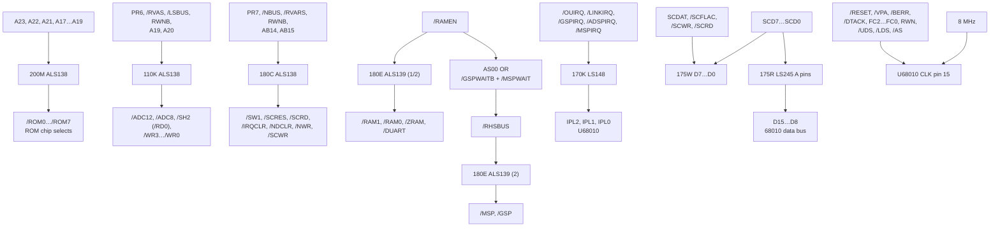

---

# Cross-page net index (pages 2–4 only)

Address / control nets drawn on these three sheets:

```
A17 A18 A19 A20 A21 A22 A23        (bus notation into 200M / 110K)
AB14 AB15                          (into both 180E ALS139s)
RWN  /RWNB  /RWS  RWNB
/UDS /LDS /AS /WEU /WEL /RD0
IPL2 IPL1 IPL0 IPL?  /IRQS
/DTACK /VPA /BERR /RESET /HALT /8MHZ /GSPWAITB /MSPWAIT
/OUIRQ /LINKIRQ /GSPIRQ /ADSPIRQ /MSPIRQ /IRQ
/RAMEN /RAM1 /RAM0 /ZRAM /DUART /ROMEN? /HSBUS /LSBUS /RHSBUS /EXTBUS /NBUS /OPTO
/ROM0../ROM7
/WR0../WR3 /SH2 /ADC12 /ADC8
/SW1 /SCRES /SCRD /IRQCLR /NDCLR /NWR /SCWR /SCBUSY /SCFLAC /SCFLAG
/RVAS /RVARS /RVAS0 /RVA
/SW? /MSP /GSP
/PR4 /PR6 /PR7  (one-kilohm pull-ups)
SCD0../SCD7 SCDAT
```

---

# Answers to the specific questions put to this agent

## 1. GSP host port / `$C00000`-`$C03FFF` / HSTADR, HSTCTL, HSTDAT

**Not present on SP-338 Pages 2, 3 or 4.** Nothing on these three sheets shows
the 34010 host interface, the `$C00000`-`$C03FFF` aperture, or the register
names HSTADR / HSTCTL / HSTDAT (or any spelling of them). The only GSP-related
material in this range is *net names only*, and they are all on Page 4:

```
/GSPWAITB   /GSP     /HSBUS     /RVAS      /RVARS     /RVAS0
```

`/GSP` and `/MSP` are produced as active-low **chip selects** by the second
`180E` (`ALS139`) from `AB15`/`AB14` and `/RHSBUS`. `/GSPWAITB` is an input to
the `190E`/`AS00` OR gate that produces `/RHSBUS`. `/HSBUS` is an input to the
second `150K`/`LS20` NAND and is the `C2B` select input of the `110K` decoder.

No page in this range draws the register-index decoding logic, so the measured
`((addr - 0xC00000) / 2 / 2) ^ 1` relation is **not** corroborated or
contradicted by this material.

## 2. VRAM array / 512 KiB vs 4 MiB

**No memory device of any kind appears on SP-338 Pages 2, 3 or 4.** There are
no DRAM/SRAM symbols, no `64K x 4`, no `RAM Array (16)`, no address-line
fan-out to a memory array, and no `VRAM` text on any of these three sheets.
Nothing here bears on the 512 KiB-vs-4 MiB question either way — a real VRAM
array sheet is evidently a different page.

## 3. The 68010 CPU page, clock, interrupts, bus transceivers

* **CPU sheet:** SP-338 **Page 3**, designator `U68010`, 64-pin symbol,
  pins transcribed above.
* **Clock:** `XOSC1` `32MHZ` → `170K`/`ALS161` divider → `16MHZ`, `8MHZ`,
  `4MHZ`, `2MHZ`. The 68010 `CLK` pin 15 is driven from the **`8MHZ`** node,
  which is buffered by the `OC`/`110C`/`U6` open-collector buffers.
* **Interrupts:** one `170K`/`LS148` 8-to-3 priority encoder. Its named
  request inputs, in drawing order, are
  `/OUIRQ`, `/LINKIRQ`, `/GSPIRQ`, `/ADSPIRQ`, `/MSPIRQ` (each with a 10 K
  pull-up), plus a local `/IRQ`. Its `A2`/`A1`/`A0` outputs go to the 68010
  `IPL2`/`IPL1`/`IPL0` pins; its `EO` output drives `/IRQS`.
* **Bus transceivers:** none on the 68010 page. The only transceiver on these
  three sheets is `175R`/`LS245` on Page 4, which bridges `SCD7..SCD0` to the
  CPU's `D15..D8`. The 68010 address bus itself leaves Page 3 as an off-sheet
  bus bracket with no transceiver drawn at the CPU.

## 4. ADSP-2100 board interface and JSA-II sound interface

* **Page 4 carries the sound-controller bus, not the ADSP-2100 itself.**
  `175R`/`LS245` (`SCD7..SCD0` ↔ `D15..D8`) plus `175W` (an 8-bit control
  device with `RES`, `FULL`, `BUSY`, `SD`, `S/M-`, `RESREQ`, `EFULL`, `WR`,
  `RD`, `CK`) form the `SC*` signal set. `175W` has **no part number printed**
  in its symbol, so it is `[not identified]` from this sheet alone — its pin
  name set (`RES`/`FULL`/`BUSY`/`SD`) is what an ADSP-2100-class part would
  present, but the sheet does not say so.
* The **ADSP-related chip selects** are `/ADC12`, `/ADC8`, `/SH2`, `/WR0..3`
  from `110K`, and `/GSP`, `/MSP` from the second `180E`.
* **JSA-II / sound board power** is on **Page 2**: connector `J12`, boxed and
  annotated `SOUND`, carrying `+15V`, `+12V`, `+5V`, `−5V`, `−22V`, `GND`
  (pin list above).
* The audio board-side net names on `SCOM-` are
  `A_AUDAT`, `A_AUDFLAG-`, `A_AUDCLK`, `A_FULL-`, plus `SELF-TEST`.

## 5. Contradictions with 512 KiB or 4 MiB of VRAM

None available — these three pages contain no memory array to contradict
either figure.

One item that may matter later and is stated here as *drawn*, not as
conclusion: the `200M` ROM decoder uses `A23 A22 A21` as its coarse select and
`A19 A18 A17` as its fine select, with **`A20` not used on that decoder**
(`A20` is used by `110K`). That is the ROM path, not VRAM, and no conclusion
is drawn from it here.

---

# `INFERENCE:` (clearly separated — none of this is printed on the sheets)

1. **`170K` is a free-running ÷2/÷4/÷8/÷16 cascade of the 32 MHz oscillator.**
   Drawn basis: `CD`/`A`/`B`/`C`/`D`/`ENT`/`ENP`/`CLR` are all tied to the same
   `+5V` pull-up net `PR6`, and the four outputs are labelled `16MHZ`, `8MHZ`,
   `4MHZ`, `2MHZ`. The pin-to-label mapping (14→16, 13→8, 12→4, 11→2) was
   read by following riser lines, and it is arithmetically consistent with a
   32 MHz ÷2/÷4/÷8/÷16 divider.
2. **The four `LS161`s form a ÷16/÷16/÷16/÷16 chain from 2 MHz**, giving
   125 kHz → 7.8 kHz → 488 Hz → 30 Hz. Drawn basis: each stage's `DD` output
   feeds the next stage's clock input, and the printed labels match
   2 MHz ÷16 = 125 kHz, ÷16 = 7.8 kHz, ÷16 = 488 Hz, ÷16 = 30.5 Hz. The
   parenthesised labels (`( 250K )`, `( 500K )`, `( 15.6K )`, `( 31.2K )`,
   `( 62.5K )`, `( 244HZ )`) are unused taps in this sheet's convention, not
   functional connections.
3. **`/VPA` is generated by the `150K`/`LS20` NAND from the function codes.**
   Drawn basis: `FC2`, `FC1`, `FC0` and the inverted-`/AS` line are the four
   inputs, and the gate output is the same node labelled `/VPA` that reaches
   the 68010 `VPA` pin 21. The fourth input's *logic sense* is not stated by
   the sheet and depends on how `160M`/`F04` is read.
4. **`/DTACK` is produced by `F11` (74LS11) as `NAND(/VPA, /RESET, /DTACK)`.**
   Drawn basis: the three named inputs and the single output on pin 12. The
   output node also ties to the `CLR` of a `74LS74`, which suggests a
   handshake/timeout role, but that role is not stated.
5. **`175R`/`LS245` is a bidirectional bridge between `SCD7..SCD0` and
   `D15..D8`.** Drawn basis: the same eight named nets appear on the A side and
   the eight `D` nets on the other side of one 245 symbol. Whether the sheet
   intends A→Y always, or Y→A under the `175T`/`AS08` gate's control, is
   **not** determinable from the symbol as drawn — the sheet does not label
   which 245 pin is `/OE` and which is `DIR`.
6. **`175W` is very likely the ADSP-2100 (or an ADSP-2100-class serial-link
   part).** Drawn basis only: the pin-name set (`D0..D7`, `RES`, `FULL`,
   `BUSY`, `SD`, `S/M-`, `RESREQ`, `EFULL`, `WR`, `RD`, `CK`). **No part
   number is printed on the sheet**, and this inference must not be recorded
   as a transcription fact.
7. **`/RHSBUS` is the low-data-bus qualifier.** Drawn basis: `190E`/`AS00`
   ORs `/GSPWAITB` and `/MSPWAIT` into `/RHSBUS`, and `/RHSBUS` is the enable
   (`C`) of the second `180E` that produces `/GSP` and `/MSP`. The
   relationship of `/RHSBUS` to `/HSBUS` and `/LSBUS` is **not** drawn in a
   way that resolves their exact meaning.
8. **`200M` produces eight 16 KiB ROM windows.** Drawn basis: the coarse
   select is fixed by `A23 A22 A21` and the fine select is `A19 A18 A17`,
   leaving `A16..A0` undecoded. **No sheet statement supports this**, it is
   arithmetic over the drawn pins, and `A20`'s absence from this decoder may
   mean the ROM region is not contiguous in the way this arithmetic suggests.

---

# Explicit `[illegible]` / not-found list

| Item | Where | Note |
|---|---|---|
| Manufacturer part numbers (7407/74LS04/… etc.) | all three pages | never printed; only Atari codes (`ALS32`, `LS161`, `F04`, …) |
| `175W` part number | Page 4 | box shows pin names only |
| `175T`'s output net name | Page 4, upper left | line leaves the crop |
| `150K` LS20 gate 2 output net name | Page 4, upper left | line leaves the crop |
| Designator of the `AS??` OR gates driven by `/RDUART`/`/DUDTACK` and by `/RHSBUS` | Page 4, upper left | cut off in render |
| Designator of the second `F74` in the `135C` pair | Page 4 | cut off |
| `140H` stage-3 outputs `DC`, `DB`, `QA` | Page 3 | labels present but not resolved at working magnification |
| `140H` stage-4 outputs `DC`, `DB` | Page 3 | drawn as unlabelled stubs |
| `U68010` D-bus pin numbers for `D5`, `D2`, `D1`, `D0` | Page 3 | overstruck in the render; **not** filled in from datasheet |
| `U68010` `HALT` pin 17 net name | Page 3 | stub drawn, label not legible |
| Exact `GND` digits for the fifth/sixth ground test points | Page 2 | read `GND8`, `GND9` at 1400%; the drawing does not use a contiguous sequence |
| Second `160K` decoder (if one exists) | Page 4 | a `160K` ALS138 was seen once at low magnification with outputs resembling `/RAMEN /HSBUS /LSBUS /EXTBUS /NBUS /OPTO /ROMEN`, but `/LSBUS` was subsequently proven at 1400% to be an **input** to `110K`, not an output. **That reading is therefore retracted and not transcribed.** |

**Gaps relevant to this project's open questions, stated plainly:** none of
SP-338 Pages 2–4 contains a memory device, a 34010/GSP symbol, or a host-port
register map. Whatever pages carry the VRAM array, the GSP host interface, or
the block diagram quoted from "Page 10" are outside this assignment's range.

## Appendix B — SP-338 Pages 5–8 (PDF 62–65)

# SP-338 — PCB Schematic Diagram, pages 5–8 (scans `page-62` … `page-65`)

Source: `/tmp/stunrunner_pages/page-62.png` … `page-65.png`, 2550×1650 each.
Document title block on every page reads:

> S.T.U.N. Runner™ Multisync Game / **PCB Schematic Diagram**
> ATARI GAMES · © 1989 Atari Games Corporation · 04999-11 B · 1st printing
> SP-338 **Page 5 / 6 / 7 / 8**

Pages were re-read as upscaled crops (2–3×, point-filtered) rather than from the
whole-page raster; several labels in a first pass were misread and are
corrected below. All page numbers below are the **document's own** (Page 5…8),
which equal scan files `page-62`…`page-65`.

---

## 0. Read this first: two of the four requested subjects are absent from these pages

**There are no VRAM chips on pages 5–8.** The `27512A/B/C/D` devices are
EPROMs (4K×8, 28-pin, 27C512 pinout), and they are **program** memory, not
framebuffer. Nothing labelled VRAM, TC3242, TMS3401x DRAM, or any
`/RAS`/`/CAS`/`WE` DRAM-style control appears anywhere in these four pages. The
TMS34010 framebuffer is on other sheets of SP-338. This is stated plainly
because the EPROMs are the only memory chips present and could easily be
mistaken for VRAM at a glance — they are not.

**There is no "Color RAM" on pages 5–8 either.** What these pages carry is a
single **addressable latch, `LS259`** (page 8) that holds a 4-bit display-format
configuration — `ZP1`, `ZP2`, `LC1`, `LC2` plus `/MSPRES` and `/CSPRES`. It is a
discrete 8-bit latch with four address inputs, not a RAM, and it is most
plausibly the board's **video-standard / monitor-select** register (see
§5.1 and the inference section). The actual palette RAM lives on another sheet.

**The GSP host port is not on these pages.** No `HSTADR` / `HSTCTL` / `HSTDAT`
equivalent appears. The closest structures present are the `EXPANSION BUS`
connector `J7` and the bus transceivers on page 7 (§4).

**The only clock on these four pages is the 3.6864 MHz UART crystal** (§3.1).
No pixel clock, no GSP clock, no video timing generator.

Page coverage that *is* present: GSP/aux program ROM (§2), serial subsystem
and ACIA (§3), bus transceivers and expansion bus (§4), and the DIP-switch /
coin / diagnostic input port (§5).

---

## 1. Page 5 (`page-62.png`) — program ROM banks

### 1.1 Bank 200 — seven `27512A`

Ref des left→right: **200X, 200W, 200V, 200U, 200T, 200S, 200R**, each body
marked `27512A`.

Address wiring, printed once on 200X (standard 27C512 28-pin order; **AB, not
"BA"** — a first-pass reading as `BA16…BA1` was wrong):

| net | pin | device pin |
|---|---|---|
| AB16 | 1 | A15 |
| AB15 | 27 | A14 |
| AB14 | 26 | A13 |
| AB13 | 2 | A12 |
| AB12 | 23 | A11 |
| AB11 | 21 | A10 |
| AB10 | 24 | A9 |
| AB9 | 25 | A8 |
| AB8 | 3 | A7 |
| AB7 | 4 | A6 |
| AB6 | 5 | A5 |
| AB5 | 6 | A4 |
| AB4 | 7 | A3 |
| AB3 | 8 | A2 |
| AB2 | 9 | A1 |
| AB1 | 10 | A0 |

Two `CE` pins per device at the bottom: **pin 22 → GND**, **pin 20 → chip
select**:

| device | /CE (pin 20) |
|---|---|
| 200X | `/ROM6` |
| 200W | `/ROM5` |
| 200V | `/ROM4` |
| 200U | `/ROM3` |
| 200T | `/ROM2` |
| 200S | `/ROM1` |
| 200R | `/ROM0` |

Data out of the group, shown once as `Q7…Q0` on pins **19, 18, 17, 16, 15, 13,
12, 11** → nets **MD15, MD14, MD13, MD12, MD11, MD10, MD9, MD8**.

An unexplained column of **eight “-” marks** appears inside 200W's body at rows
A15…A8. See §6 (illegible/open) — I cannot determine whether this denotes
"pin not connected on this device" or a drafting shortcut for "same as 200X".

### 1.2 Bank 210 — seven `27512B`

Ref des left→right: **210X, 210W, 210V, 210U, 210T, 210S, 210R**, each body
marked `27512B`. Same `AB1…AB16 → A0…A15` pin order and the same eight “-”
marks. Data out shown as `Q7…Q0` on pins 19, 18, 17, 16, 15, 13, 12, 11 →
**MD7, MD6, MD5, MD4, MD3, MD2, MD1, MD0**.

### 1.3 `200P` — LS2455H

`A` side pins 2–9 = **MD15…MD8**; `B` side pins 18–11 = **D15…D8**.
Controls: pin 1 (`D`) ← `RWNB`, pin 19 (`/C`) ← `/ROMEN`.

### 1.4 `210P` — LS245 (type suffix partly obscured)

`A` side pins 2–9 = **MD7…MD0**; `B` side pins 18–11 = **D7…D0**.
Controls: pin 1 ← `RWNB`, pin 19 ← `/ROMEN`.

### 1.5 `200K` — `SLP3TK17`, the high-order address decoder

| net | pin | device pin |
|---|---|---|
| — | 8 | `VCC` (via `C317` .1 to GND) |
| `/ROM7` | 6 | `/CS` |
| AB14 | 5 | A14 |
| AB13 | 4 | A13 |
| AB12 | 3 | A12 |
| AB11 | 2 | A11 |
| AB10 | 1 | A10 |
| AB9 | 20 | A9 |
| AB8 | 19 | A8 |
| AB7 | 18 | A7 |
| AB6 | 17 | A6 |
| AB5 | 16 | A5 |
| AB4 | 15 | A4 |
| AB3 | 14 | A3 |
| AB2 | 13 | A2 |
| AB1 | 12 | A1 |
| `/RVAS` | 7 | `/CE` |
| — | 11 | `GND` |

Outputs: pin **9 = `BS1`**, pin **10 = `BS0`**. Both route leftward to become
the `A15` and `A14` address pins of `200Y` and `210Y` (§1.6) — this is the key
structural detail of the page.

### 1.6 `200Y` — `27512C`, and `210Y` — `27512D`

`200Y`: `A15` pin 1 and `A14` pin 27 are **not** on `AB16`/`AB15` — they are
driven by `BS1`/`BS0` from `200K`. `AB14…AB1` → `A13…A0` on the normal 27C512
pins. Outputs `Q7…Q0` on pins 19, 18, 17, 16, 15, 13, 12, 11 → **MD15…MD8**.
Both `CE` pins (**22** and **20**) → `/ROM7`.

`210Y`: same arrangement, `A15`/`A14` from `BS1`/`BS0`, `AB14…AB1` → `A13…A0`.
Outputs pins 19, 18, 17, 16, 15, 13, 12, 11 → **MD7…MD0**. Both `CE` pins →
the `/ROM7` net shared with `200Y`.

---

## 2. Page 6 (`page-63.png`) — serial subsystem

### 2.1 `200E` — `4Z02-15`

`AB13→A12(2)`, `AB12→A11(23)`, `AB11→A10(21)`, `AB10→A9(24)`, `AB9→A8(25)`,
`AB8→A7(3)`, `AB7→A6(4)`, `AB6→A5(5)`, `AB5→A4(6)`, `AB4→A3(7)`,
`AB3→A2(8)`, `AB2→A1(9)`, `AB1→A0(10)`.
Outputs `DD11, DD10, DD9, DD8` on pins 11, 10, 9, 8.
Enables: `/RWNB`→20, `/ZHEU`→21, `/ZRAM`→19.

### 2.2 `200C` / `200D` — `8K8/150A` (dual)

Identical address wiring (`AB13…AB1 → A12…A0`), `CS`/`NC` strapping to `PR8`.
`200C` outputs `DD15…DD8` (pins 19, 18, 17, 16, 15, 13, 12, 11);
`200D` outputs `DD7…DD0` (same pin sequence).
Enables: `/RAM0`, `/RAM1`, `/WEU`, `/RWNB` on pins 20, 27, 22.

### 2.3 `200F` — LS2455J

`DD15…DD8` → `D15…D8`; pin 1 ← `RWNB`, pin 19 ← `/RAMEN`.

`210F` — LS2455J, `DD7…DD0` → `D7…D0`; pin 1 ← `RWNB`, pin 19 ← `/RAMEN`.

### 2.4 `200A` — `68681` ACIA  ← **the clock**

| pin | label | connection |
|---|---|---|
| 40 | VCC | `C80` .1 → GND |
| 32 | X1/CLK | `C79` 10PF → GND |
| 33 | X2 | **`XTAL1` = 3.6864 MHz** |
| 9 | OTACK | `/OUTACK`, `R49` 4.7K pull-up to +5V |
| 21 | IRQ | `/OUIRQ` |
| 31 | RXDA | `RXDA` |
| 30 | TXDA | `TXDA` |
| 11 | TXDB | `TXDB` |
| 10 | RXDB | `RXDB` |
| 19,22,18,23,17,24,16,25 | D7…D0 | **DD15, DD14, DD13, DD12, DD11, DD10, DD9, DD8** |
| 7 | IP0 | `/CTSA` |
| 4 | IP1 | `/CTSB` |
| 36 | IP2 | `IP2` |
| 2 | IP3 | `IP3` |
| 39, 38 | IP4, IP5 | no connection visible |

### 2.5 `210D` — TX1 / TX2 (4551 dual VCO, body marked `VCO`/`CC`)

`TX1` pins 1, 2, 4, 5, 8, 14; `TX2` pins 1, 2, 3, 5, 12, 13.
`OP4`→TX1 pin 2, `OP5`→TX2 pin 2, `TXDA`→TX1 pin 4, `TXDB`→TX2 pin 4.

### 2.6 `210B` / `210E` — MC14849AL RS-232 line drivers

Drive `SERIAL A` (`J2-1`…`J2-10`) and `SERIAL B` (`J3-1`…`J3-10`).
Support: `R171`/`C35410` 1 µF (−5 V rail on `4056B`), `R147` 100K,
`R151`/`R152` 220, `R150`/`R153` 10K, `C325`/`C83`/`C336` 100PF.
`C5` .1 on +5 V; `C81` .1 on −5 V; `C82` .1 on +12 V; `205B` = 4066B, `2058` = 4066B.

---

## 3. Page 7 (`page-64.png`) — bus transceivers and expansion bus

### 3.1 Address-bus buffers

| device | type | in | out | enable |
|---|---|---|---|---|
| `210J` | LS2444A | `A16…A9` / `A8…A1` | `FA16…FA9` / `FA8…FA1` | pins 1,19 tied **GND** |
| `200J` | LS2444A | `A16…A9` / `A8…A1` | `AB16…AB9` / `AB8…AB1` | pins 1,19 tied **GND** |
| `200H` | LS2451A | `AB16…AB1` | `A16…A1` | enable **GND** |
| `200Q` | LS2453A | `AB15…AB2` | `AB15…AB2` (self-loop) | — |
| `F04` | inverter | `AB2` | `/AB2` | single gate |

`210J` is unconditional: `A1…A16` are buffered straight onto `FA1…FA16`.
`FA17…FA20` are **not** produced here — they come from `210K`.

### 3.2 `210K` — LS2444A (expansion decode)

in: `RWN(2)`, `/RWS(4)`, `/RVAS(6)`, `/EXTBUS(8)`, `A20(11)`, `A19(13)`,
`A18(15)`, `A17(17)`
out: `/ERWN(18)`, `/ERWS(16)`, `/ERVAS(14)`, `/EXTB(12)`, `EA20(9)`,
`EA19(7)`, `EA18(5)`, `EA17(3)`
enable pins 1,19 → GND.

### 3.3 `210N` — LS2444A (expansion control)

in: `/AS(2)`, `/WEU(4)`, `/WEL(6)`, `16M4Z(8)`, `8M4Z(11)`, `/RESET(13)`,
`RWN(15)`, `19M4Z(17)`
out: `/EAS(18)`, `/EWEU(16)`, `/EWEL(14)`, `E16M(12)`, `E8M(9)`, `/MRES(7)`,
`RWNB(5)`, `ADC1X(3)`
enable pins 1,19 → GND.

### 3.4 Data-bus transceivers

| device | type | A side | B side | controls (pin 1 / pin 19) |
|---|---|---|---|---|
| `210P` | LS2454A | `FD15…FD0` | `D15…D0` | `RWNB` / `/EXTBUS` |
| `210C` | LS2454A | `DB15…DB0` | `D15…D0` | `RWNB` / `/LSBUS` |
| `210M` | LS245 | `HD15…HD0` | `D15…D0` | `RWNB` / `/HSBUS` |
| `150C` | LS2455K | `DB15…DB8` | `D15…D8` | `RWNB` / `/LSBUS` |
| `170C` | LS2455K | `DB7…DB0` | `D7…D0` | `RWNB` / `/LSBUS` |
| `200P` | LS2455 | `HD15…HD8` | `D15…D8` | `RWNB` / `/HSBUS` |
| `190P` | LS245 | `HD7…HD0` | `D7…D0` | `RWNB` / `/HSBUS` |

### 3.5 `EXPANSION BUS` — connector `J7`  ← *the one interface here resembling a host port*

```
FA1  → J7-1      FD0  → J7-30
FA2  → J7-2      FD1  → J7-31
FA3  → J7-3      FD2  → J7-32
FA4  → J7-4      FD3  → J7-33
FA5  → J7-5      FD4  → J7-34
FA6  → J7-6      FD5  → J7-35
FA7  → J7-7      FD6  → J7-36
FA8  → J7-8      FD7  → J7-37
FA9  → J7-9      FD8  → J7-38
FA10 → J7-10     FD9  → J7-39
FA11 → J7-11     FD10 → J7-40
FA12 → J7-12     FD11 → J7-41
FA13 → J7-13     FD12 → J7-42
FA14 → J7-14     FD13 → J7-43
FA15 → J7-15     FD14 → J7-44
FA16 → J7-16     FD15 → J7-45
FA17 → J7-17            → J7-46
FA18 → J7-18     +5V   → J7-47
FA19 → J7-19            → J7-48
FA20 → J7-20     /MRES  → J7-49
 +5V → J7-21            → J7-50
      → J7-22     /LINKIRQ → J7-51
/EXTB → J7-23     /EWEU → J7-52
/EAS  → J7-24     /EWEL → J7-53
      → J7-25     /ADSPIRQ → J7-54
      → J7-26            → J7-55
/ERWN → J7-27            → J7-56
/ERVAS → J7-28    E8M → J7-57
/ERNS → J7-29            → J7-58
                    E16M → J7-59
                          → J7-60
```

Notes:
* **There is no `FA0`.** The address bus runs `FA1…FA20` — 20 lines, LSB absent.
* `/ERWN` (J7-27) is the same net `210K` pin 18 drives as `/ERWN`; a first
  pass read it as `/ERN` at this resolution — **`/ERWN` is correct**,
  confirmed against the `210K` symbol.
* `/ADSPIRQ` at J7-54 is the only reference to the ADSP subsystem on these pages.
* J7-46, J7-48, J7-50, J7-55, J7-56, J7-58 and J7-60 carry **no net name**.

---

## 4. Page 8 (`page-65.png`) — DIP switches, coin, diagnostic

### 4.1 `150E` — LS244B, SW1 bank

`SW1` positions 16…9 → pins 17, 6, 15, 13, 8, 11 → **D15, D14, D13, D12, D11,
D10, D9, D8** (pins 3, 18, 14, 9, 7, 12). Enable pins 1,19 tied to **`/SW1`**.

### 4.2 `170E` — LS244B, input/coin port  ← *cross-checked against `fake_ports.c`*

| pin | source net | → | pin |
|---|---|---|---|
| 2 | `J6-1` COIN1 (via `R43` 1K; `R48` 470 pull-up) | D7 | 18 |
| 4 | `J6-2` COIN2 (via `R44` 1K; `R47` 470 pull-up) | D6 | 16 |
| 6 | `J6-3` SELF-TEST (via `R45` 1K; `R46` 470 pull-up) | D5 | 14 |
| 8 | `EOC8` | D4 | 12 |
| 11 | `EOC12` | D3 | 9 |
| 13 | `/VSYNCD` | D2 | 7 |
| 15 | `/HSTNCD` | D1 | 5 |
| 17 | `DIAGN.` (via `R68` 1K pull-up; `C319` .1; `CN07`) | D0 | 3 |

Enable pins 1,19 tied to **`/SW1`** — the same strobe as `150E`, which is why
`D15…D8` and `D7…D0` do not collide.

### 4.3 `160E` / `160C` — LS244C, SW2 bank

`160E`: `/SCBUSY` → D15 (18), `/CENTER` → D14 (16), then `J5-1…J5-6` →
D13…D9, with `R29…R34` 1K pull-ups and `C24…C29`, `C56…C61` .1.
`160C`: `J5-1…J5-9` → D7…D0, `R35…R42` 1K, `C30…C37`, `C62…C75` .1.
Both enabled by **`/SW2`**. `RN2` is the `SWITCHES B` bank; `RN1` is
`SWITCHES A`.

### 4.4 `LS259` — the display-format latch (the closest thing to "Color RAM")

| in | pin | | out | pin | net |
|---|---|---|---|---|---|
| `AB4` | 13 | | Q7 | 12 | `/MSPRES` |
| `AB3` | 3 | | Q6 | 11 | `/CSPRES` |
| `AB2` | 2 | | Q5 | 10 | `ZP2` |
| `AB1` | 1 | | Q4 | 9 | `ZP1` |
| `/NMR` | 14 | `G` | Q3 | 7 | `LC2` |
| `/RESET` | 15 | `/CLR` | Q2 | 6 | `LC1` |
| | | | Q1 | 5 | → `U06` pin 13 |
| | | | Q0 | 4 | → `U06` pin 13 |

`U06` (hex inverter) → `R62`/`R63` 220 → `CR1`/`CR2`, both **`MV5053`**.
`LC1` → `Q12` 2N3904 → `R162` 150 → `J6-10`; `LC2` → `Q13` 2N3904 → `R163` 150
→ `J6-11`.

### 4.5 Coin counters

`CC1` → `R60` 1K to +5V, `R57` 1K, `Q2` 2N6044, `C42` .1.
`CC2` → `R59` 1K to +5V, `R58` 1K, `Q1` 2N6044, `C41` .1.
Both marked **NOT LOADED**. Outputs `COIN-CNTR1 → J6-7`, `COIN-CNTR2 → J6-6`;
`J6-4`, `J6-8` also shown with no net.

---

## 5. Cross-check: `170E` confirms the repo's IN0 port definition

`native/fake_ports.c:34-38` documents MAME's `INPUT_PORTS_START(stunrun)` IN0 as
bit0 diagnostic jumper, bit1 /HBLANK, bit2 /VSYNCB, bit4 8-bit ADC EOC,
bit3 12-bit EOC, bit5 PORT_SERVICE, bit6 /COIN2, bit7 /COIN1.

The Page-8 `170E` netlist matches that definition **bit for bit, 8 of 8**:

| bit | `fake_ports.c` | SP-338 Page 8 net |
|---|---|---|
| 0 | diagnostic jumper on | `DIAGN.` (`R68` pull-up, `C319`, `CN07`) |
| 1 | /HBLANK | `/HSTNCD` |
| 2 | /VSYNCB | `/VSYNCD` |
| 3 | 12-bit EOC | `EOC12` |
| 4 | 8-bit ADC EOC | `EOC8` |
| 5 | PORT_SERVICE | `J6-3` SELF-TEST |
| 6 | /COIN2 | `J6-2` COIN2 |
| 7 | /COIN1 | `J6-1` COIN1 |

This is hardware corroboration, not proof: it confirms the *schematic* intent
and is consistent with the MAME definition, but the ROM-visible value still
comes from MAME's port defaults and the on-board 470 Ω pull-ups, not from this
page. Two items of note:

* The `D0` diagnostic line is **pulled up to +5 V by `R68`**, i.e. its
  unjumpered idle is HIGH. That matches `fake_ports.c:58` setting
  `IN0 = 0xE7` (bit 0 set).
* `COIN1`/`COIN2`/`SELF-TEST` each sit behind a 1 K series resistor (`R43`,
  `R44`, `R45`) with 470 Ω pull-ups `R48`/`R47`/`R46` — the coin and service
  inputs are active-**low**, matching `fake_ports.c:34-38`.

---

## 6. Illegible / unresolved — do not resolve these from this document alone

1. **The eight “-” marks inside `200W`** (§1.1), repeated in `210W`. Cannot
   tell "unused pin" from "not repeated" drafting. Affects whether `200W…200R`
   are addressed by `AB15`/`AB16` at all.
2. **Seven devices producing eight data bits** in each bank (§1.1–1.2). The
   bank is drawn with seven `27512` rectangles but a single `Q7…Q0` /
   `MD15…MD8` output group. The reconciliation is not on this page.
3. **`200P` vs `210P` type suffixes** — `LS2455H` is legible; the lower bank's
   `LS245` suffix is partly obscured by crop overlap. Not load-bearing.
4. **`190P` ref des** (§3.4) — read from the sheet; the boundary between `200P`
   and `190P` at the `HD7`/`D7` row is drawn but the two boxes share one
   outline.
5. **Unnamed `J7` pins** — J7-46, 48, 50, 55, 56, 58, 60 (§3.5).
6. **`4Z02-15` and `SLP3TK17`** — Atari custom markings; the underlying silicon
   part number is not given on this sheet and I am not guessing it.
7. **`/NMR`, `/ZHEU`, `ZRAM`, `ZHEU`** — signal-name expansions not given
   anywhere in these four pages.

---

## 7. Inference — separated, and not asserted

Everything above §6 is transcription. This section is my reading, and none of
it is established by these four pages alone.

* **Page 5 shows two address windows for the same MD bus, not one.** Banks
  `200X…200R` / `210X…210R` are selected by `/ROM0…/ROM6` and take their full
  address from `AB1…AB16` directly. `200Y` / `210Y` are selected by `/ROM7` and
  take `A15`/`A14` from `BS1`/`BS0`, which `200K` decodes out of `AB1…AB14`.
  So `BS1`/`BS0` are the missing high-order decode, and the two groups cannot
  overlap. Strong, but the decode function of `200K` is never written out.
* **`LS259` is a video-standard / monitor-select register**, addressed on the
  low four bits of the `AB` bus, cleared by `/RESET`, latched on `/NMR`. The
  `ZP1`/`ZP2`/`LC1`/`LC2` names read as zoom/line-clock monitor-standard
  selectors, and `LC1`/`LC2` are exported off-board on `J6-10`/`J6-11` via
  2N3904 level shifters, which fits a board strapped for several video
  standards. **This is a name-based reading.** I did not find a legend, and
  these pages contain no colour-palette storage at all.
* **Bus ownership is inferred from the enable strobes**, not stated: `/LSBUS`
  gates `DB`, `/HSBUS` gates `HD`, `/EXTBUS` gates `FD`, `/ROMEN` gates `MD`.
  By that grouping `MD`/`AB` are the GSP-side program memory (§1), `DB` is one
  subsystem's bus, `HD` another, and `FD` the expansion side. Which processor
  owns `DB` and `HD` is **not determinable from these pages**.
* **`200C`/`200D` (`8K8/150A`) are a 16 KB serial-port buffer**, not framebuffer
  — 8 K×8 SRAM on the `DD` bus with `/RAM0`, `/RAM1` selects and no RAS/CAS
  style DRAM control. Do not mistake this for VRAM; it is the one SRAM on these
  pages.
* **The `68681` sits on `DD15…DD8`**, i.e. the serial subsystem shares the `DD`
  bus with `200C`/`200D`/`200E`, not the `D` bus. Consistent with a separate
  small processor or a dedicated serial board section.
* **3.6864 MHz on the ACIA** is the classic 68000-family UART clock (×1 or ×2
  the 1.8432 MHz base). I have not verified the resulting baud rate because the
  divisor is programmed by firmware that is not on these pages.

## Appendix C — SP-338 Sheets/Pages 11–14 (PDF 68–71)

**Title-block correction from direct image inspection:** PDF 68 is explicitly
`SP-338 Sheet 11`; PDF 69 is `SP-338 Page 12`; PDF 70 is `SP-338 Page 13`; PDF
71 is `SP-338 Page 14`. The transcription below has been corrected to those
visible title blocks. The phrase “SP-338 Page N = PDF 47+N” in its introductory
note applies to the numbered pages, but **Sheet 11 is an exception** and has no
“Page 11” title block.

# SP-338 (Atari Games S.T.U.N. Runner technical manual, drawing SP-338) — Pages 11–14

**Transcription only.** Source images: `/tmp/stunrunner_pages/page-68.png` … `page-71.png`
(2550 × 1650 rendered page images; SP-338 page N = PDF page 47+N).

`reference/manuals/stunrunner-ocr.txt` was **not** used. No corroboration from it is claimed
anywhere below; everything here was read off the page images, mostly via magnified crops.

Convention: `/NAME` means the drawing shows an overbar (active low). `.` suffix on a net name
(`Q0.`, `C3.`, `VD6`) is reproduced exactly as printed. Designator suffixes (`175U`, `10C`,
`3F/H`, `1C/O`, `12A`, `4A`, `2E/F`) are as printed — this drawing set uses several
reference-designator styles on different sheets, so I have *not* normalised them.

---

## SP-338 Page 11 = PDF page 68

**Drawing title (title block, bottom right):**

```
S.T.U.N. Runner™ Multisync Game
PCB Schematic Diagram
```

* Sheet reference printed as **`SP-338 Sheet 11`**, **`1st printing`**.
* `© 1989 Atari Games Corporation`
* Large legend in the middle-right of the drawing area: **`THIS SHEET NOT LOADED`**
* Under the Atari logo: `0-4660-11` (or `04660-11`; leading character uncertain).

**What the sheet contains.** Discrete logic around connector `J13` (an unnamed 11-way
connector, pins `J13-1` … `J13-11`, with **no `J13-10`**), an RGB/TTL colour "sync" comparator
(`SCB.IN` → `SCB.OUT`), a varistor-clamped output, and counter/shift-register plumbing
(`C0.`–`C7.`, `D8`–`D15`). Marked *not loaded*, i.e. this is option/unused population.

### Integrated circuits (as printed)

| Ref. | Part | Function as drawn |
|---|---|---|
| `195W` | `HC14` | hex inverter; gates 1→2, 3→4, 5→6 |
| `185W` | `LS14` | hex inverter; gates 2→1, 4→3, 6→5 |
| `175U` | `LS74` | D flip-flop, single: `P` pin 8, `D` pin 2, `Q` pin 5, `/Q` pin 6, `CK` pin 3, `CLR` pin 1 |
| `175U` | `LS74` | second D flip-flop in same package: `P` pin 10, `D` pin 12, `Q` pin 9, `/Q` pin 8, `CK` pin 11, `CLR` pin 13 |
| `195H` | `HC14` | hex inverter; gates 9→8, 11→10, 13→12 |
| `185H` | `LS14` | hex inverter; gates 13→12, 9→8 |
| `105H` | `LS14` | inverter, gate 11→10 (from `/OPTORES`) |
| `195R` | `LS194` | 4-bit shift register (see pin list below) |
| `195T` | `LS193` | 4-bit binary up/down counter |
| `185T` | `LS193` | 4-bit binary up/down counter |
| `185R` | `LS374E` | octal D flip-flop (latch) |
| `185U` | `LS374` | octal D flip-flop, with `/OC` pin 1 |
| `15B` | `AO711` | op-amp triangle (pins 2 `-`, 3 `+`, 7 `+12V`, 4 gnd, 6 out; pins 1 and 5 drawn as unbonded dots) |

#### `195R` — `LS194`, verbatim pin ↔ net list

| Pin | Signal | Net |
|---|---|---|
| 6 | `C1` | `PR9` |
| 5 | `G2A` | `/RVAS` |
| 4 | `G2B` | `/OPTO` |
| 3 | `SELC` | `RWMB` |
| 2 | `SELB` | `AB15` |
| 1 | `SELA` | `AB14` |
| 7 | `Y7` | (no net label) |
| 9 | `Y6` | (no net label) |
| 10 | `Y5` | (no net label) |
| 11 | `T4` | `/OPTORD` |
| 12 | `T3` | (no net label) |
| 13 | `T2` | `/CENRES` |
| 14 | `T1` | `/OPTORES` |
| 15 | `T0` | (no net label) |

#### `195T` / `185T` — `LS193` counters

* Both drawn with `CL`, `LD`, `CU`, `CD` on pins `14 13 12 11` and `D`/`C`/`R` on `9 10 1 15`,
  `BOR`/`CAR` on `13`/`12`.
* `195T` outputs → `C7.` `C6.` `C5.` `C4.`
* `185T` outputs → `C3.` `C2.` `C1.` `C0.`

#### `185R` — `LS374E`, verbatim

| D pin | Net | Q pin | Net |
|---|---|---|---|
| 3 | `C7.` | 2 | `D15` |
| 4 | `C6.` | 5 | `D14` |
| 7 | `C5.` | 6 | `D13` |
| 8 | `C4.` | 9 | `D12` |
| 13 | `C3.` | 12 | `D11` |
| 14 | `C2.` | 15 | `D10` |
| 17 | `C1.` | 16 | `D9` |
| 18 | `C0.` | 19 | `D8` |

`CK` pin 11 ← `/8MHZ`; `/OC` pin 1 ← `/OPTORD`.

#### `185U` — `LS374`, verbatim

| D pin | Net | Q pin | Net |
|---|---|---|---|
| 2 | `Q1.` | 2 | `NEWQ1` |
| 4 | `Q0.` | 5 | `NEWQ0` |
| 7 | `NEWQ1` | 6 | `OLDQ1` |
| 9 | `NEWQ0` | 9 | `OLDQ0` |
| 13 | `/DN` | 12 | `/CLKDN` |
| 14 | `/UP` | 15 | `/CLKUP` |
| 17 | `PR9` | 16 | (no net label) |
| 16 | (loop-back wire from `PR9` branch) | 19 | (no net label) |

`CK` pin 11 ← `/8MHZ`; `/OC` pin 1 tied to ground symbol.

### Nets / connector references on this sheet (verbatim)

* Connector: `J13-1`, `J13-2`, `J13-3`, `J13-4`, `J13-5`, `J13-6`, `J13-7`, `J13-8`,
  `J13-9`, `J13-11`.
* Net names: `Q0.`, `Q1.`, `/CENTER`, `/CENRES`, `/CENTER`, `/OPTORES`, `/OPTORD`, `/OPTO`,
  `/RVAS`, `/DN`, `/UP`, `/CLKDN`, `/CLKUP`, `NEWQ0`, `NEWQ1`, `OLDQ0`, `OLDQ1`, `C0.`–`C7.`,
  `D8`–`D15`, `AB14`, `AB15`, `RWMB`, `PR9`, `SCB.IN`, `SCB.OUT`, `SC.SW`, `/8MHZ`,
  `/SPKR-1`, `/SPKR-2`.
* Supplies on this sheet: `+5V`, `+12V`, `+10V`.

### Values printed

| Item | Value as printed |
|---|---|
| `R179` `R180` `R181` | `10K` |
| `R182` `R183` `R184` | `10K` |
| `R185` | `1K` |
| `C361` `C362` `C363` | `1000PF` |
| `C364` | `.1` |
| `R186` | `82` |
| `CR21` | `1N4740A`, `10V,1W` |
| `C365` | `.1` |
| `C366` | `470/16V` |
| `R187` | `330/1/2W` |
| `C367` | `.1` |
| `R188` | `1K` |
| `R189` | `2.2M` |
| `R190` | `10K` |
| `R191` | `1K` |
| `R192` | `270K` |
| `R193` | `1K` |
| `R197` | `1K` |
| `C368` | `10/20V/T` |
| `C378` | `.001` |
| `CR22` | `MV5053` (varistor) |
| `CR21` symbol | drawn as a Zener |

### Signal flow drawn on this sheet

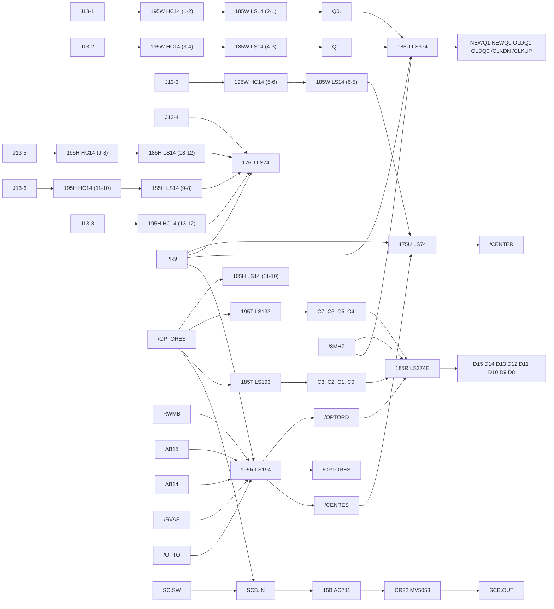

---

## SP-338 Page 12 = PDF page 69

**Drawing title (title block, bottom right):**

```
S.T.U.N. Runner™ SA Audio II
PCB Schematic Diagram
```

* Sheet reference printed as **`SP-338 Page 12`**, **`1st printing`**.
* `© 1989 Atari Games Corporation`
* `047350-01 B` printed beneath the Atari logo.

### Power entry / off-sheet connector references (verbatim)

| Reference | Net / value |
|---|---|
| `ACDC-11` | `KEY` (shown as `ACDC-11 >-- KEY`) |
| `ACDC-10` | `12VAC-LO` |
| `ACDC-9`  | `12VAC-HI` |
| `ACDC-8`  | (arrow only, no net name legible on this page) |
| `ACDC-7`  | `AGND` |
| `ACDC-6`  | (arrow only) |
| `ACDC-5`  | (arrow only) |
| `ACDC-4`  | `+14V` |
| `ACDC-3`  | `GND` |
| `ACDC-2`  | `-14V` |
| `ACDC-1`  | `+5V` |
| `ACDC-12` | `RGND` |

Internal rails printed on this sheet: `+5V`, `+14V`, `-14V`, `-6.8V`, `+VOP`, `AGND`,
`GND`, `PR`.

### Integrated circuits (as printed)

| Ref. | Part | Function as drawn |
|---|---|---|
| `11C` | `PAL16L8` | combinational PLD, address-decode / strobe generator (verbatim pin list below) |
| `3F/H` | `LS86` | quad XOR. Gates shown: (9,10)→8 ; (4,5)→6 ; (6,1)→2 ; (5,4)→6 ; (2,1)→… |
| `2F/H` | `LS74` | D flip-flop: `D` 12, `S` (bubbled) 11, `Q` 9, `/Q` 8, `C` 13 |
| `4F/H` | `LS74` | D flip-flop: `D` 2, `S` (bubbled) 3, `Q` 5, `/Q` 6, `C` 1 |
| `5F` | `LS74` | D flip-flop: `D` 12, `S` (bubbled) 11, `Q` 9, `/Q` 8, `C` 13 |
| `5H` | `LS393` | dual 4-bit binary counter (two sections drawn) |
| `7H` | `LS393` | dual 4-bit binary counter |
| `9H` | `LS393` | dual 4-bit binary counter (pins `QD 6`, `QC 5`, `QB 4`, `QA 3`, `CLR 2`) |
| `7F` | `LS14` | hex inverter; gates 9→8, 5→6, 4→2 (each drawn separately) |
| `10E` | `LS244` | octal buffer/tri-state |
| `1B/D` | `TL084` | quad op-amp (power amp drive) |
| `3B/C` | `TL084` | quad op-amp (pins 12,13,14,11 drawn; → `OPMP`) |
| `4A`  | `TL084` | quad op-amp |

#### `11C` — `PAL16L8`, verbatim pin ↔ net list

Inputs (left, marked `I`):

| Pin | Signal | Net |
|---|---|---|
| 11 | `SA15` | `SA15` |
| 9  | `SA14` | `SA14` |
| 8  | `SA13` | `SA13` |
| 7  | `SA12` | `SA12` |
| 6  | `SA11` | `SA11` |
| 5  | `SA9`  | `SA9` |
| 4  | `BA13` | `BA13` |
| 3  | `BA12` | `BA12` |
| 2  | `O2`   | `O2` |
| 1  | `SR//W` | `SR//W` |

Outputs (right):

| Pin | Type | Function | Net |
|---|---|---|---|
| 19 | `O` | `/SRD` | `/SRD` |
| 18 | `O` | `/SWR` | `/SWR` |
| 17 | `I/O` | `A12B` | `A12B` |
| 16 | `I/O` | `A13B` | `A13B` |
| 15 | `I/O` | `/RAM` | `/RAM` |
| 14 | `I/O` | `/REST` | `/REST` |
| 13 | `I/O` | `/YAM` | `/YAM` |
| 12 | `O`  | `/ROM` | `/ROM` |

Pin 19 (`/SRD`) also carries the printed text `SP1`.

#### `10E` — `LS244`, verbatim

`A` inputs on pins 2, 4, 6, 8, 11, 13, 15, 17; `Y` outputs on pins 18, 16, 14, 12, 9, 7, 5, 3.
Pins `1E` (pin 1) and `2G` (pin 19) are wired together and the net is labelled **`/RDIO`**.

Inputs feeding `A`:

| Pin | Net |
|---|---|
| 2  | `SELF-TEST` |
| 4  | `/NMI` |
| 6  | `SFULL` |
| 8  | (no net label legible) |
| 11 | `R48` / `R51` branch |
| 13 | `R49` / `R52` branch |
| 15 | `R53` / `R54` branch |
| 17 | `R55` / `R36` branch |

Outputs `Y` → `SD7`, `SD6`, `SD5`, `SD4`, `SD3`, `SD2`, `SD1`, `SD0` (top to bottom).

### Memory devices on this page

**None.** This page carries no ROM or RAM. (The sound-board ROMs are on SP-338 Page 13.)

### Clocks, oscillators and dividers (verbatim)

| Net label | Where printed |
|---|---|
| `X1` | crystal, value **`3.579M`** |
| `C50` | `100PF` (crystal load) |
| `C67` | `39PF` |
| `C68` | `.1` |
| `L1` | `100UH` |
| `R63` | `220` |
| `R64` | `150K` |
| `R65` | `150K` |
| `R61` | `470` |
| `3579K` | net label (top half of the divide chain) |
| `1790K` | net label |
| `1193K` | net label |
| `1B/UH` | net label |
| `2B/DH` | net label |
| `1193K` | also appears beside the `/SPKR-2` amplifier network |

Divider chain drawn: `X1 3.579M` → `L1 100UH` / `C50 100PF` → `Q6 2N3904` (via `R61 470`,
`7F LS14` gate 3→4) → `7H LS393` → `5H LS393` → `5F LS74` / `2F/H LS74` / `4F/H LS74` →
nets `3579K`, `1790K`, `1193K`, and `/IRQACK`.

### Semiconductors and discretes (verbatim)

| Ref. | Part |
|---|---|
| `Q2` | `2N3904` |
| `Q3` | `2N5306` |
| `Q4` | `2N5306` |
| `Q5` | `2N5306` |
| `Q6` | `2N3904` |
| `CR1` | `MHT5053` |
| `CR3` | `1N754A` |
| `CR4` | `1N4001` |
| `CR5` | `1N4001` |
| `CR6`, `CR7`, `CR8`, `CR9` | `1N5401` |
| `CR10`, `CR11`, `CR12` | `1N4001` (CR11/CR12 legible) |
| varistor near `/POR` | printed `5053` (full prefix clipped, reads `MV5053` / `MOV5053`) |
| `1B/D` power device | `TDR2030` |

### Interrupt / handshake nets on this page (verbatim)

* **`/IRQ`** — open-collector-looking node with `R39 10K` pull-up to `+5V`, driven by `Q2 2N3904`.
  Label printed as `/IRQ`.
* **`/IRAPCK`** — same region, `R40 10K`, driven by `Q2`.
* **`/IRQACK`** — printed net label in the divider-chain area.
* **`PR`** — printed throughout as the power-on / reset net (pull-up `R183 1K` and `R41 1K`).
* **`/POR`** — output of two `7F LS14` inverters (pins 9→8 and 5→6), fed from `Q3 2N5306`.
* **`SP-1`** / **`SPKR-1`** / **`SPKR-2`** — speaker output arrows.

### Coin / input nets (verbatim)

`COIN-1`, `COIN-2`, `COIN-3`, `COIN-4`, `COIN-5`, `COIN-7`, `COIN-8`, `COIN-9`, `COIN-10`,
`COIN-11` (note: **no `COIN-6`** appears on this sheet).

### Audio amplifier / speaker (verbatim)

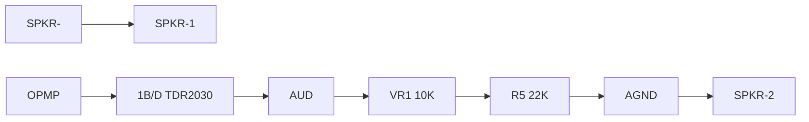

---

## SP-338 Page 13 = PDF page 70

**Drawing title (title block, bottom right):**

```
S.T.U.N. Runner™ SA Audio II
PCB Schematic Diagram
```

* Sheet reference printed as **`SP-338 Page 13`**, **`1st printing`**.
* `© 1989 Atari Games Corporation`
* `047350-01 B` beneath the Atari logo.

### The CPU

| Ref. | Part as printed | Notes |
|---|---|---|
| `10A` | *(designator only; the symbol carries no part number above it)* | 40-pin CPU symbol |

The symbol is printed with these pin names and pin numbers **exactly as drawn**:

| Pin | Pin name | Net |
|---|---|---|
| 8 | `VCC` | — |
| 40 | `RES` (bubbled) | `/SNDRES` |
| 7 | `SYNC` | — |
| 6 | `NMI` (bubbled) | `/NMI` |
| 4 | `IRQ` (bubbled) | `/IRQ` |
| 38 | `SO` | `PR` (junction dot also ties `RDY`) |
| 2 | `RDY` | `PR` |
| 39 | `O2` | — |
| 34 | `R/W` | `SR//W` |
| 25 | `A15` | `SA15` |
| 24 | `A14` | `SA14` |
| 23 | `A13` | `SA13` |
| 22 | `A12` | `SA12` |
| 20 | `A11` | `SA11` |
| 19 | `A10` | `SA10` |
| 18 | `A9`  | `SA9` |
| 17 | `A8`  | `SA8` |
| 16 | `A7`  | `SA7` |
| 15 | `A6`  | `SA6` |
| 14 | `A5`  | `SA5` |
| 13 | `A4`  | `SA4` |
| 12 | `A3`  | `SA3` |
| 11 | `A2`  | `SA2` |
| 10 | `A1`  | `SA1` |
| 9  | `A0`  | `SA0` |
| 37 | `D0`  | `1790K` |
| 3  | `D1`  | — |
| 5, 35, 36 | `NC` | — |
| 26 | `D2`  | `SD2` |
| 27 | `D3`  | `SD3` |
| 28 | `D4`  | `SD4` |
| 29 | `D5`  | `SD5` |
| 30 | `D6`  | `SD6` |
| 31 | `D7`  | `SD7` |
| 33 | `D0`  | `SD0` |

Also printed inside the same box: **`6502A`**. See "Anomalies" below.

### Other integrated circuits on this page

| Ref. | Part | Function as drawn |
|---|---|---|
| `10C` | `27512` / `300N` (two-line rotated device marking) | 28-pin mask ROM: `CE` pin 20 = `/ROM`, `DE` pin 22 = `/SRD` |
| `8C` | `8KX8` / `150N` | 28-pin ROM: `CS2` pin 26 = `PR`, outputs `SD7`…`SD0` |
| `1C/O` | `27512` / `300N` | ROM, `VD7`…`VD0` data, `VA15`…`VA0` address |
| `1D/E` | `27512` / `300N` | ROM, same pinout |
| `1E/F` | `27512` / `300N` | ROM, same pinout |
| `1F/H` | `27512` / `300N` | ROM, same pinout |
| `12A` | `MSM6295S` (marking `2E/F`) | ADPCM playback |
| `6A` | `YM2151S` | FM synth |
| `4A` | `YM3012` | PSG / AY-3-8912-class |
| `7E` | `LS138` | 3-to-8 decoder (address strobe generator) |
| `9E` | `LS273` | octal D flip-flop |
| `5E` | `LS174` | hex D flip-flop |
| `7F` | `LS14` | hex inverter (gates 13→12 and 11→12 drawn) |
| `6B` | `4066B` | CMOS analog switch |
| `1A/B` | `TL084` | quad op-amp |
| `2A` | `TL084` | quad op-amp |
| `3B/C` | `TL084` | quad op-amp (output `AUD`) |
| `Q1` | `2N3904` | transistor |

#### ROM pinout printed on `1C/O`, `1D/E`, `1E/F`, `1F/H` (all four identical)

Address in, pins `1 27 26 2 23 21 24 25 3 4 5 6 7 8 9 10` = `A15 A14 A13 A12 A11 A10 A9 A8 A7 A6 A5 A4 A3 A2 A1 A0`.
Data out, pins `19 18 17 16 15 13 12 11` = `D7 D6 D5 D4 D3 D2 D1 D0`.
Address nets as printed: `VA15`…`VA0`; data nets as printed: `VD6`…`VD0`.

#### `8C` — `8KX8` ROM, verbatim

`NC` pin 1; `CS2` pin 26 ← `PR`; `A12` pin 2 ← `SA12`; `A11` pin 23 ← `SA11`; `A10` pin 21 ← `SA10`;
`A9` pin 24; `A8` pin 25; `A7` pin 3; `A6` pin 4; `A5` pin 5; `A4` pin 6; `A3` pin 7; `A2` pin 8;
`A1` pin 9; `A0` pin 10; `D7` pin 19 ← `SD7`; `D6` pin 18 ← `SD6`; `D5` pin 17; `D4` pin 16;
`D3` pin 15; `D2` pin 13; `D1` pin 12; `D0` pin 11.

#### `10C` — ROM, verbatim

`SA15` pin 1; `SA14` pin 27; `A13B` pin 26; `A12B` pin 2; `SA11` pin 23; `SA10` pin 21;
`SA9` pin 24; `SA8` pin 25; `SA7` pin 3; `SA6` pin 4; `SA5` pin 5; `SA4` pin 6; `SA3` pin 7;
`SA2` pin 8; `SA1` pin 9; `SA0` pin 10; `SD7` pin 19; `SD6` pin 18; `SD5` pin 17; `SD4` pin 16;
`SD3` pin 15; `SD2` pin 13; `SD1` pin 12; `SD0` pin 11; `CE` pin 20 ← `/ROM`; `DE` pin 22 ← `/SRD`.

#### `7E` — `LS138`, verbatim (this is the Z80 address-decode strobe generator)

| Pin | Function | Net |
|---|---|---|
| 6 | `G1` | `PR` |
| 5 | `/G2B` | `/REST` |
| 4 | `/G2A` | `SA10` |
| 3 | `C` | `SA9` |
| 2 | `B` | `SA2` |
| 1 | `A` | `SA1` |
| 7 | `Y7` | `/MIX` |
| 9 | `Y6` | `/WRIO` |
| 10 | `Y5` | `/WRP` |
| 11 | `Y4` | `/WRV` |
| 12 | `Y3` | `/IRQACK` |
| 13 | `Y2` | `/RDIO` |
| 14 | `Y1` | `/RDP` |
| 15 | `Y0` | `/RDV` |

#### `9E` — `LS273`, verbatim

| D pin | Net | Q pin | Net |
|---|---|---|---|
| 4  | `SD7` | 5  | `BA13` |
| 7  | `SD6` | 6  | `BA12` |
| 8  | `SD5` | 9  | `CCTR2` |
| 13 | `SD4` | 12 | `CCTR1` |
| 14 | `SD3` | 15 | `VFREQ` |
| 17 | `SD2` | 16 | `/OKIRES` |
| 18 | `SD1` | 19 | (no net label) |
| 3  | `SD0` | 2  | `/YAMRES` |

`CLK` pin 11 ← `/WRIO`; `/CLR` pin 1 ← `/POR`.

#### `5E` — `LS174`, verbatim

| D pin | Net | Q pin | Net |
|---|---|---|---|
| 3  | `SD5` | 2  | `LPF` |
| 4  | `SD4` | 5  | (no net label) |
| 6  | `SD3` | 7  | `YM2` |
| 11 | `SD2` | 10 | `YM1` |
| 13 | `SD1` | 12 | `YM0` |
| 14 | `SD0` | 15 | `SP0` |

`CK` pin 9 ← `/MIX`; `/C` pin 1 ← `/POR`.

#### `12A` — `MSM6295S`, verbatim

| Pin | Function | Net |
|---|---|---|
| 17 | `VDD` | `+5V` |
| 36 | `DA0` | — |
| 35 | `A17` | — |
| 34 | `A16` | — |
| 33 | `A15` | `VA15` |
| 32 | `A14` | `VA14` |
| 31 | `A13` | `VA13` |
| 30 | `A12` | `VA12` |
| 29 | `A11` | `VA11` |
| 28 | `A10` | `VA10` |
| 27 | `A9`  | `VA9` |
| 26 | `A8`  | `VA8` |
| 25 | `A7`  | `VA7` |
| 24 | `A6`  | `VA6` |
| 23 | `A5`  | `VA5` |
| 22 | `A4`  | `VA4` |
| 21 | `A3`  | `VA3` |
| 20 | `A2`  | `VA2` |
| 19 | `A1`  | `VA1` |
| 18 | `A0`  | `VA0` |
| 19 | `VD6` | `VD6` |
| 18 | `VD5` | `VD5` |
| 16 | `VD4` | `VD4` |
| 15 | `VD3` | `VD3` |
| 13 | `VD2` | `VD2` |
| 12 | `VD1` | `VD1` |
| 11 | `VD0` | `VD0` |
| 44 | `I7` | `I7` |
| 43 | `I6` | `I6` |
| 42 | `I5` | `I5` |
| 41 | `I4` | `I4` |
| 40 | `I3` | `I3` |
| 39 | `I2` | `I2` |
| 38 | `I1` | `I1` |
| 37 | `I0` | `I0` |
| 7  | `SS` | `VFREQ` |
| 8  | `RESET` (bubbled) | `/OKIRES` |
| 3  | `WR` (bubbled) | `/WRV` |
| 2  | `RD` (bubbled) | `/RDV` |
| 4  | `CS` | tied to ground symbol |
| 5  | `XT` | `1193K` |
| 6  | `XT` | — |
| 1  | `VSS` | ground symbol |

#### `6A` — `YM2151S`, verbatim

| Pin | Function | Net |
|---|---|---|
| 18 | `D7` | `SD7` |
| 17 | `D6` | `SD6` |
| 16 | `D5` | `SD5` |
| 15 | `D4` | `SD4` |
| 14 | `D3` | `SD3` |
| 13 | `D2` | `SD2` |
| 12 | `D1` | `SD1` |
| 10 | `D0` | `SD0` |
| 24 | `M1` | `3579K` |
| 4  | `A0` | `SA0` |
| 3  | `IC` (bubbled) | `/YAMRES` |
| 5  | `WR` (bubbled) | `/SWR` |
| 6  | `RD` (bubbled) | `/SRD` |
| 7  | `CS` (bubbled) | `/YAM` |
| 1  | `VSS` | ground |
| 11 | `VSS` | ground |
| 22 | `VDD` | `+5V` |
| 2  | `IRQ` (bubbled) | `/IRQ` |
| 23 | `O1` | `O1` |
| 21 | `S0` | `S0` |
| 19 | `SH2` | `SH2` |
| 20 | `SH1` | `SH1` |
| 9  | `CT2` | `CT2` |
| 8  | `CT1` | `CT1` |

#### `4A` — `YM3012`, verbatim

| Pin | Function | Net |
|---|---|---|
| 1  | `VDD` | `+5V` |
| 7  | `ICL` (bubbled) | `/YAMRES` |
| 2  | `CKO` | — |
| 4  | `DATA` | (net name not legible at this crop) |
| 6  | `SAM2` | `SH2` |
| 5  | `SAM1` | `SH1` |
| 8  | `AGND` | `AGND` |
| 16 | `AGND` | `AGND` |
| 3  | `GND` | ground |
| 11 | `COM` | — |
| 12 | `BUF` | — |
| 13 | `MP`  | — |
| 14 | `BC`  | — |
| 15 | `RB`  | — |
| 9  | `CH2` | — |
| 10 | `CH1` | — |

### Sound-board board-to-board interface (`SCOM`) — verbatim

Printed as off-sheet connector arrows at the top-right of SP-338 Page 13:

| Connector pin | Net carried |
|---|---|
| `SCOM-11` | `+5V` |
| `SCOM-10` | `+5V` |
| `SCOM-9`  | `GND` |
| `SCOM-8`  | `GND` |
| `SCOM-2`  | `GND` |
| `SCOM-5`  | printed as `SCOM-5>-- KEY` (net `KEY`) |
| `SCOM-4`  | `FIN` |
| `SCOM-7`  | `CLK` |
| `SCOM-1`  | `SELF-TEST` (from `SW1`, switch to ground, `0` on both throws) |
| `SCOM-6`  | `FOUT` |
| `SCOM-3`  | `DATA` |

(`SCOM-11`, `-10`, `-9`, `-8`, `-2` are tied together to a `+5V` / `GND` node respectively;
`C53 100PF` hangs on `CLK`. `R43 1K` and `R42 470`, `C51 .1`, `C54 100PF`, `C52 100PF` sit in
the `FOUT` / `DATA` feed.)

`SW1` is drawn as a single-pole switch, both positions marked `0`, wiper common with the
`SELF-TEST` node, common side to a ground symbol.

### Interrupt-related nets on this page (verbatim)

* `/IRQ` — `6A` (`YM2151S`) pin 2 `IRQ`, drawn bubbled.
* `/OKIRES` — `9E` pin 16 Q output → `12A` (`MSM6295S`) pin 8 `RESET`, drawn bubbled.
* `/YAMRES` — `9E` pin 2 Q output → `6A` pin 3 `IC` and `4A` pin 7 `ICL`, both bubbled.
* `/IRQACK` — output of `7E` pin 12.
* `/POR` — power-on reset net, driven from the Page-12 `7F LS14` chain, used as `/CLR` on
  `9E` pin 1 and `/C` on `5E` pin 1.
* `/SWR`, `/SRD`, `/ROM`, `/RAM`, `/REST`, `/YAM` — generated by `11C` (`PAL16L8`) on Page 12.
* `PR` — the Z80 `SO`/`RDY` net (pins 38 and 2 tied together at a junction dot).

### Values printed on this page

| Item | Value |
|---|---|
| `R17` | `3.3K` |
| `R16` | `16K` |
| `C22` | `.015` |
| `C57` | `.1` |
| `R46` | `10K` |
| `R33` | `68K` |
| `C39`, `C37` | `.22` |
| `R24`, `R25` | (values not legible) |
| `R36` | (value not legible) |
| `R43` | `1K` |
| `R42` | `470` |
| `C51` | `.1` |
| `C54`, `C52`, `C53` | `100PF` |
| `SW1` | switch, labelled `SELF-TEST` |
| `6B` | `4066B` (pins 3, 4, 5 shown; control pin 12 ← `SP0`) |
| `Q1` | `2N3904` |

### Signal flow drawn on this page

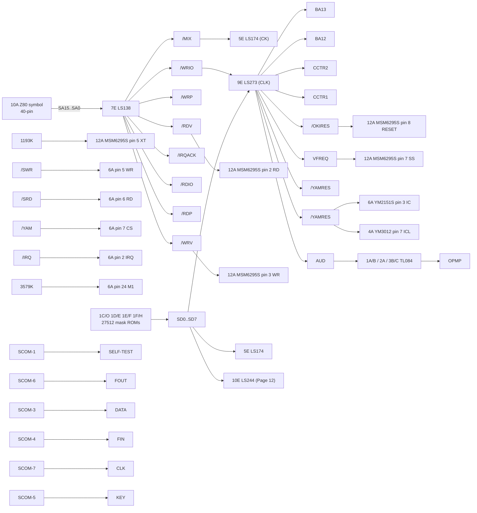

---

## SP-338 Page 14 = PDF page 71

**Drawing title (title block, bottom right):**

```
Switching/Linear Power Supply, Hitron 5V,
10A Switching Power Supply, and Coin Door
Wiring Diagrams
```

* Sheet reference printed as **`SP-338 Page 14`**, **`1st printing`**.
* `© 1989 Atari Games Corporation`
* `A046990-01 A, 149035-03, & 171027-001` beneath the title.
* Copyright/notice block at bottom-left of the title block.

**No ICs, no CPUs, no DSP, no memory arrays on this page.** It is a mains-power block diagram,
a linear/switching supply schematic, and a coin-door harness drawing.

### Block diagram: "Switching/Linear Power Supply"

Verbatim labels and topology:

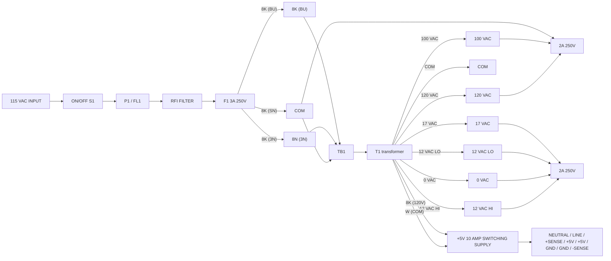

Power-supply pin nets with harness colours as printed:

| Supply pin | Net | Harness colour |
|---|---|---|
| `NEUTRAL` | `W` | `W` |
| `LINE` | `8K` | `8K` |
| `+SENSE` | `R/W` | `R/W` |
| `+5V` | `R` | `R` |
| `+5V` | `R` | `R` |
| `GND` | `8N` | `8N` |
| `GND` | `8N` | `8N` |
| `-SENSE` | `8N/W` | `8N/W` |

### Block: "Hitron 5V 10A Switching Power Supply"

Printed under the block:

```
ATARI PART NO:  149003-003 (120V)
                149003-103 (240V)
```

Values as printed:

* Transformers / magnetics: `T2A 250V` (fuse symbol), `TH1`, `T1`, `T2`, `L1 15MH`,
  `L2 1/2W` *(value line reads `1/2W`; may be `1.2MH` — see gaps)*, `L3 7uH`, `L4 2.2uH`,
  `L5 1.5MH`.
* Resistors: `RH1 0.5 5W`; `R1 180K 1W`; `R2 180K 1W`; `R3 120 2W`; `R4 RGP 10K`;
  `R5 33 2W`; `R6 5.6`; `R7 5.6 D3`; `R8 47 2W`; `R9 10`; `R10 1K`; `R11 47`; `R12 5.6`;
  `R13 330`; `R14 270`; `R15 330 1/2W`; `R16 8.2`; `R17 5Ω`; `R18 55`; `R19 39`; `R20 2K`;
  `R21 430`; `R22 2.2K`; `R23 2K`; `R24 1`; `R25 1Ω`; `R26 2W`; `R27 47`; `R28 150 3W`;
  `R31 150 3W`; `R29 2K`; `VR1 2K`.
* Capacitors: `C0.47 2W`; `C1 .047 250V`; `C2 .1 100V`; `C3 4700P 400V`; `C4 4700P 400V`;
  `C5 * 100 200V`; `C6 * 100 200V`; `C7 400V`; `C8 .001 2KV`; `C9 1F 1KV`; `C10 220, 25V`;
  `C11 .22 100V`; `C12 .022 100V`; `C13 .22 100V`; `C14 1800P 2KV`; `C17 470 25V`;
  `C21 470P 1KV`; `C22 .01`; `C23 10uF 25V`; `C24 2W`.
* Diodes: `D1 RGP 10K`; `D2 RGP 10K`; `D4 RGP10B`; `D5 1N4148`; `D6 1N4148`; `D7 1N4148`;
  `D8 S`; `D9 30DF1`; `D11 S10SC4M`; `D12 S10SC4M`; `D14`; `D15 1N4005 (4 PLC)`; `D16`.
* Transistors: `Q1 2SC1413A`; `Q2`; `Q3 PE8050B`; `Q4 PE8550B`; `Q7 PE8050B`;
  `U1 12SC1413A`.
* ICs: **`1C1` = `TL431`**, pins `1` and `3` drawn.
* Regulator: `ZD1 1N752A`; `SGR1 S2800`.
* Switch: `S1`.
* Input terminals: `(L)`, `(N)`, `(GND)`; `S11` marked `(115V)`; `T2` marked `2F` on both halves.

### Block: "Coin Door Wiring Diagram"

Connector pin list, verbatim:

| Pin | Signal | Harness colour |
|---|---|---|
| 1 | `SW GND` | `BK` |
| 2 | `RIGHT COIN SW` | `OR` |
| 3 | `LEFT COIN SW` | `Y` |
| 4 | (no signal name) | (no colour legible) |
| 5 | (no signal name) | (no colour legible) |
| 6 | (no signal name) | (no colour legible) |
| 7 | `GND` | `BU` |
| 8 | `+5V AC` | `GN` |
| 9 | `CHASSIS GND` | `GN` |

The `BU` / `GN` pair runs to a lamp or coin-mech terminal ring symbol (two terminals shown),
and a second `BU`/`GN` ring below.

A separate small detail box labelled **`RIGHT COIN SW`** / **`LEFT COIN SW`** carries wire
colours `8NC`, `C 8K`, `NC`, `G`, `8K`, `OR NC`. It lies at the extreme right edge of the
sheet and is **partially outside the captured image** — see gaps.

---

## Anomalies and observations (as printed, not corrected)

1. **Sheet 11 says `SP-338 Sheet 11`, not `Page 11`.** Pages 12–14 say `SP-338 Page N`.
   All four are `1st printing`.
2. **Sheet 11 is annotated `THIS SHEET NOT LOADED`.**
3. **The CPU symbol on SP-338 Page 13 carries two part strings.** Designator `10A` at the top
   of the box; the string `6502A` printed inside the same box, roughly two-thirds down.
   Both are transcribed verbatim; I have not resolved which the board was built with.
4. **The CPU symbol's printed pin numbering does not form a standard Z80/Z8400 map**
   (e.g. `D0` appears on both pin 37 and pin 33; `VCC` is drawn on pin 8; `RES` on pin 40).
   `A13` is printed as **pin 29**, breaking the `25 24 … 22 20 19 18 17 …` run around it.
   This is transcribed as drawn.
5. **The Z80's `SO` (pin 38) and `RDY` (pin 2) are joined by a drawn junction dot** onto the
   net `PR` on SP-338 Page 13.
6. **Two different reference-designator conventions coexist.** `11C` is a `PAL16L8` on
   SP-338 Page 12, while `12C` and `4A` are audio chips on Page 13. Board-to-sheet
   cross-referencing must use the sheet, not the designator, alone.
7. **`J13-10` and `COIN-6` do not appear** on the sheets transcribed here.
8. **Two designators are reused for different packages across sheets** (`12A`, `4A`, `3B/C`
   are audio on Page 13; the same strings appear in the power entry block on Page 12).
9. `L2` on SP-338 Page 14 has a value line printed as `1/2W`, which is a power rating rather
   than an inductance. Recorded as printed.
10. Several component values are rendered with the tens digit run into the reference designator
    (e.g. `C0.47 2W`, `RGP 10K` for `R4`, `RGP10B` for `D4`). Reproduced as printed.

---

## INFERENCE (clearly separated — none of the above is a drawing fact)

These are my readings of the topology, not labels on the sheet.

* **`SCOM` is the JSA-II board-to-game-board connector.** Pages 12 and 13 together account for
  `SCOM-1` … `SCOM-11` (no `SCOM-12`): `DATA` (`SCOM-3`), `CLK` (`SCOM-7`), `FOUT` (`SCOM-6`),
  `FIN` (`SCOM-4`), `KEY` (`SCOM-5`), `SELF-TEST` (`SCOM-1`), two `+5V` and three `GND`.
  That is consistent with the `SCOM` shift-register serial port at `$600000`. I did **not**
  find a discrete connector symbol labelled `12C` on either sheet; the pins appear only as
  named off-sheet arrows.
* **`/IRQ` is the sound board's interrupt to the 68010**, driven open-collector from the
  `YM2151S` `IRQ` pin and pulled up by `R39 10K`; `/IRAPCK` looks like the paired
  acknowledge/re-route line.
* **`11C` `PAL16L8` is the Z80 address-decode / strobe generator**, producing `/ROM`, `/RAM`,
  `/YAM` and `A12B`/`A13B` from `SA9 SA11 … SA15`, `BA12 BA13`, `O2`, `SR//W`.
  `7E LS138` on Page 13 is a second, coarser decode on `SA9 SA10 SA2 SA1 PR`.
* **The `1790K` / `3579K` / `1193K` chain** on Pages 12–13 is a 3.579545 MHz crystal divided
  by LS393 counters and LS74 flip-flops: 3579K → 1790K → 1193K. `1193K` clocks the
  `MSM6295S` and `1790K` feeds the Z80 `D0`, which is unusual enough that I would not rely on
  it without tracing the sheet again.
* **The four `27512` mask ROMs `1C/O 1D/E 1E/F 1F/H`** are the JSA-II sample/ADPCM ROM set;
  `27512` is a Hitachi-family 32K mask ROM part number. This matches the `MSM6295S`'s
  `A0`–`A16` addressing.
* **Sheet 11 (`THIS SHEET NOT LOADED`) is the optional RGB-sync / video-standard logic.**
  `SCB.IN` → `AO711` comparator → `CR22 MV5053` clamp → `SCB.OUT` looks like a sync-separation
  or horizontal/vertical sync-align comparator, with `185U LS374` registering `Q0`/`Q1`
  against `/CLKDN`/`/CLKUP` on `/8MHZ`. Nothing on it is populated in the machine we emulate.

---

## What I could NOT read

Marked honestly rather than guessed:

1. **`SP-338 Page 14`, the `RIGHT COIN SW` / `LEFT COIN SW` wire-colour detail box** — it sits
   at the extreme right edge of the rendered page and is cut off. I could see the labels
   `RIGHT COIN SW`, `LEFT COIN SW` and fragments `8NC`, `C 8K`, `NC`, `OR NC`, but could not
   resolve the full pin-to-colour table. Needs a wider render of the PDF page.
2. **`SP-338 Page 14`, `ACDC-5` / `ACDC-6` / `ACDC-8`** on Page 12 — the arrows are drawn but
   the net names were not legible at the resolution available. `[illegible]`.
3. **`4A YM3012` pin 4 `DATA`** — the pin is drawn, the net name at its left was not legible.
   `[illegible]`
4. **`10E LS244` `A` pin 8** on Page 12 — pin drawn, net name not legible. `[illegible]`
5. **Several Page-13 resistor values** in the `YM0/YM1/YM2` mixing network (`R24`, `R25`,
   `R35`, `R36`, `R37`, `R38`) — the designators are legible, the values are not.
   `[illegible — value]`
6. **`L2` value on Page 14** — printed `1/2W`; I could not tell whether the third character is
   `H` (henry) or a watt rating. Transcribed as printed.
7. **`195R LS194` output pins 7, 9, 10, 12, 15** on Sheet 11 — pins drawn, no net labels.
   Listed as `(no net label)` rather than guessed.
8. **The `105H LS14` and `185T LS193` net names** on Sheet 11 — partially readable; I have
   transcribed only what I could confirm.
9. **`Page 11` sub-caption under the Atari logo** — reads `0-4660-11` or `04660-11`; the
   leading character is not resolvable.
10. **No ADSP-2100 appears anywhere on SP-338 Pages 11–14.** The DSP board schematic is on
    other sheets of SP-338 (not in my scope) — pages 11–14 cover the option/sync logic, the
    whole SA Audio II sound board (two sheets), and power/coin-door.


## 9. Corrections this transcription forces on the OCR-derived notes

* `FF 8000 - FF BFFF RAM 0 (16K)` and `FF C000 - FF FFFF RAM 1 (16K)`. The OCR
  reads `FE BFEF` / `FF BFEF`; the image is unambiguous.
* GSP reset is `60 400C` / `60 401C`, not `60 4006` / `60 4016` as the OCR has it.
* `60 C000` is labelled `SW1`, and the table under it covers **all sixteen bits**
  — D15–D8 option switches, D7/D6 coin switches, D5 self-test, D0 diagnostic.
  The OCR renders this as two disconnected fragments.

---

## Detailed page transcriptions

The following are source-page transcriptions from the rendered images. Labels,
pin tables, gaps and lane-specific uncertainty notes are retained. Do not detach
an inference from its stated evidence or treat an illegible marking as known.

### Appendix A — SP-338 Pages 2–4 (PDF 59–61)

### SP-338 (Atari TM 238) — transcription of Pages 2, 3, 4

Source images (read directly, no OCR file used):

| Drawing page | PDF page | Image |
|---|---|---|
| SP-338 Page 2 | 59 | `/tmp/stunrunner_pages/page-59.png` |
| SP-338 Page 3 | 60 | `/tmp/stunrunner_pages/page-60.png` |
| SP-338 Page 4 | 61 | `/tmp/stunrunner_pages/page-61.png` |

`reference/manuals/stunrunner-ocr.txt` was **not** consulted. All text below
was read from the rendered images, most of it at 500–1400% crop magnification
using ImageMagick.

**Reading conventions used by this drawing set** (established by observation,
not documented on the sheet):

* A chip's *designator* is printed straddling the top edge of its symbol box
  (`120K`, `140H`, `170K`, `110K`, `200M`, `175W`, …).
* A *function symbol name* is printed inside the box (`LS161`, `ALS138`,
  `ALS32`, `LS74`, `F74`, `AS00`, `OC`, …).
* Both strings are reproduced verbatim below. Where it is not possible to tell
  which string is the designator and which is the part number, both are given
  and the ambiguity is noted rather than resolved by guessing.
* Atari "part" codes seen on gates: `F04` (inverter, 74LS04), `F11`
  (triple 3-input AND, 74LS11), `F74` (D flip-flop, 74LS74), `LS14`
  (inverter, 74LS14), `ALS32` (quad OR, 74LS32), `ALS139`, `ALS138`,
  `ALS161`, `AS00`, `AS08`, `OC` (open-collector buffer).
  These mappings are consistent with the drawn pin numbers but the **sheet
  does not print a manufacturer part number anywhere** — only Atari codes.

---

### SP-338 Page 2

**Title block (verbatim):**

```
S.T.U.N. Runner™ Multisync Game PCB Schematic Diagram
044998-11 B                    SP-338 Page 2
1st printing                   © 1989 Atari Games Corporation
```

A boxed notice at lower right reads (partially legible):

```
NOTICE TO ALL PERSONS RECEIVING THIS DRAWING
CONFIDENTIAL: Reproduction, the specific written permission of Atari
out the specific written permission of Atari Games Corporation, Milpitas,
Games Corporation, Milpitas, ... is only conditionally issued and ...
nor possession thereof confers ... right in, or license to use, the ...
the drawing or any design or ... tion shown thereon, nor any ...
```

#### Page 2 — content

This page is **power distribution and the edge/option connectors**. There is
no CPU, no memory device and no bus logic on this sheet.

##### Connector `J1` (main board / harness connector)

Pin groups exactly as drawn (each group is internally shorted together):

| Group | Pins on the sheet |
|---|---|
| upper | `J1-2`, `J1-3`, `J1-10`, `J1-11` |
| lower | `J1-1`, `J1-5`, `J1-8`, `J1-12` |
| AC-ish pair | `J1-4`, `J1-9` |
| negative rail pair, annotated `POWER` | `J1-6`, `J1-7` |

* `C1` `100-35V` (electrolytic) hangs off the upper group.
* Test-point / ground labels on the lower group, left to right:
  `GND1`, `GND2`, `GND3`, `GND4`, `GND8`, `GND9`.
  *(The two trailing digits — `GND8`, `GND9` — were read at 1400%; they are
  clearly not `5`/`6`. The numbering skips 5, 6 and 7, which is as drawn.)*
* Annotations `MOUNTING HOLE` and `MOUNTING HOLES` point at groups of open
  circles drawn on the board.

##### +15 V / +12 V rail (from `J1-4`, `J1-9`)

```
J1-4 ─┬
      ├─ test point  "+15V1"
J1-9 ─┘
      ├── C128  10-35V     (to GND, + terminal up)
      ├── C130  .1         (to GND)
      ├── CR8   1N4002     (series diode, +15V → +12V)
      └──► U7812 Q4   triangle, pins I / O / C, "7812" printed inside
              output ──► test point "+12V1"
              C127 10-35V  (to GND)
              C129 .1      (to GND)
```

##### −22 V / −5 V rail (from `J1-6`, `J1-7`, marked `POWER`)

```
J1-6 ─┬   J1-7 ─┘   (shorted together; annotation "POWER")
      ├── test point  "-22V1";  net arrow labelled  "-22V"
      ├── C126  10-35V    (to GND)
      ├── C115  .1        (to GND)
      ├── CR5   1N4002    (series diode, -22V → -5V)
      └──► U7905 Q3   triangle, pins I / O / C, "7905" printed inside
              output ──► test point "-5V1"
              C125 10-35V  (to GND)
              C114 .1      (to GND)
      note near this rail:  "NOT LOADED"
```

##### +5 V pull-up bank

Eight one-kilohm resistors, all to `+5V`, appearing as a row:

| Label | Value |
|---|---|
| `PR1` | `R134` `1K` |
| `PR2` | `R125` `1K` |
| `PR3` | `R126` `1K` |
| `PR4` | `R127` `1K` |
| `PR5` | `R128` `1K` |
| `PR6` | `R129` `1K` |
| `PR7` | `R131` `1K` |
| `PR8` | `R130` `1K` |

Associated passives read on the same sheet: `C124` `.1`, `C309` `.1`,
test points `+5V1` and `+5V2`, `R76` `220`, `CR6` `MV5053`.
*(The last four were read at 380–550% magnification and are lower confidence
than the items above.)*

##### Connector `J12` — the `SOUND` connector (boxed, right of sheet)

| Pin | Net | Decoupling shown |
|---|---|---|
| `J12-4` | `+15V` | `C320` `.1` to GND |
| `J12-6` | `+12V` | `C316` `.1` to GND |
| `J12-5` | `+5V` | — |
| `J12-9` | `GND` | — |
| `J12-1` | `GND` | — |
| `J12-2` | `-5V` | `C315` `.1` to GND |
| `J12-3` | `-22V` | `C318` `.1` to GND |
| `J12-7` | `-22V` | — |
| `J12-8` | *(drawn as a short unconnected stub, no net name)* | — |

Box annotations: `SOUND` (above), `NOT LOADED` (below the box).

##### Page 2 ASCII signal flow

```
J1-2,J1-3,J1-10,J1-11 ──┬── C1 100-35V
                        │
J1-1,J1-5,J1-8,J1-12 ───┴── GND1 GND2 GND3 GND4 GND8 GND9

J1-4 ─┬
J1-9 ─┴─► +15V1 ─┬─ CR8 1N4002 ─► [U7812 / Q4 : 7812] ─► +12V1 ─► J12-6
                 └─ C128, C130                         └─ J12-4 (raw +15V)

J1-6 ─┬  "POWER"
J1-7 ─┴─► -22V1 ─┬─ CR5 1N4002 ─► [U7905 / Q3 : 7905] ─► -5V1 ─► J12-2
                 └─ C126, C115                         └─ J12-3, J12-7

+5V ─► PR1..PR8 (R134,R125,R126,R127,R128,R129,R131,R130, all 1K)
```

---

### SP-338 Page 3

**Title block (verbatim):** same drawing title and number as Page 2, with

```
SP-338 Page 3
```

#### Page 3 — this is the 68010 CPU page

##### Clock source

* `XOSC1` — labelled `32MHZ`. Drawn as a four-pin oscillator/crystal block:
  pin `1` (unconnected stub), pin `14` (top, to `C195` `.1` → `+5V`),
  pin `8` (right, to the clock divider), pin `7` (bottom, to ground).
* `C195` `.1`.

##### Clock divider `170K` (`ALS161`)

```
  +5V ─ PR6 ─┬──────────────────────────────────────────┐
             ├─ CD (pin 9)                             │
             ├─ A  (pin 3)                             │
             ├─ B  (pin 4)                             │
             ├─ C  (pin 5)                             │
             ├─ D  (pin 6)                             │
             ├─ ENT (pin 10)                           │
             ├─ ENP (pin 7)                            │
             └─ CLR (pin 1)                            │
                                                          │
XOSC1 pin 8 ──────────────────────► CK (pin 2)           │
                                                          ▼
  DA (pin 14) ──►  16MHZ
  DB (pin 13) ──►   8MHZ
  DC (pin 12) ──►   4MHZ
  DD (pin 11) ──►   2MHZ
  RCO (pin 15) ──►  (unlabelled stub)
```

The four output labels, top to bottom on the sheet, are exactly
`2MHZ`, `4MHZ`, `8MHZ`, `16MHZ`; the pin-to-label mapping above was resolved
by following the four riser lines at 900% magnification and is a
straight ÷2/÷4/÷8/÷16 cascade of the 32 MHz source.

##### Frequency divider chain — four `LS161` counters

Designators, in drawing order top to bottom: **`120K`, `120K`, `140H`, `140H`**.

| Stage | Designator | clock input | outputs (pin: label) |
|---|---|---|---|
| 1 | `120K` | pin `1` (`A`) ← `2MHZ`; pin `2` (`C`) ← counter clear bus | `DD`(6) → `125KHZ`; `DC`(5) → `( 250K )`; `DB`(4) → `( 500K )`; `QA`(3) → `1MHZ` |
| 2 | `120K` | pin `13` (`A`) ← `125KHZ`; pin `12` (`C`) ← clear bus | `DD`(8) → `7.8KHZ`; `DC`(9) → `( 15.6K )`; `DB`(10) → `( 31.2K )`; `QA`(11) → `( 62.5K )` |
| 3 | `140H` | pin `13` (`A`) ← `7.8KHZ`; pin `12` (`C`) ← clear bus | `DD`(8) → `488HZ`; `DC`(9), `DB`(10), `QA`(11) → labels not legible at the magnification used |
| 4 | `140H` | pin `1` (`A`) ← `488HZ`; pin `2` (`C`) ← clear bus | `DD`(6) → `30HZ`; `DC`(5), `DB`(4) → unlabelled stubs; `QA`(3) → `( 244HZ )` |

* The common "clear bus" is driven by a `75H` / `LS14` inverter, pins `1`→`2`.
  Its input comes from the left; nearby resistors `R82` `470` and `R83` `470`.
* Stage 3's three remaining output labels and stage 4's two remaining output
  labels are marked `[illegible]` above rather than guessed.

##### Interrupt priority encoder `170K` (`LS148`, 74LS148)

Left-side input pins and the nets drawn on them:

| Pin | Net |
|---|---|
| `4` | *(unlabelled line; pull-up `R144` `10K`)* |
| `3` | `/OUIRQ` |
| `2` | `/IRQ` |
| `1` | *(unlabelled line)* |
| `13` | *(unlabelled line)* |
| `12` | *(unlabelled line)* |
| `11` | *(unlabelled line)* |
| `10` | `PR7` |

Pull-up bank to `+5V` on the incoming request lines, left to right:
`R86` `10K`, `R87` `10K`, `R86` `10K`, `R85` `10K`, `R84` `10K`, `R144` `10K`.

Right-side outputs: `A2` pin `6`, `A1` pin `7`, `A0` pin `9`, `GS` pin `14`,
`EO` pin `13`. `EO`(13) is drawn going to the net **`/IRQS`**.

`A2`, `A1`, `A0` run right, drop, and arrive at the 68010 as `IPL2`, `IPL1`,
`IPL0` — verified at 800% by following the three risers with no crossings
between them (topmost output → `IPL2`).

##### Reset / watchdog chain

```
75H / LS14 (1 -> 2)   input from left, output to counter clear bus

140K (LS74)   D(12) ─┬── 1.4HZ-ish source [see note]
                 P(10) ─── /PCLR
                CLR(13) ─── PR7
                Q(9)  ──┬──► "OC / 110C / U6" buffer input pin 1
                      └──► (node)
                    /Q(8) ──► (node)

"OC"  /  "110C"  /  "U6"   two non-inverting buffers (open collector)
      buffer A : pins 1 -> 2   ──► net "8MHZ"
      buffer B : pins 3 -> 4   ──► net "/RESET"
      pull-ups: R61 4.7K and R78 4.7K to +5V
      (both gate symbols carry a third pin labelled "110C" — enable/strobe)

F11 (74LS11, triple 3-input NAND)
      1 <- /VPA
      2 <- /RESET
      3 <- /DTACK
     12 ──► joins the CLR(13) node of the 140K flip-flop above
```

Also drawn in this region: `R77` (value read as `4.7`, truncated at the crop
edge), pulling a node down to `GND`; a terminal on that node is labelled
`WO-DIS` with `GND` beneath it. `+5V` rail markers and `/MSPIRQ` appear at
the top of the same region.

##### `U68010` — the CPU symbol

Designator `U68010` printed vertically inside the box. The address and data
stubs run off the right edge of the sheet into a bus bracket (off-page).

Left-hand pins (pin name, pin number, net):

```
  VCC  14  ─► +5V
  IPL2 23  ◄── (from 170K / LS148 A2 pin 6)
  IPL1 24  ◄── (from 170K / LS148 A1 pin 7)
  IPL0 25  ◄── (from 170K / LS148 A0 pin 9)
  CLK  15  ◄── 8MHZ
  HALT 17  ──► (net label not legible)
  RESET 18 ◄── /RESET
  R/W   9  ──► RWN          (drawn exiting to the right of the box)
  UDS   7  ──► /UDS
  LDS   8  ──► /LDS
  AS    6  ──► /AS
  DTACK 10 ◄── /DTACK
  BG    11 ──► (stub, no net drawn)
  BGACK 12 ◄── PR6
  BR    13 ◄── PR6
  E     20 ──► (stub, no net drawn)
  VMA   19 ──► (stub, no net drawn)
  BERR  22 ◄── /BERR
  VPA   21 ◄── /VPA
  FC2   26 ◄── FC2
  FC1   27 ◄── FC1
  FC0   28 ◄── FC0
  GND   16  ──► GND
```

Right-hand pins:

```
  VCC  49 ──► +5V
  A23  52 ... A19 47, A18 46, A17 45, A16 44, A15 43, A14 42, A13 41,
  A12  40, A11 39, A10 38, A9 37, A8 36, A7 35, A6 34, A5 33, A4 32,
  A3   31, A2 30, A1 29      ──► off-sheet bus bracket
  D15  66, D14 65, D13 64, D12 63, D11 62, D10 57, D9 56, D8 55,
  D7   54, D6 53, D5 52(?), D4 51, D3 50, D2 49(?), D1 48, D0 47(?)
  GND  53  ──► GND
```

> **Honest note on the D-bus pin numbers.** The row of D-bus pin numbers is
> partly overstruck by the address-bus stubs in the rendering, and the D15/D14
> rows are close to the top edge of the box where they collide with `VCC 49`.
> The **pin names and their order** (D15 → D0, descending) are certain; the
> **individual numbers** on D5, D2, D1 and D0 are `[illegible]` and have not
> been filled in from datasheet knowledge.

##### Other logic on Page 3 (lower half) — lower confidence

Read at 300–350% magnification; transcribed as seen, not re-verified at higher
zoom:

* `190E` / `AS00` OR gate, pins `1`,`2` → `3`, driven by `/PCLR` and
  `/NDCLR`, with `R80` `1K` as a pull-up on `/PCLR`. Its output drives the
  `C` inputs of a pair of `190C` (`LS393C`) dual counters.
* `135M` (`LS74`): `/S4` appears on one output; `PR4` and `F11`-related
  nodes feed the other.
* `ALS161` with pins `7`, `1` (`CL`) and `CK` shown; `2MHZ` on one input.
* A `LS123` monostable pair with `C314` `.01`, `C323` `.01`, `R75` `12K`.
* A block marked `(RUN)` driving `U6` output buffers via `R73` `220` and
  `CR12` `MV5053`.
* A `RESET` push-button symbol drawn near the top-left of the clock area.

> **Not on this page:** there is **no** 34010/GSP symbol, **no** host-port
> block, and **no** HSTADR / HSTCTL / HSTDAT register names anywhere on
> SP-338 Pages 2–4. `HSBUS`, `RHSBUS`, `GSPWAITB`, `MSPWAIT`, `GSP`, `MSP`
> appear as *net names only* on Page 4.

---

### SP-338 Page 4

**Title block (verbatim):** same drawing title and number, with

```
SP-338 Page 4
```

Page 4 is the **address / chip-select decoding and bus-control page**.

#### `200M` (`ALS138`, 74LS138) — ROM decode, lower left

```
A23 ─► [160M / F04 inverter : 1 -> 8] ─► C1  (pin 6)
A22 ─────────────────────────────────► C2A (pin 5)
A21 ─────────────────────────────────► C2B (pin 4)
A19 ─────────────────────────────────► SELC (pin 3)
A18 ─────────────────────────────────► SELB (pin 2)
A17 ─────────────────────────────────► SELA (pin 1)

Y7 (7)  ─► /ROM7
Y6 (9)  ─► /ROM6
Y5 (10) ─► /ROM5
Y4 (11) ─► /ROM4
Y3 (12) ─► /ROM3
Y2 (13) ─► /ROM2
Y1 (14) ─► /ROM1
Y0 (15) ─► /ROM0
```

`A23`, `A22`, `A21`, `A19`, `A18`, `A17` arrive at this decoder from a
bracket-style **bus** notation (the triple-slash bus entry marks on the left),
not as individually drawn wires. **No other address line is drawn into this
decoder.** `A20` is conspicuously absent here and is used instead by `110K`
below.

#### `110K` (`ALS138`, 74LS138) — ADSP / ADLC write-strobe decode

```
PR6    ─► C1   (pin 6)
/RVAS  ─► C2A  (pin 5)
/LSBUS ─► C2B  (pin 4)
RWNB   ─► SELC (pin 3)
A20    ─► SELB (pin 2)
A19    ─► SELA (pin 1)

Y7 (7)  ─► /ADC12
Y6 (9)  ─► /ADC8
Y5 (10) ─► /SH2
Y4 (11) ─► (/RD0)        <- printed in parentheses, as drawn
Y3 (12) ─► /WR3
Y2 (13) ─► /WR2
Y1 (14) ─► /WR1
Y0 (15) ─► /WR0          (a second "AD…" label continues to the right, cut off)
```

#### `180C` (`ALS138`, 74LS138) — sound-controller / reset-control decode

```
PR7     ─► C1   (pin 6)
/NBUS   ─► C2A  (pin 5)
/RVARS  ─► C2B  (pin 4)
RWNB    ─► SELC (pin 3)
AB15    ─► SELB (pin 2)
AB14    ─► SELA (pin 1)

Y7 (7)  ─► /SW1
Y6 (9)  ─► (stub, NO net name drawn)
Y5 (10) ─► /SCRES
Y4 (11) ─► /SCRD
Y3 (12) ─► /IRQCLR
Y2 (13) ─► /NDCLR
Y1 (14) ─► /NWR
Y0 (15) ─► /SCWR
```

#### `180E` (`ALS139`, 74LS139) ×2 — low-byte RAM / processor selects

```
180E #1:   AB15 ─► B (3)     AB14 ─► A (2)     /RAMEN ─► C (1)
           T3 (7) ─► /RAM1
           T2 (6) ─► /RAM0
           T1 (5) ─► /ZRAM
           T0 (4) ─► /DUART

180E #2:   AB15 ─► B (13)    AB14 ─► A (14)    /RHSBUS ─► C (15)
           T3 (9)  ─► (stub, no net name)
           T2 (10) ─► (stub, no net name)
           T1 (11) ─► /MSP
           T0 (12) ─► /GSP
```

#### `150K` (`LS20`, 74LS20) ×2 — function-code and bus-grant decode

```
150K gate 1 (4-input NAND):
    FC2 ─► (pin 4)      FC1 ─► (pin 5)      FC0 ─► (pin 1)
    4th input ← from the vertical line that also feeds the F74 clock
    out pin 6 ─► joins the vertical stub labelled "/VPA"

150K gate 2 (4-input NAND):
    RVA    ─► (pin 12)   /HSBUS ─► (pin 10)   /DUART ─► (pin 13)
    4th input ← same vertical line
    out pin 8 ─► (net label cut off at the crop edge)
```

#### `190E` (`AS00`) OR gate and neighbours, upper left

```
190E / AS00 (OR):   /GSPWAITB ─► (pin 1)
                    /MSPWAIT  ─► (pin 2)
                    out (pin 3) ─► /RHSBUS

a second AS?? OR gate (designator cut off in the render):
                    /RDUART  ─► (pin 4)
                    /DUDTACK ─► (pin 5)
                    out (pin 6)

a third gate "AS??" further right, designator starts "13…":
                    out pin 1 ─► fed from /RHSBUS
```

Note the net is spelled **`/GSPWAITB`** on this sheet.

#### `160M` (`F04`) inverters ×3, `160H` (`ALS32`) ×2

```
160M / F04 :  /AS  ─► (pin 5 -> 8)   output node fans out to
                                   - the 135C F74 CK (pin 11)
                                   - the 150K LS20 4th inputs
160M / F04 :  RWNB ─► (pin 9 -> 8)   output ─► /RWNB
160M / F04 :  A23  ─► (pin 1 -> 2)   output ─► 200M C1  (see 200M above)

160H / ALS32 :  /UDS ─► (pin 1)   /RWS ─► (pin 2)   out (pin 3) ─► /WEU
160H / ALS32 :  /LDS ─► (pin 12)  /RWS ─► (pin 13)  out (pin 11) ─► /WEL
```

#### Flip-flops on Page 4

```
135C (F74 / LS74)      D (12) ──┬── PR7
                       P (10) ──┴── PR7
                      CK (11) ───── from the 160M/F04 inverter of /AS
                      /Q(8)  ─────► /S4
                      Q (9)  ─────► to the next flip-flop's D

second F74 (designator cut off in the render, "13…")
                      D (12) ◄──── from the 135C Q output
                      CK (11) ◄──── 8MHZ          (printed "8MHZ", no leading slash)
                      P  (4) ◄──── PR7
                      CLR(1) ───── PR7

two further F74 blocks, upper middle of the sheet:
   F74 #1   D (2) ◄──── /DTACK        CK (3) ◄──── /8MHZ
            Q (5) ──► (net)           /Q(6) ──► (net)      P, CLR (1) ── PR7
   F74 #2   D (2) ──► ground symbol   CK (3) ◄──── (node from F74 #1 Q)
            /Q(6) ────► /RVAS0        Q (5) ──► (net)      CLR (1) ── PR7
```

#### `175R` (`LS245`) and `175W` — the sound-controller bus interface

```
175R / LS245  left (A) pins, right (Y) pins:
    SCD7 ─► (9)        ─► pin 11  D15
    SCD6 ─► (2)        ─► pin 18  D14
    SCD5 ─► (3)        ─► pin 17  D13
    SCD4 ─► (4)        ─► pin 16  D12
    SCD3 ─► (5)        ─► pin 15  D11
    SCD2 ─► (6)        ─► pin 14  D10
    SCD1 ─► (7)        ─► pin 13  D9
    SCD0 ─► (8)        ─► pin 12  D8
    RWNB ─► (1)
    a gate output drives pin 14 of this block

175T / AS08 (OR):  /RESET ─► (pin 1)
                    /SCRES ─► (pin 2)
                    out (pin 3) ─► to the 175W control area

175W  (no part number is printed inside this box; only pin names):
    D7 (15) ◄─ SCD7      RES   (16) ──► (short stub)
    D6 (14) ◄─ SCD6      FULL  (4)  ──► /LINKIRQ
    D5 (13) ◄─ SCD5      BUSY  (5)  ──► /SCBUSY
    D4 (12) ◄─ SCD4      SD    (19) ──► SCDAT
    D3 (3)  ◄─ SCD3      S/M-  (8)
    D2 (2)  ◄─ SCD2      RESREQ(7)
    D1 (1)  ◄─ SCD1      EFULL (6)  ──► /SCFLAC
    D0 (20) ◄─ SCD0      WR    (9)  ──► /SCWR
    VCC(17) ──► +5V       RD   (10) ──► /SCRD
    GND(18) ──► GND       CK   (11)  ──► (net)
```

Also on this sheet, an OR gate labelled `175…` / `AS0…` (partly cut off) with
inputs `ADCLK` (pin `9`) and pin `10`, plus the label `AS0…`.

#### `SCOM-` connector assignments (right-hand column of Page 4)

| Net on this sheet | Series part | Board-side name at the connector |
|---|---|---|
| `SCDAT` | `R164` `470` | `A_AUDAT` → `SCOM-3` |
| `/SCFLAG` | `R165` `470` | `A_AUDFLAG-` → `SCOM-6` |
| `ESCLK` | `R166` `470` | `A_AUDCLK` → `SCOM-7` |
| `/LINKIRQ` | `R167` `470` | `A_FULL-` → `SCOM-4` |
| `SELF-TEST` | — | → `SCOM-1` |
| `+5V` | — | → `SCOM-10`, `SCOM-11` |
| `GND` | — | → `SCOM-2`, `SCOM-8`, `SCOM-9` |

Nearby decoupling: `C343` `.1`, `C344` `100PF`, `C345` `100PF`, `C346` `100PF`,
`C347` `100PF`, `C348` `.1`.

##### Page 4 ASCII signal flow

```
  A23 ─[F04]─┐
  A22 ───────┼──► 200M ALS138 ──► /ROM0 … /ROM7      (ROM chip selects)
  A21 ───────┤        A17,A18,A19 = SELA/SELB/SELC
  A17..A19 ──┘

  PR6  ───────┬──────────────┐
  /RVAS ──────┤              │
  /LSBUS ─────┼──► 110K ALS138 ──► /ADC12 /ADC8 /SH2 (/RD0) /WR3.. /WR0
  RWNB ───────┤        A19,A20 = SELA/SELB, RWNB = SELC
  A19,A20 ────┘

  PR7  ───────┬──────────────┐
  /NBUS ──────┤              │
  /RVARS ─────┼──► 180C ALS138 ──► /SW1 /SCRES /SCRD /IRQCLR /NDCLR /NWR /SCWR
  RWNB ───────┤        AB14,AB15 = SELA/SELB
  AB14,AB15 ──┘

  /RAMEN ─┬─► 180E ALS139 (1/2) ─► /RAM1 /RAM0 /ZRAM /DUART
          └─► [AS00 OR] /GSPWAITB + /MSPWAIT ─► /RHSBUS ─► 180E ALS139 (2)
                                                    ─► /MSP , /GSP

  8MHZ ─► U68010 CLK(15)
  /RESET ─► U68010 RESET(18)
  /VPA ─► U68010 VPA(21)
  /BERR ─► U68010 BERR(22)
  /DTACK ⇄ U68010 DTACK(10)
  FC2,FC1,FC0 ─► U68010 FC2(26),FC1(27),FC0(28)
  RWN ─► U68010 R/W(9) ;  /UDS ─► (7) ; /LDS ─► (8) ; /AS ─► (6)
  /OUIRQ /LINKIRQ /GSPIRQ /ADSPIRQ /MSPIRQ ─► 170K LS148 ─► IPL2/IPL1/IPL0

  SCD7..SCD0 ─┬─► 175W (D7..D0)
              └─► 175R LS245 (A pins) ─► D15..D8 (to the 68010 data bus)
  SCDAT / /SCFLAC /SCWR / /SCRD ─► 175W control inputs
```

---

### Cross-page net index (pages 2–4 only)

Address / control nets drawn on these three sheets:

```
A17 A18 A19 A20 A21 A22 A23        (bus notation into 200M / 110K)
AB14 AB15                          (into both 180E ALS139s)
RWN  /RWNB  /RWS  RWNB
/UDS /LDS /AS /WEU /WEL /RD0
IPL2 IPL1 IPL0 IPL?  /IRQS
/DTACK /VPA /BERR /RESET /HALT /8MHZ /GSPWAITB /MSPWAIT
/OUIRQ /LINKIRQ /GSPIRQ /ADSPIRQ /MSPIRQ /IRQ
/RAMEN /RAM1 /RAM0 /ZRAM /DUART /ROMEN? /HSBUS /LSBUS /RHSBUS /EXTBUS /NBUS /OPTO
/ROM0../ROM7
/WR0../WR3 /SH2 /ADC12 /ADC8
/SW1 /SCRES /SCRD /IRQCLR /NDCLR /NWR /SCWR /SCBUSY /SCFLAC /SCFLAG
/RVAS /RVARS /RVAS0 /RVA
/SW? /MSP /GSP
/PR4 /PR6 /PR7  (one-kilohm pull-ups)
SCD0../SCD7 SCDAT
```

---

### Answers to the specific questions put to this agent

#### 1. GSP host port / `$C00000`-`$C03FFF` / HSTADR, HSTCTL, HSTDAT

**Not present on SP-338 Pages 2, 3 or 4.** Nothing on these three sheets shows
the 34010 host interface, the `$C00000`-`$C03FFF` aperture, or the register
names HSTADR / HSTCTL / HSTDAT (or any spelling of them). The only GSP-related
material in this range is *net names only*, and they are all on Page 4:

```
/GSPWAITB   /GSP     /HSBUS     /RVAS      /RVARS     /RVAS0
```

`/GSP` and `/MSP` are produced as active-low **chip selects** by the second
`180E` (`ALS139`) from `AB15`/`AB14` and `/RHSBUS`. `/GSPWAITB` is an input to
the `190E`/`AS00` OR gate that produces `/RHSBUS`. `/HSBUS` is an input to the
second `150K`/`LS20` NAND and is the `C2B` select input of the `110K` decoder.

No page in this range draws the register-index decoding logic, so the measured
`((addr - 0xC00000) / 2 / 2) ^ 1` relation is **not** corroborated or
contradicted by this material.

#### 2. VRAM array / 512 KiB vs 4 MiB

**No memory device of any kind appears on SP-338 Pages 2, 3 or 4.** There are
no DRAM/SRAM symbols, no `64K x 4`, no `RAM Array (16)`, no address-line
fan-out to a memory array, and no `VRAM` text on any of these three sheets.
Nothing here bears on the 512 KiB-vs-4 MiB question either way — a real VRAM
array sheet is evidently a different page.

#### 3. The 68010 CPU page, clock, interrupts, bus transceivers

* **CPU sheet:** SP-338 **Page 3**, designator `U68010`, 64-pin symbol,
  pins transcribed above.
* **Clock:** `XOSC1` `32MHZ` → `170K`/`ALS161` divider → `16MHZ`, `8MHZ`,
  `4MHZ`, `2MHZ`. The 68010 `CLK` pin 15 is driven from the **`8MHZ`** node,
  which is buffered by the `OC`/`110C`/`U6` open-collector buffers.
* **Interrupts:** one `170K`/`LS148` 8-to-3 priority encoder. Its named
  request inputs, in drawing order, are
  `/OUIRQ`, `/LINKIRQ`, `/GSPIRQ`, `/ADSPIRQ`, `/MSPIRQ` (each with a 10 K
  pull-up), plus a local `/IRQ`. Its `A2`/`A1`/`A0` outputs go to the 68010
  `IPL2`/`IPL1`/`IPL0` pins; its `EO` output drives `/IRQS`.
* **Bus transceivers:** none on the 68010 page. The only transceiver on these
  three sheets is `175R`/`LS245` on Page 4, which bridges `SCD7..SCD0` to the
  CPU's `D15..D8`. The 68010 address bus itself leaves Page 3 as an off-sheet
  bus bracket with no transceiver drawn at the CPU.

#### 4. ADSP-2100 board interface and JSA-II sound interface

* **Page 4 carries the sound-controller bus, not the ADSP-2100 itself.**
  `175R`/`LS245` (`SCD7..SCD0` ↔ `D15..D8`) plus `175W` (an 8-bit control
  device with `RES`, `FULL`, `BUSY`, `SD`, `S/M-`, `RESREQ`, `EFULL`, `WR`,
  `RD`, `CK`) form the `SC*` signal set. `175W` has **no part number printed**
  in its symbol, so it is `[not identified]` from this sheet alone — its pin
  name set (`RES`/`FULL`/`BUSY`/`SD`) is what an ADSP-2100-class part would
  present, but the sheet does not say so.
* The **ADSP-related chip selects** are `/ADC12`, `/ADC8`, `/SH2`, `/WR0..3`
  from `110K`, and `/GSP`, `/MSP` from the second `180E`.
* **JSA-II / sound board power** is on **Page 2**: connector `J12`, boxed and
  annotated `SOUND`, carrying `+15V`, `+12V`, `+5V`, `−5V`, `−22V`, `GND`
  (pin list above).
* The audio board-side net names on `SCOM-` are
  `A_AUDAT`, `A_AUDFLAG-`, `A_AUDCLK`, `A_FULL-`, plus `SELF-TEST`.

#### 5. Contradictions with 512 KiB or 4 MiB of VRAM

None available — these three pages contain no memory array to contradict
either figure.

One item that may matter later and is stated here as *drawn*, not as
conclusion: the `200M` ROM decoder uses `A23 A22 A21` as its coarse select and
`A19 A18 A17` as its fine select, with **`A20` not used on that decoder**
(`A20` is used by `110K`). That is the ROM path, not VRAM, and no conclusion
is drawn from it here.

---

### `INFERENCE:` (clearly separated — none of this is printed on the sheets)

1. **`170K` is a free-running ÷2/÷4/÷8/÷16 cascade of the 32 MHz oscillator.**
   Drawn basis: `CD`/`A`/`B`/`C`/`D`/`ENT`/`ENP`/`CLR` are all tied to the same
   `+5V` pull-up net `PR6`, and the four outputs are labelled `16MHZ`, `8MHZ`,
   `4MHZ`, `2MHZ`. The pin-to-label mapping (14→16, 13→8, 12→4, 11→2) was
   read by following riser lines, and it is arithmetically consistent with a
   32 MHz ÷2/÷4/÷8/÷16 divider.
2. **The four `LS161`s form a ÷16/÷16/÷16/÷16 chain from 2 MHz**, giving
   125 kHz → 7.8 kHz → 488 Hz → 30 Hz. Drawn basis: each stage's `DD` output
   feeds the next stage's clock input, and the printed labels match
   2 MHz ÷16 = 125 kHz, ÷16 = 7.8 kHz, ÷16 = 488 Hz, ÷16 = 30.5 Hz. The
   parenthesised labels (`( 250K )`, `( 500K )`, `( 15.6K )`, `( 31.2K )`,
   `( 62.5K )`, `( 244HZ )`) are unused taps in this sheet's convention, not
   functional connections.
3. **`/VPA` is generated by the `150K`/`LS20` NAND from the function codes.**
   Drawn basis: `FC2`, `FC1`, `FC0` and the inverted-`/AS` line are the four
   inputs, and the gate output is the same node labelled `/VPA` that reaches
   the 68010 `VPA` pin 21. The fourth input's *logic sense* is not stated by
   the sheet and depends on how `160M`/`F04` is read.
4. **`/DTACK` is produced by `F11` (74LS11) as `NAND(/VPA, /RESET, /DTACK)`.**
   Drawn basis: the three named inputs and the single output on pin 12. The
   output node also ties to the `CLR` of a `74LS74`, which suggests a
   handshake/timeout role, but that role is not stated.
5. **`175R`/`LS245` is a bidirectional bridge between `SCD7..SCD0` and
   `D15..D8`.** Drawn basis: the same eight named nets appear on the A side and
   the eight `D` nets on the other side of one 245 symbol. Whether the sheet
   intends A→Y always, or Y→A under the `175T`/`AS08` gate's control, is
   **not** determinable from the symbol as drawn — the sheet does not label
   which 245 pin is `/OE` and which is `DIR`.
6. **`175W` is very likely the ADSP-2100 (or an ADSP-2100-class serial-link
   part).** Drawn basis only: the pin-name set (`D0..D7`, `RES`, `FULL`,
   `BUSY`, `SD`, `S/M-`, `RESREQ`, `EFULL`, `WR`, `RD`, `CK`). **No part
   number is printed on the sheet**, and this inference must not be recorded
   as a transcription fact.
7. **`/RHSBUS` is the low-data-bus qualifier.** Drawn basis: `190E`/`AS00`
   ORs `/GSPWAITB` and `/MSPWAIT` into `/RHSBUS`, and `/RHSBUS` is the enable
   (`C`) of the second `180E` that produces `/GSP` and `/MSP`. The
   relationship of `/RHSBUS` to `/HSBUS` and `/LSBUS` is **not** drawn in a
   way that resolves their exact meaning.
8. **`200M` produces eight 16 KiB ROM windows.** Drawn basis: the coarse
   select is fixed by `A23 A22 A21` and the fine select is `A19 A18 A17`,
   leaving `A16..A0` undecoded. **No sheet statement supports this**, it is
   arithmetic over the drawn pins, and `A20`'s absence from this decoder may
   mean the ROM region is not contiguous in the way this arithmetic suggests.

---

### Explicit `[illegible]` / not-found list

| Item | Where | Note |
|---|---|---|
| Manufacturer part numbers (7407/74LS04/… etc.) | all three pages | never printed; only Atari codes (`ALS32`, `LS161`, `F04`, …) |
| `175W` part number | Page 4 | box shows pin names only |
| `175T`'s output net name | Page 4, upper left | line leaves the crop |
| `150K` LS20 gate 2 output net name | Page 4, upper left | line leaves the crop |
| Designator of the `AS??` OR gates driven by `/RDUART`/`/DUDTACK` and by `/RHSBUS` | Page 4, upper left | cut off in render |
| Designator of the second `F74` in the `135C` pair | Page 4 | cut off |
| `140H` stage-3 outputs `DC`, `DB`, `QA` | Page 3 | labels present but not resolved at working magnification |
| `140H` stage-4 outputs `DC`, `DB` | Page 3 | drawn as unlabelled stubs |
| `U68010` D-bus pin numbers for `D5`, `D2`, `D1`, `D0` | Page 3 | overstruck in the render; **not** filled in from datasheet |
| `U68010` `HALT` pin 17 net name | Page 3 | stub drawn, label not legible |
| Exact `GND` digits for the fifth/sixth ground test points | Page 2 | read `GND8`, `GND9` at 1400%; the drawing does not use a contiguous sequence |
| Second `160K` decoder (if one exists) | Page 4 | a `160K` ALS138 was seen once at low magnification with outputs resembling `/RAMEN /HSBUS /LSBUS /EXTBUS /NBUS /OPTO /ROMEN`, but `/LSBUS` was subsequently proven at 1400% to be an **input** to `110K`, not an output. **That reading is therefore retracted and not transcribed.** |

**Gaps relevant to this project's open questions, stated plainly:** none of
SP-338 Pages 2–4 contains a memory device, a 34010/GSP symbol, or a host-port
register map. Whatever pages carry the VRAM array, the GSP host interface, or
the block diagram quoted from "Page 10" are outside this assignment's range.

### Appendix B — SP-338 Pages 5–8 (PDF 62–65)

### SP-338 — PCB Schematic Diagram, pages 5–8 (scans `page-62` … `page-65`)

Source: `/tmp/stunrunner_pages/page-62.png` … `page-65.png`, 2550×1650 each.
Document title block on every page reads:

> S.T.U.N. Runner™ Multisync Game / **PCB Schematic Diagram**
> ATARI GAMES · © 1989 Atari Games Corporation · 04999-11 B · 1st printing
> SP-338 **Page 5 / 6 / 7 / 8**

Pages were re-read as upscaled crops (2–3×, point-filtered) rather than from the
whole-page raster; several labels in a first pass were misread and are
corrected below. All page numbers below are the **document's own** (Page 5…8),
which equal scan files `page-62`…`page-65`.

---

#### 0. Read this first: two of the four requested subjects are absent from these pages

**There are no VRAM chips on pages 5–8.** The `27512A/B/C/D` devices are
EPROMs (4K×8, 28-pin, 27C512 pinout), and they are **program** memory, not
framebuffer. Nothing labelled VRAM, TC3242, TMS3401x DRAM, or any
`/RAS`/`/CAS`/`WE` DRAM-style control appears anywhere in these four pages. The
TMS34010 framebuffer is on other sheets of SP-338. This is stated plainly
because the EPROMs are the only memory chips present and could easily be
mistaken for VRAM at a glance — they are not.

**There is no "Color RAM" on pages 5–8 either.** What these pages carry is a
single **addressable latch, `LS259`** (page 8) that holds a 4-bit display-format
configuration — `ZP1`, `ZP2`, `LC1`, `LC2` plus `/MSPRES` and `/CSPRES`. It is a
discrete 8-bit latch with four address inputs, not a RAM, and it is most
plausibly the board's **video-standard / monitor-select** register (see
§5.1 and the inference section). The actual palette RAM lives on another sheet.

**The GSP host port is not on these pages.** No `HSTADR` / `HSTCTL` / `HSTDAT`
equivalent appears. The closest structures present are the `EXPANSION BUS`
connector `J7` and the bus transceivers on page 7 (§4).

**The only clock on these four pages is the 3.6864 MHz UART crystal** (§3.1).
No pixel clock, no GSP clock, no video timing generator.

Page coverage that *is* present: GSP/aux program ROM (§2), serial subsystem
and ACIA (§3), bus transceivers and expansion bus (§4), and the DIP-switch /
coin / diagnostic input port (§5).

---

#### 1. Page 5 (`page-62.png`) — program ROM banks

##### 1.1 Bank 200 — seven `27512A`

Ref des left→right: **200X, 200W, 200V, 200U, 200T, 200S, 200R**, each body
marked `27512A`.

Address wiring, printed once on 200X (standard 27C512 28-pin order; **AB, not
"BA"** — a first-pass reading as `BA16…BA1` was wrong):

| net | pin | device pin |
|---|---|---|
| AB16 | 1 | A15 |
| AB15 | 27 | A14 |
| AB14 | 26 | A13 |
| AB13 | 2 | A12 |
| AB12 | 23 | A11 |
| AB11 | 21 | A10 |
| AB10 | 24 | A9 |
| AB9 | 25 | A8 |
| AB8 | 3 | A7 |
| AB7 | 4 | A6 |
| AB6 | 5 | A5 |
| AB5 | 6 | A4 |
| AB4 | 7 | A3 |
| AB3 | 8 | A2 |
| AB2 | 9 | A1 |
| AB1 | 10 | A0 |

Two `CE` pins per device at the bottom: **pin 22 → GND**, **pin 20 → chip
select**:

| device | /CE (pin 20) |
|---|---|
| 200X | `/ROM6` |
| 200W | `/ROM5` |
| 200V | `/ROM4` |
| 200U | `/ROM3` |
| 200T | `/ROM2` |
| 200S | `/ROM1` |
| 200R | `/ROM0` |

Data out of the group, shown once as `Q7…Q0` on pins **19, 18, 17, 16, 15, 13,
12, 11** → nets **MD15, MD14, MD13, MD12, MD11, MD10, MD9, MD8**.

An unexplained column of **eight “-” marks** appears inside 200W's body at rows
A15…A8. See §6 (illegible/open) — I cannot determine whether this denotes
"pin not connected on this device" or a drafting shortcut for "same as 200X".

##### 1.2 Bank 210 — seven `27512B`

Ref des left→right: **210X, 210W, 210V, 210U, 210T, 210S, 210R**, each body
marked `27512B`. Same `AB1…AB16 → A0…A15` pin order and the same eight “-”
marks. Data out shown as `Q7…Q0` on pins 19, 18, 17, 16, 15, 13, 12, 11 →
**MD7, MD6, MD5, MD4, MD3, MD2, MD1, MD0**.

##### 1.3 `200P` — LS2455H

`A` side pins 2–9 = **MD15…MD8**; `B` side pins 18–11 = **D15…D8**.
Controls: pin 1 (`D`) ← `RWNB`, pin 19 (`/C`) ← `/ROMEN`.

##### 1.4 `210P` — LS245 (type suffix partly obscured)

`A` side pins 2–9 = **MD7…MD0**; `B` side pins 18–11 = **D7…D0**.
Controls: pin 1 ← `RWNB`, pin 19 ← `/ROMEN`.

##### 1.5 `200K` — `SLP3TK17`, the high-order address decoder

| net | pin | device pin |
|---|---|---|
| — | 8 | `VCC` (via `C317` .1 to GND) |
| `/ROM7` | 6 | `/CS` |
| AB14 | 5 | A14 |
| AB13 | 4 | A13 |
| AB12 | 3 | A12 |
| AB11 | 2 | A11 |
| AB10 | 1 | A10 |
| AB9 | 20 | A9 |
| AB8 | 19 | A8 |
| AB7 | 18 | A7 |
| AB6 | 17 | A6 |
| AB5 | 16 | A5 |
| AB4 | 15 | A4 |
| AB3 | 14 | A3 |
| AB2 | 13 | A2 |
| AB1 | 12 | A1 |
| `/RVAS` | 7 | `/CE` |
| — | 11 | `GND` |

Outputs: pin **9 = `BS1`**, pin **10 = `BS0`**. Both route leftward to become
the `A15` and `A14` address pins of `200Y` and `210Y` (§1.6) — this is the key
structural detail of the page.

##### 1.6 `200Y` — `27512C`, and `210Y` — `27512D`

`200Y`: `A15` pin 1 and `A14` pin 27 are **not** on `AB16`/`AB15` — they are
driven by `BS1`/`BS0` from `200K`. `AB14…AB1` → `A13…A0` on the normal 27C512
pins. Outputs `Q7…Q0` on pins 19, 18, 17, 16, 15, 13, 12, 11 → **MD15…MD8**.
Both `CE` pins (**22** and **20**) → `/ROM7`.

`210Y`: same arrangement, `A15`/`A14` from `BS1`/`BS0`, `AB14…AB1` → `A13…A0`.
Outputs pins 19, 18, 17, 16, 15, 13, 12, 11 → **MD7…MD0**. Both `CE` pins →
the `/ROM7` net shared with `200Y`.

---

#### 2. Page 6 (`page-63.png`) — serial subsystem

##### 2.1 `200E` — `4Z02-15`

`AB13→A12(2)`, `AB12→A11(23)`, `AB11→A10(21)`, `AB10→A9(24)`, `AB9→A8(25)`,
`AB8→A7(3)`, `AB7→A6(4)`, `AB6→A5(5)`, `AB5→A4(6)`, `AB4→A3(7)`,
`AB3→A2(8)`, `AB2→A1(9)`, `AB1→A0(10)`.
Outputs `DD11, DD10, DD9, DD8` on pins 11, 10, 9, 8.
Enables: `/RWNB`→20, `/ZHEU`→21, `/ZRAM`→19.

##### 2.2 `200C` / `200D` — `8K8/150A` (dual)

Identical address wiring (`AB13…AB1 → A12…A0`), `CS`/`NC` strapping to `PR8`.
`200C` outputs `DD15…DD8` (pins 19, 18, 17, 16, 15, 13, 12, 11);
`200D` outputs `DD7…DD0` (same pin sequence).
Enables: `/RAM0`, `/RAM1`, `/WEU`, `/RWNB` on pins 20, 27, 22.

##### 2.3 `200F` — LS2455J

`DD15…DD8` → `D15…D8`; pin 1 ← `RWNB`, pin 19 ← `/RAMEN`.

`210F` — LS2455J, `DD7…DD0` → `D7…D0`; pin 1 ← `RWNB`, pin 19 ← `/RAMEN`.

##### 2.4 `200A` — `68681` ACIA  ← **the clock**

| pin | label | connection |
|---|---|---|
| 40 | VCC | `C80` .1 → GND |
| 32 | X1/CLK | `C79` 10PF → GND |
| 33 | X2 | **`XTAL1` = 3.6864 MHz** |
| 9 | OTACK | `/OUTACK`, `R49` 4.7K pull-up to +5V |
| 21 | IRQ | `/OUIRQ` |
| 31 | RXDA | `RXDA` |
| 30 | TXDA | `TXDA` |
| 11 | TXDB | `TXDB` |
| 10 | RXDB | `RXDB` |
| 19,22,18,23,17,24,16,25 | D7…D0 | **DD15, DD14, DD13, DD12, DD11, DD10, DD9, DD8** |
| 7 | IP0 | `/CTSA` |
| 4 | IP1 | `/CTSB` |
| 36 | IP2 | `IP2` |
| 2 | IP3 | `IP3` |
| 39, 38 | IP4, IP5 | no connection visible |

##### 2.5 `210D` — TX1 / TX2 (4551 dual VCO, body marked `VCO`/`CC`)

`TX1` pins 1, 2, 4, 5, 8, 14; `TX2` pins 1, 2, 3, 5, 12, 13.
`OP4`→TX1 pin 2, `OP5`→TX2 pin 2, `TXDA`→TX1 pin 4, `TXDB`→TX2 pin 4.

##### 2.6 `210B` / `210E` — MC14849AL RS-232 line drivers

Drive `SERIAL A` (`J2-1`…`J2-10`) and `SERIAL B` (`J3-1`…`J3-10`).
Support: `R171`/`C35410` 1 µF (−5 V rail on `4056B`), `R147` 100K,
`R151`/`R152` 220, `R150`/`R153` 10K, `C325`/`C83`/`C336` 100PF.
`C5` .1 on +5 V; `C81` .1 on −5 V; `C82` .1 on +12 V; `205B` = 4066B, `2058` = 4066B.

---

#### 3. Page 7 (`page-64.png`) — bus transceivers and expansion bus

##### 3.1 Address-bus buffers

| device | type | in | out | enable |
|---|---|---|---|---|
| `210J` | LS2444A | `A16…A9` / `A8…A1` | `FA16…FA9` / `FA8…FA1` | pins 1,19 tied **GND** |
| `200J` | LS2444A | `A16…A9` / `A8…A1` | `AB16…AB9` / `AB8…AB1` | pins 1,19 tied **GND** |
| `200H` | LS2451A | `AB16…AB1` | `A16…A1` | enable **GND** |
| `200Q` | LS2453A | `AB15…AB2` | `AB15…AB2` (self-loop) | — |
| `F04` | inverter | `AB2` | `/AB2` | single gate |

`210J` is unconditional: `A1…A16` are buffered straight onto `FA1…FA16`.
`FA17…FA20` are **not** produced here — they come from `210K`.

##### 3.2 `210K` — LS2444A (expansion decode)

in: `RWN(2)`, `/RWS(4)`, `/RVAS(6)`, `/EXTBUS(8)`, `A20(11)`, `A19(13)`,
`A18(15)`, `A17(17)`
out: `/ERWN(18)`, `/ERWS(16)`, `/ERVAS(14)`, `/EXTB(12)`, `EA20(9)`,
`EA19(7)`, `EA18(5)`, `EA17(3)`
enable pins 1,19 → GND.

##### 3.3 `210N` — LS2444A (expansion control)

in: `/AS(2)`, `/WEU(4)`, `/WEL(6)`, `16M4Z(8)`, `8M4Z(11)`, `/RESET(13)`,
`RWN(15)`, `19M4Z(17)`
out: `/EAS(18)`, `/EWEU(16)`, `/EWEL(14)`, `E16M(12)`, `E8M(9)`, `/MRES(7)`,
`RWNB(5)`, `ADC1X(3)`
enable pins 1,19 → GND.

##### 3.4 Data-bus transceivers

| device | type | A side | B side | controls (pin 1 / pin 19) |
|---|---|---|---|---|
| `210P` | LS2454A | `FD15…FD0` | `D15…D0` | `RWNB` / `/EXTBUS` |
| `210C` | LS2454A | `DB15…DB0` | `D15…D0` | `RWNB` / `/LSBUS` |
| `210M` | LS245 | `HD15…HD0` | `D15…D0` | `RWNB` / `/HSBUS` |
| `150C` | LS2455K | `DB15…DB8` | `D15…D8` | `RWNB` / `/LSBUS` |
| `170C` | LS2455K | `DB7…DB0` | `D7…D0` | `RWNB` / `/LSBUS` |
| `200P` | LS2455 | `HD15…HD8` | `D15…D8` | `RWNB` / `/HSBUS` |
| `190P` | LS245 | `HD7…HD0` | `D7…D0` | `RWNB` / `/HSBUS` |

##### 3.5 `EXPANSION BUS` — connector `J7`  ← *the one interface here resembling a host port*

```
FA1  → J7-1      FD0  → J7-30
FA2  → J7-2      FD1  → J7-31
FA3  → J7-3      FD2  → J7-32
FA4  → J7-4      FD3  → J7-33
FA5  → J7-5      FD4  → J7-34
FA6  → J7-6      FD5  → J7-35
FA7  → J7-7      FD6  → J7-36
FA8  → J7-8      FD7  → J7-37
FA9  → J7-9      FD8  → J7-38
FA10 → J7-10     FD9  → J7-39
FA11 → J7-11     FD10 → J7-40
FA12 → J7-12     FD11 → J7-41
FA13 → J7-13     FD12 → J7-42
FA14 → J7-14     FD13 → J7-43
FA15 → J7-15     FD14 → J7-44
FA16 → J7-16     FD15 → J7-45
FA17 → J7-17            → J7-46
FA18 → J7-18     +5V   → J7-47
FA19 → J7-19            → J7-48
FA20 → J7-20     /MRES  → J7-49
 +5V → J7-21            → J7-50
      → J7-22     /LINKIRQ → J7-51
/EXTB → J7-23     /EWEU → J7-52
/EAS  → J7-24     /EWEL → J7-53
      → J7-25     /ADSPIRQ → J7-54
      → J7-26            → J7-55
/ERWN → J7-27            → J7-56
/ERVAS → J7-28    E8M → J7-57
/ERNS → J7-29            → J7-58
                    E16M → J7-59
                          → J7-60
```

Notes:
* **There is no `FA0`.** The address bus runs `FA1…FA20` — 20 lines, LSB absent.
* `/ERWN` (J7-27) is the same net `210K` pin 18 drives as `/ERWN`; a first
  pass read it as `/ERN` at this resolution — **`/ERWN` is correct**,
  confirmed against the `210K` symbol.
* `/ADSPIRQ` at J7-54 is the only reference to the ADSP subsystem on these pages.
* J7-46, J7-48, J7-50, J7-55, J7-56, J7-58 and J7-60 carry **no net name**.

---

#### 4. Page 8 (`page-65.png`) — DIP switches, coin, diagnostic

##### 4.1 `150E` — LS244B, SW1 bank

`SW1` positions 16…9 → pins 17, 6, 15, 13, 8, 11 → **D15, D14, D13, D12, D11,
D10, D9, D8** (pins 3, 18, 14, 9, 7, 12). Enable pins 1,19 tied to **`/SW1`**.

##### 4.2 `170E` — LS244B, input/coin port  ← *cross-checked against `fake_ports.c`*

| pin | source net | → | pin |
|---|---|---|---|
| 2 | `J6-1` COIN1 (via `R43` 1K; `R48` 470 pull-up) | D7 | 18 |
| 4 | `J6-2` COIN2 (via `R44` 1K; `R47` 470 pull-up) | D6 | 16 |
| 6 | `J6-3` SELF-TEST (via `R45` 1K; `R46` 470 pull-up) | D5 | 14 |
| 8 | `EOC8` | D4 | 12 |
| 11 | `EOC12` | D3 | 9 |
| 13 | `/VSYNCD` | D2 | 7 |
| 15 | `/HSTNCD` | D1 | 5 |
| 17 | `DIAGN.` (via `R68` 1K pull-up; `C319` .1; `CN07`) | D0 | 3 |

Enable pins 1,19 tied to **`/SW1`** — the same strobe as `150E`, which is why
`D15…D8` and `D7…D0` do not collide.

##### 4.3 `160E` / `160C` — LS244C, SW2 bank

`160E`: `/SCBUSY` → D15 (18), `/CENTER` → D14 (16), then `J5-1…J5-6` →
D13…D9, with `R29…R34` 1K pull-ups and `C24…C29`, `C56…C61` .1.
`160C`: `J5-1…J5-9` → D7…D0, `R35…R42` 1K, `C30…C37`, `C62…C75` .1.
Both enabled by **`/SW2`**. `RN2` is the `SWITCHES B` bank; `RN1` is
`SWITCHES A`.

##### 4.4 `LS259` — the display-format latch (the closest thing to "Color RAM")

| in | pin | | out | pin | net |
|---|---|---|---|---|---|
| `AB4` | 13 | | Q7 | 12 | `/MSPRES` |
| `AB3` | 3 | | Q6 | 11 | `/CSPRES` |
| `AB2` | 2 | | Q5 | 10 | `ZP2` |
| `AB1` | 1 | | Q4 | 9 | `ZP1` |
| `/NMR` | 14 | `G` | Q3 | 7 | `LC2` |
| `/RESET` | 15 | `/CLR` | Q2 | 6 | `LC1` |
| | | | Q1 | 5 | → `U06` pin 13 |
| | | | Q0 | 4 | → `U06` pin 13 |

`U06` (hex inverter) → `R62`/`R63` 220 → `CR1`/`CR2`, both **`MV5053`**.
`LC1` → `Q12` 2N3904 → `R162` 150 → `J6-10`; `LC2` → `Q13` 2N3904 → `R163` 150
→ `J6-11`.

##### 4.5 Coin counters

`CC1` → `R60` 1K to +5V, `R57` 1K, `Q2` 2N6044, `C42` .1.
`CC2` → `R59` 1K to +5V, `R58` 1K, `Q1` 2N6044, `C41` .1.
Both marked **NOT LOADED**. Outputs `COIN-CNTR1 → J6-7`, `COIN-CNTR2 → J6-6`;
`J6-4`, `J6-8` also shown with no net.

---

#### 5. Cross-check: `170E` confirms the repo's IN0 port definition

`native/fake_ports.c:34-38` documents MAME's `INPUT_PORTS_START(stunrun)` IN0 as
bit0 diagnostic jumper, bit1 /HBLANK, bit2 /VSYNCB, bit4 8-bit ADC EOC,
bit3 12-bit EOC, bit5 PORT_SERVICE, bit6 /COIN2, bit7 /COIN1.

The Page-8 `170E` netlist matches that definition **bit for bit, 8 of 8**:

| bit | `fake_ports.c` | SP-338 Page 8 net |
|---|---|---|
| 0 | diagnostic jumper on | `DIAGN.` (`R68` pull-up, `C319`, `CN07`) |
| 1 | /HBLANK | `/HSTNCD` |
| 2 | /VSYNCB | `/VSYNCD` |
| 3 | 12-bit EOC | `EOC12` |
| 4 | 8-bit ADC EOC | `EOC8` |
| 5 | PORT_SERVICE | `J6-3` SELF-TEST |
| 6 | /COIN2 | `J6-2` COIN2 |
| 7 | /COIN1 | `J6-1` COIN1 |

This is hardware corroboration, not proof: it confirms the *schematic* intent
and is consistent with the MAME definition, but the ROM-visible value still
comes from MAME's port defaults and the on-board 470 Ω pull-ups, not from this
page. Two items of note:

* The `D0` diagnostic line is **pulled up to +5 V by `R68`**, i.e. its
  unjumpered idle is HIGH. That matches `fake_ports.c:58` setting
  `IN0 = 0xE7` (bit 0 set).
* `COIN1`/`COIN2`/`SELF-TEST` each sit behind a 1 K series resistor (`R43`,
  `R44`, `R45`) with 470 Ω pull-ups `R48`/`R47`/`R46` — the coin and service
  inputs are active-**low**, matching `fake_ports.c:34-38`.

---

#### 6. Illegible / unresolved — do not resolve these from this document alone

1. **The eight “-” marks inside `200W`** (§1.1), repeated in `210W`. Cannot
   tell "unused pin" from "not repeated" drafting. Affects whether `200W…200R`
   are addressed by `AB15`/`AB16` at all.
2. **Seven devices producing eight data bits** in each bank (§1.1–1.2). The
   bank is drawn with seven `27512` rectangles but a single `Q7…Q0` /
   `MD15…MD8` output group. The reconciliation is not on this page.
3. **`200P` vs `210P` type suffixes** — `LS2455H` is legible; the lower bank's
   `LS245` suffix is partly obscured by crop overlap. Not load-bearing.
4. **`190P` ref des** (§3.4) — read from the sheet; the boundary between `200P`
   and `190P` at the `HD7`/`D7` row is drawn but the two boxes share one
   outline.
5. **Unnamed `J7` pins** — J7-46, 48, 50, 55, 56, 58, 60 (§3.5).
6. **`4Z02-15` and `SLP3TK17`** — Atari custom markings; the underlying silicon
   part number is not given on this sheet and I am not guessing it.
7. **`/NMR`, `/ZHEU`, `ZRAM`, `ZHEU`** — signal-name expansions not given
   anywhere in these four pages.

---

#### 7. Inference — separated, and not asserted

Everything above §6 is transcription. This section is my reading, and none of
it is established by these four pages alone.

* **Page 5 shows two address windows for the same MD bus, not one.** Banks
  `200X…200R` / `210X…210R` are selected by `/ROM0…/ROM6` and take their full
  address from `AB1…AB16` directly. `200Y` / `210Y` are selected by `/ROM7` and
  take `A15`/`A14` from `BS1`/`BS0`, which `200K` decodes out of `AB1…AB14`.
  So `BS1`/`BS0` are the missing high-order decode, and the two groups cannot
  overlap. Strong, but the decode function of `200K` is never written out.
* **`LS259` is a video-standard / monitor-select register**, addressed on the
  low four bits of the `AB` bus, cleared by `/RESET`, latched on `/NMR`. The
  `ZP1`/`ZP2`/`LC1`/`LC2` names read as zoom/line-clock monitor-standard
  selectors, and `LC1`/`LC2` are exported off-board on `J6-10`/`J6-11` via
  2N3904 level shifters, which fits a board strapped for several video
  standards. **This is a name-based reading.** I did not find a legend, and
  these pages contain no colour-palette storage at all.
* **Bus ownership is inferred from the enable strobes**, not stated: `/LSBUS`
  gates `DB`, `/HSBUS` gates `HD`, `/EXTBUS` gates `FD`, `/ROMEN` gates `MD`.
  By that grouping `MD`/`AB` are the GSP-side program memory (§1), `DB` is one
  subsystem's bus, `HD` another, and `FD` the expansion side. Which processor
  owns `DB` and `HD` is **not determinable from these pages**.
* **`200C`/`200D` (`8K8/150A`) are a 16 KB serial-port buffer**, not framebuffer
  — 8 K×8 SRAM on the `DD` bus with `/RAM0`, `/RAM1` selects and no RAS/CAS
  style DRAM control. Do not mistake this for VRAM; it is the one SRAM on these
  pages.
* **The `68681` sits on `DD15…DD8`**, i.e. the serial subsystem shares the `DD`
  bus with `200C`/`200D`/`200E`, not the `D` bus. Consistent with a separate
  small processor or a dedicated serial board section.
* **3.6864 MHz on the ACIA** is the classic 68000-family UART clock (×1 or ×2
  the 1.8432 MHz base). I have not verified the resulting baud rate because the
  divisor is programmed by firmware that is not on these pages.

### Appendix C — SP-338 Sheet 11 and Pages 12–14 (PDF 68–71)

**Title-block mapping checked against the images:** PDF 68 is explicitly
`SP-338 Sheet 11`; PDF 69 is `SP-338 Page 12`; PDF 70 is `SP-338 Page 13`; PDF
71 is `SP-338 Page 14`. The source transcription's page-heading errors have been
corrected below. The general `PDF = 47 + page number` rule applies to numbered
pages; Sheet 11 is the exception.

### SP-338 (Atari Games S.T.U.N. Runner technical manual, drawing SP-338) — Pages 11–14

**Transcription only.** Source images: `/tmp/stunrunner_pages/page-68.png` … `page-71.png`
(2550 × 1650 rendered page images; SP-338 page N = PDF page 47+N).

`reference/manuals/stunrunner-ocr.txt` was **not** used. No corroboration from it is claimed
anywhere below; everything here was read off the page images, mostly via magnified crops.

Convention: `/NAME` means the drawing shows an overbar (active low). `.` suffix on a net name
(`Q0.`, `C3.`, `VD6`) is reproduced exactly as printed. Designator suffixes (`175U`, `10C`,
`3F/H`, `1C/O`, `12A`, `4A`, `2E/F`) are as printed — this drawing set uses several
reference-designator styles on different sheets, so I have *not* normalised them.

---

#### SP-338 Page 11 = PDF page 68

**Drawing title (title block, bottom right):**

```
S.T.U.N. Runner™ Multisync Game
PCB Schematic Diagram
```

* Sheet reference printed as **`SP-338 Sheet 11`**, **`1st printing`**.
* `© 1989 Atari Games Corporation`
* Large legend in the middle-right of the drawing area: **`THIS SHEET NOT LOADED`**
* Under the Atari logo: `0-4660-11` (or `04660-11`; leading character uncertain).

**What the sheet contains.** Discrete logic around connector `J13` (an unnamed 11-way
connector, pins `J13-1` … `J13-11`, with **no `J13-10`**), an RGB/TTL colour "sync" comparator
(`SCB.IN` → `SCB.OUT`), a varistor-clamped output, and counter/shift-register plumbing
(`C0.`–`C7.`, `D8`–`D15`). Marked *not loaded*, i.e. this is option/unused population.

##### Integrated circuits (as printed)

| Ref. | Part | Function as drawn |
|---|---|---|
| `195W` | `HC14` | hex inverter; gates 1→2, 3→4, 5→6 |
| `185W` | `LS14` | hex inverter; gates 2→1, 4→3, 6→5 |
| `175U` | `LS74` | D flip-flop, single: `P` pin 8, `D` pin 2, `Q` pin 5, `/Q` pin 6, `CK` pin 3, `CLR` pin 1 |
| `175U` | `LS74` | second D flip-flop in same package: `P` pin 10, `D` pin 12, `Q` pin 9, `/Q` pin 8, `CK` pin 11, `CLR` pin 13 |
| `195H` | `HC14` | hex inverter; gates 9→8, 11→10, 13→12 |
| `185H` | `LS14` | hex inverter; gates 13→12, 9→8 |
| `105H` | `LS14` | inverter, gate 11→10 (from `/OPTORES`) |
| `195R` | `LS194` | 4-bit shift register (see pin list below) |
| `195T` | `LS193` | 4-bit binary up/down counter |
| `185T` | `LS193` | 4-bit binary up/down counter |
| `185R` | `LS374E` | octal D flip-flop (latch) |
| `185U` | `LS374` | octal D flip-flop, with `/OC` pin 1 |
| `15B` | `AO711` | op-amp triangle (pins 2 `-`, 3 `+`, 7 `+12V`, 4 gnd, 6 out; pins 1 and 5 drawn as unbonded dots) |

###### `195R` — `LS194`, verbatim pin ↔ net list

| Pin | Signal | Net |
|---|---|---|
| 6 | `C1` | `PR9` |
| 5 | `G2A` | `/RVAS` |
| 4 | `G2B` | `/OPTO` |
| 3 | `SELC` | `RWMB` |
| 2 | `SELB` | `AB15` |
| 1 | `SELA` | `AB14` |
| 7 | `Y7` | (no net label) |
| 9 | `Y6` | (no net label) |
| 10 | `Y5` | (no net label) |
| 11 | `T4` | `/OPTORD` |
| 12 | `T3` | (no net label) |
| 13 | `T2` | `/CENRES` |
| 14 | `T1` | `/OPTORES` |
| 15 | `T0` | (no net label) |

###### `195T` / `185T` — `LS193` counters

* Both drawn with `CL`, `LD`, `CU`, `CD` on pins `14 13 12 11` and `D`/`C`/`R` on `9 10 1 15`,
  `BOR`/`CAR` on `13`/`12`.
* `195T` outputs → `C7.` `C6.` `C5.` `C4.`
* `185T` outputs → `C3.` `C2.` `C1.` `C0.`

###### `185R` — `LS374E`, verbatim

| D pin | Net | Q pin | Net |
|---|---|---|---|
| 3 | `C7.` | 2 | `D15` |
| 4 | `C6.` | 5 | `D14` |
| 7 | `C5.` | 6 | `D13` |
| 8 | `C4.` | 9 | `D12` |
| 13 | `C3.` | 12 | `D11` |
| 14 | `C2.` | 15 | `D10` |
| 17 | `C1.` | 16 | `D9` |
| 18 | `C0.` | 19 | `D8` |

`CK` pin 11 ← `/8MHZ`; `/OC` pin 1 ← `/OPTORD`.

###### `185U` — `LS374`, verbatim

| D pin | Net | Q pin | Net |
|---|---|---|---|
| 2 | `Q1.` | 2 | `NEWQ1` |
| 4 | `Q0.` | 5 | `NEWQ0` |
| 7 | `NEWQ1` | 6 | `OLDQ1` |
| 9 | `NEWQ0` | 9 | `OLDQ0` |
| 13 | `/DN` | 12 | `/CLKDN` |
| 14 | `/UP` | 15 | `/CLKUP` |
| 17 | `PR9` | 16 | (no net label) |
| 16 | (loop-back wire from `PR9` branch) | 19 | (no net label) |

`CK` pin 11 ← `/8MHZ`; `/OC` pin 1 tied to ground symbol.

##### Nets / connector references on this sheet (verbatim)

* Connector: `J13-1`, `J13-2`, `J13-3`, `J13-4`, `J13-5`, `J13-6`, `J13-7`, `J13-8`,
  `J13-9`, `J13-11`.
* Net names: `Q0.`, `Q1.`, `/CENTER`, `/CENRES`, `/CENTER`, `/OPTORES`, `/OPTORD`, `/OPTO`,
  `/RVAS`, `/DN`, `/UP`, `/CLKDN`, `/CLKUP`, `NEWQ0`, `NEWQ1`, `OLDQ0`, `OLDQ1`, `C0.`–`C7.`,
  `D8`–`D15`, `AB14`, `AB15`, `RWMB`, `PR9`, `SCB.IN`, `SCB.OUT`, `SC.SW`, `/8MHZ`,
  `/SPKR-1`, `/SPKR-2`.
* Supplies on this sheet: `+5V`, `+12V`, `+10V`.

##### Values printed

| Item | Value as printed |
|---|---|
| `R179` `R180` `R181` | `10K` |
| `R182` `R183` `R184` | `10K` |
| `R185` | `1K` |
| `C361` `C362` `C363` | `1000PF` |
| `C364` | `.1` |
| `R186` | `82` |
| `CR21` | `1N4740A`, `10V,1W` |
| `C365` | `.1` |
| `C366` | `470/16V` |
| `R187` | `330/1/2W` |
| `C367` | `.1` |
| `R188` | `1K` |
| `R189` | `2.2M` |
| `R190` | `10K` |
| `R191` | `1K` |
| `R192` | `270K` |
| `R193` | `1K` |
| `R197` | `1K` |
| `C368` | `10/20V/T` |
| `C378` | `.001` |
| `CR22` | `MV5053` (varistor) |
| `CR21` symbol | drawn as a Zener |

##### Signal flow drawn on this sheet


---

#### SP-338 Page 12 = PDF page 68 + 69 (sheet of the same drawing number, page-1)

**Drawing title (title block, bottom right):**

```
S.T.U.N. Runner™ SA Audio II
PCB Schematic Diagram
```

* Sheet reference printed as **`SP-338 Page 12`**, **`1st printing`**.
* `© 1989 Atari Games Corporation`
* `047350-01 B` printed beneath the Atari logo.

##### Power entry / off-sheet connector references (verbatim)

| Reference | Net / value |
|---|---|
| `ACDC-11` | `KEY` (shown as `ACDC-11 >-- KEY`) |
| `ACDC-10` | `12VAC-LO` |
| `ACDC-9`  | `12VAC-HI` |
| `ACDC-8`  | (arrow only, no net name legible on this page) |
| `ACDC-7`  | `AGND` |
| `ACDC-6`  | (arrow only) |
| `ACDC-5`  | (arrow only) |
| `ACDC-4`  | `+14V` |
| `ACDC-3`  | `GND` |
| `ACDC-2`  | `-14V` |
| `ACDC-1`  | `+5V` |
| `ACDC-12` | `RGND` |

Internal rails printed on this sheet: `+5V`, `+14V`, `-14V`, `-6.8V`, `+VOP`, `AGND`,
`GND`, `PR`.

##### Integrated circuits (as printed)

| Ref. | Part | Function as drawn |
|---|---|---|
| `11C` | `PAL16L8` | combinational PLD, address-decode / strobe generator (verbatim pin list below) |
| `3F/H` | `LS86` | quad XOR. Gates shown: (9,10)→8 ; (4,5)→6 ; (6,1)→2 ; (5,4)→6 ; (2,1)→… |
| `2F/H` | `LS74` | D flip-flop: `D` 12, `S` (bubbled) 11, `Q` 9, `/Q` 8, `C` 13 |
| `4F/H` | `LS74` | D flip-flop: `D` 2, `S` (bubbled) 3, `Q` 5, `/Q` 6, `C` 1 |
| `5F` | `LS74` | D flip-flop: `D` 12, `S` (bubbled) 11, `Q` 9, `/Q` 8, `C` 13 |
| `5H` | `LS393` | dual 4-bit binary counter (two sections drawn) |
| `7H` | `LS393` | dual 4-bit binary counter |
| `9H` | `LS393` | dual 4-bit binary counter (pins `QD 6`, `QC 5`, `QB 4`, `QA 3`, `CLR 2`) |
| `7F` | `LS14` | hex inverter; gates 9→8, 5→6, 4→2 (each drawn separately) |
| `10E` | `LS244` | octal buffer/tri-state |
| `1B/D` | `TL084` | quad op-amp (power amp drive) |
| `3B/C` | `TL084` | quad op-amp (pins 12,13,14,11 drawn; → `OPMP`) |
| `4A`  | `TL084` | quad op-amp |

###### `11C` — `PAL16L8`, verbatim pin ↔ net list

Inputs (left, marked `I`):

| Pin | Signal | Net |
|---|---|---|
| 11 | `SA15` | `SA15` |
| 9  | `SA14` | `SA14` |
| 8  | `SA13` | `SA13` |
| 7  | `SA12` | `SA12` |
| 6  | `SA11` | `SA11` |
| 5  | `SA9`  | `SA9` |
| 4  | `BA13` | `BA13` |
| 3  | `BA12` | `BA12` |
| 2  | `O2`   | `O2` |
| 1  | `SR//W` | `SR//W` |

Outputs (right):

| Pin | Type | Function | Net |
|---|---|---|---|
| 19 | `O` | `/SRD` | `/SRD` |
| 18 | `O` | `/SWR` | `/SWR` |
| 17 | `I/O` | `A12B` | `A12B` |
| 16 | `I/O` | `A13B` | `A13B` |
| 15 | `I/O` | `/RAM` | `/RAM` |
| 14 | `I/O` | `/REST` | `/REST` |
| 13 | `I/O` | `/YAM` | `/YAM` |
| 12 | `O`  | `/ROM` | `/ROM` |

Pin 19 (`/SRD`) also carries the printed text `SP1`.

###### `10E` — `LS244`, verbatim

`A` inputs on pins 2, 4, 6, 8, 11, 13, 15, 17; `Y` outputs on pins 18, 16, 14, 12, 9, 7, 5, 3.
Pins `1E` (pin 1) and `2G` (pin 19) are wired together and the net is labelled **`/RDIO`**.

Inputs feeding `A`:

| Pin | Net |
|---|---|
| 2  | `SELF-TEST` |
| 4  | `/NMI` |
| 6  | `SFULL` |
| 8  | (no net label legible) |
| 11 | `R48` / `R51` branch |
| 13 | `R49` / `R52` branch |
| 15 | `R53` / `R54` branch |
| 17 | `R55` / `R36` branch |

Outputs `Y` → `SD7`, `SD6`, `SD5`, `SD4`, `SD3`, `SD2`, `SD1`, `SD0` (top to bottom).

##### Memory devices on this page

**None.** This page carries no ROM or RAM. (The sound-board ROMs are on SP-338 Page 13.)

##### Clocks, oscillators and dividers (verbatim)

| Net label | Where printed |
|---|---|
| `X1` | crystal, value **`3.579M`** |
| `C50` | `100PF` (crystal load) |
| `C67` | `39PF` |
| `C68` | `.1` |
| `L1` | `100UH` |
| `R63` | `220` |
| `R64` | `150K` |
| `R65` | `150K` |
| `R61` | `470` |
| `3579K` | net label (top half of the divide chain) |
| `1790K` | net label |
| `1193K` | net label |
| `1B/UH` | net label |
| `2B/DH` | net label |
| `1193K` | also appears beside the `/SPKR-2` amplifier network |

Divider chain drawn: `X1 3.579M` → `L1 100UH` / `C50 100PF` → `Q6 2N3904` (via `R61 470`,
`7F LS14` gate 3→4) → `7H LS393` → `5H LS393` → `5F LS74` / `2F/H LS74` / `4F/H LS74` →
nets `3579K`, `1790K`, `1193K`, and `/IRQACK`.

##### Semiconductors and discretes (verbatim)

| Ref. | Part |
|---|---|
| `Q2` | `2N3904` |
| `Q3` | `2N5306` |
| `Q4` | `2N5306` |
| `Q5` | `2N5306` |
| `Q6` | `2N3904` |
| `CR1` | `MHT5053` |
| `CR3` | `1N754A` |
| `CR4` | `1N4001` |
| `CR5` | `1N4001` |
| `CR6`, `CR7`, `CR8`, `CR9` | `1N5401` |
| `CR10`, `CR11`, `CR12` | `1N4001` (CR11/CR12 legible) |
| varistor near `/POR` | printed `5053` (full prefix clipped, reads `MV5053` / `MOV5053`) |
| `1B/D` power device | `TDR2030` |

##### Interrupt / handshake nets on this page (verbatim)

* **`/IRQ`** — open-collector-looking node with `R39 10K` pull-up to `+5V`, driven by `Q2 2N3904`.
  Label printed as `/IRQ`.
* **`/IRAPCK`** — same region, `R40 10K`, driven by `Q2`.
* **`/IRQACK`** — printed net label in the divider-chain area.
* **`PR`** — printed throughout as the power-on / reset net (pull-up `R183 1K` and `R41 1K`).
* **`/POR`** — output of two `7F LS14` inverters (pins 9→8 and 5→6), fed from `Q3 2N5306`.
* **`SP-1`** / **`SPKR-1`** / **`SPKR-2`** — speaker output arrows.

##### Coin / input nets (verbatim)

`COIN-1`, `COIN-2`, `COIN-3`, `COIN-4`, `COIN-5`, `COIN-7`, `COIN-8`, `COIN-9`, `COIN-10`,
`COIN-11` (note: **no `COIN-6`** appears on this sheet).

##### Audio amplifier / speaker (verbatim)


---

#### SP-338 Page 13 = PDF page 69

**Drawing title (title block, bottom right):**

```
S.T.U.N. Runner™ SA Audio II
PCB Schematic Diagram
```

* Sheet reference printed as **`SP-338 Page 13`**, **`1st printing`**.
* `© 1989 Atari Games Corporation`
* `047350-01 B` beneath the Atari logo.

##### The CPU

| Ref. | Part as printed | Notes |
|---|---|---|
| `10A` | *(designator only; the symbol carries no part number above it)* | 40-pin CPU symbol |

The symbol is printed with these pin names and pin numbers **exactly as drawn**:

| Pin | Pin name | Net |
|---|---|---|
| 8 | `VCC` | — |
| 40 | `RES` (bubbled) | `/SNDRES` |
| 7 | `SYNC` | — |
| 6 | `NMI` (bubbled) | `/NMI` |
| 4 | `IRQ` (bubbled) | `/IRQ` |
| 38 | `SO` | `PR` (junction dot also ties `RDY`) |
| 2 | `RDY` | `PR` |
| 39 | `O2` | — |
| 34 | `R/W` | `SR//W` |
| 25 | `A15` | `SA15` |
| 24 | `A14` | `SA14` |
| 23 | `A13` | `SA13` |
| 22 | `A12` | `SA12` |
| 20 | `A11` | `SA11` |
| 19 | `A10` | `SA10` |
| 18 | `A9`  | `SA9` |
| 17 | `A8`  | `SA8` |
| 16 | `A7`  | `SA7` |
| 15 | `A6`  | `SA6` |
| 14 | `A5`  | `SA5` |
| 13 | `A4`  | `SA4` |
| 12 | `A3`  | `SA3` |
| 11 | `A2`  | `SA2` |
| 10 | `A1`  | `SA1` |
| 9  | `A0`  | `SA0` |
| 37 | `D0`  | `1790K` |
| 3  | `D1`  | — |
| 5, 35, 36 | `NC` | — |
| 26 | `D2`  | `SD2` |
| 27 | `D3`  | `SD3` |
| 28 | `D4`  | `SD4` |
| 29 | `D5`  | `SD5` |
| 30 | `D6`  | `SD6` |
| 31 | `D7`  | `SD7` |
| 33 | `D0`  | `SD0` |

Also printed inside the same box: **`6502A`**. See "Anomalies" below.

##### Other integrated circuits on this page

| Ref. | Part | Function as drawn |
|---|---|---|
| `10C` | `27512` / `300N` (two-line rotated device marking) | 28-pin mask ROM: `CE` pin 20 = `/ROM`, `DE` pin 22 = `/SRD` |
| `8C` | `8KX8` / `150N` | 28-pin ROM: `CS2` pin 26 = `PR`, outputs `SD7`…`SD0` |
| `1C/O` | `27512` / `300N` | ROM, `VD7`…`VD0` data, `VA15`…`VA0` address |
| `1D/E` | `27512` / `300N` | ROM, same pinout |
| `1E/F` | `27512` / `300N` | ROM, same pinout |
| `1F/H` | `27512` / `300N` | ROM, same pinout |
| `12A` | `MSM6295S` (marking `2E/F`) | ADPCM playback |
| `6A` | `YM2151S` | FM synth |
| `4A` | `YM3012` | PSG / AY-3-8912-class |
| `7E` | `LS138` | 3-to-8 decoder (address strobe generator) |
| `9E` | `LS273` | octal D flip-flop |
| `5E` | `LS174` | hex D flip-flop |
| `7F` | `LS14` | hex inverter (gates 13→12 and 11→12 drawn) |
| `6B` | `4066B` | CMOS analog switch |
| `1A/B` | `TL084` | quad op-amp |
| `2A` | `TL084` | quad op-amp |
| `3B/C` | `TL084` | quad op-amp (output `AUD`) |
| `Q1` | `2N3904` | transistor |

###### ROM pinout printed on `1C/O`, `1D/E`, `1E/F`, `1F/H` (all four identical)

Address in, pins `1 27 26 2 23 21 24 25 3 4 5 6 7 8 9 10` = `A15 A14 A13 A12 A11 A10 A9 A8 A7 A6 A5 A4 A3 A2 A1 A0`.
Data out, pins `19 18 17 16 15 13 12 11` = `D7 D6 D5 D4 D3 D2 D1 D0`.
Address nets as printed: `VA15`…`VA0`; data nets as printed: `VD6`…`VD0`.

###### `8C` — `8KX8` ROM, verbatim

`NC` pin 1; `CS2` pin 26 ← `PR`; `A12` pin 2 ← `SA12`; `A11` pin 23 ← `SA11`; `A10` pin 21 ← `SA10`;
`A9` pin 24; `A8` pin 25; `A7` pin 3; `A6` pin 4; `A5` pin 5; `A4` pin 6; `A3` pin 7; `A2` pin 8;
`A1` pin 9; `A0` pin 10; `D7` pin 19 ← `SD7`; `D6` pin 18 ← `SD6`; `D5` pin 17; `D4` pin 16;
`D3` pin 15; `D2` pin 13; `D1` pin 12; `D0` pin 11.

###### `10C` — ROM, verbatim

`SA15` pin 1; `SA14` pin 27; `A13B` pin 26; `A12B` pin 2; `SA11` pin 23; `SA10` pin 21;
`SA9` pin 24; `SA8` pin 25; `SA7` pin 3; `SA6` pin 4; `SA5` pin 5; `SA4` pin 6; `SA3` pin 7;
`SA2` pin 8; `SA1` pin 9; `SA0` pin 10; `SD7` pin 19; `SD6` pin 18; `SD5` pin 17; `SD4` pin 16;
`SD3` pin 15; `SD2` pin 13; `SD1` pin 12; `SD0` pin 11; `CE` pin 20 ← `/ROM`; `DE` pin 22 ← `/SRD`.

###### `7E` — `LS138`, verbatim (this is the Z80 address-decode strobe generator)

| Pin | Function | Net |
|---|---|---|
| 6 | `G1` | `PR` |
| 5 | `/G2B` | `/REST` |
| 4 | `/G2A` | `SA10` |
| 3 | `C` | `SA9` |
| 2 | `B` | `SA2` |
| 1 | `A` | `SA1` |
| 7 | `Y7` | `/MIX` |
| 9 | `Y6` | `/WRIO` |
| 10 | `Y5` | `/WRP` |
| 11 | `Y4` | `/WRV` |
| 12 | `Y3` | `/IRQACK` |
| 13 | `Y2` | `/RDIO` |
| 14 | `Y1` | `/RDP` |
| 15 | `Y0` | `/RDV` |

###### `9E` — `LS273`, verbatim

| D pin | Net | Q pin | Net |
|---|---|---|---|
| 4  | `SD7` | 5  | `BA13` |
| 7  | `SD6` | 6  | `BA12` |
| 8  | `SD5` | 9  | `CCTR2` |
| 13 | `SD4` | 12 | `CCTR1` |
| 14 | `SD3` | 15 | `VFREQ` |
| 17 | `SD2` | 16 | `/OKIRES` |
| 18 | `SD1` | 19 | (no net label) |
| 3  | `SD0` | 2  | `/YAMRES` |

`CLK` pin 11 ← `/WRIO`; `/CLR` pin 1 ← `/POR`.

###### `5E` — `LS174`, verbatim

| D pin | Net | Q pin | Net |
|---|---|---|---|
| 3  | `SD5` | 2  | `LPF` |
| 4  | `SD4` | 5  | (no net label) |
| 6  | `SD3` | 7  | `YM2` |
| 11 | `SD2` | 10 | `YM1` |
| 13 | `SD1` | 12 | `YM0` |
| 14 | `SD0` | 15 | `SP0` |

`CK` pin 9 ← `/MIX`; `/C` pin 1 ← `/POR`.

###### `12A` — `MSM6295S`, verbatim

| Pin | Function | Net |
|---|---|---|
| 17 | `VDD` | `+5V` |
| 36 | `DA0` | — |
| 35 | `A17` | — |
| 34 | `A16` | — |
| 33 | `A15` | `VA15` |
| 32 | `A14` | `VA14` |
| 31 | `A13` | `VA13` |
| 30 | `A12` | `VA12` |
| 29 | `A11` | `VA11` |
| 28 | `A10` | `VA10` |
| 27 | `A9`  | `VA9` |
| 26 | `A8`  | `VA8` |
| 25 | `A7`  | `VA7` |
| 24 | `A6`  | `VA6` |
| 23 | `A5`  | `VA5` |
| 22 | `A4`  | `VA4` |
| 21 | `A3`  | `VA3` |
| 20 | `A2`  | `VA2` |
| 19 | `A1`  | `VA1` |
| 18 | `A0`  | `VA0` |
| 19 | `VD6` | `VD6` |
| 18 | `VD5` | `VD5` |
| 16 | `VD4` | `VD4` |
| 15 | `VD3` | `VD3` |
| 13 | `VD2` | `VD2` |
| 12 | `VD1` | `VD1` |
| 11 | `VD0` | `VD0` |
| 44 | `I7` | `I7` |
| 43 | `I6` | `I6` |
| 42 | `I5` | `I5` |
| 41 | `I4` | `I4` |
| 40 | `I3` | `I3` |
| 39 | `I2` | `I2` |
| 38 | `I1` | `I1` |
| 37 | `I0` | `I0` |
| 7  | `SS` | `VFREQ` |
| 8  | `RESET` (bubbled) | `/OKIRES` |
| 3  | `WR` (bubbled) | `/WRV` |
| 2  | `RD` (bubbled) | `/RDV` |
| 4  | `CS` | tied to ground symbol |
| 5  | `XT` | `1193K` |
| 6  | `XT` | — |
| 1  | `VSS` | ground symbol |

###### `6A` — `YM2151S`, verbatim

| Pin | Function | Net |
|---|---|---|
| 18 | `D7` | `SD7` |
| 17 | `D6` | `SD6` |
| 16 | `D5` | `SD5` |
| 15 | `D4` | `SD4` |
| 14 | `D3` | `SD3` |
| 13 | `D2` | `SD2` |
| 12 | `D1` | `SD1` |
| 10 | `D0` | `SD0` |
| 24 | `M1` | `3579K` |
| 4  | `A0` | `SA0` |
| 3  | `IC` (bubbled) | `/YAMRES` |
| 5  | `WR` (bubbled) | `/SWR` |
| 6  | `RD` (bubbled) | `/SRD` |
| 7  | `CS` (bubbled) | `/YAM` |
| 1  | `VSS` | ground |
| 11 | `VSS` | ground |
| 22 | `VDD` | `+5V` |
| 2  | `IRQ` (bubbled) | `/IRQ` |
| 23 | `O1` | `O1` |
| 21 | `S0` | `S0` |
| 19 | `SH2` | `SH2` |
| 20 | `SH1` | `SH1` |
| 9  | `CT2` | `CT2` |
| 8  | `CT1` | `CT1` |

###### `4A` — `YM3012`, verbatim

| Pin | Function | Net |
|---|---|---|
| 1  | `VDD` | `+5V` |
| 7  | `ICL` (bubbled) | `/YAMRES` |
| 2  | `CKO` | — |
| 4  | `DATA` | (net name not legible at this crop) |
| 6  | `SAM2` | `SH2` |
| 5  | `SAM1` | `SH1` |
| 8  | `AGND` | `AGND` |
| 16 | `AGND` | `AGND` |
| 3  | `GND` | ground |
| 11 | `COM` | — |
| 12 | `BUF` | — |
| 13 | `MP`  | — |
| 14 | `BC`  | — |
| 15 | `RB`  | — |
| 9  | `CH2` | — |
| 10 | `CH1` | — |

##### Sound-board board-to-board interface (`SCOM`) — verbatim

Printed as off-sheet connector arrows at the top-right of SP-338 Page 13:

| Connector pin | Net carried |
|---|---|
| `SCOM-11` | `+5V` |
| `SCOM-10` | `+5V` |
| `SCOM-9`  | `GND` |
| `SCOM-8`  | `GND` |
| `SCOM-2`  | `GND` |
| `SCOM-5`  | printed as `SCOM-5>-- KEY` (net `KEY`) |
| `SCOM-4`  | `FIN` |
| `SCOM-7`  | `CLK` |
| `SCOM-1`  | `SELF-TEST` (from `SW1`, switch to ground, `0` on both throws) |
| `SCOM-6`  | `FOUT` |
| `SCOM-3`  | `DATA` |

(`SCOM-11`, `-10`, `-9`, `-8`, `-2` are tied together to a `+5V` / `GND` node respectively;
`C53 100PF` hangs on `CLK`. `R43 1K` and `R42 470`, `C51 .1`, `C54 100PF`, `C52 100PF` sit in
the `FOUT` / `DATA` feed.)

`SW1` is drawn as a single-pole switch, both positions marked `0`, wiper common with the
`SELF-TEST` node, common side to a ground symbol.

##### Interrupt-related nets on this page (verbatim)

* `/IRQ` — `6A` (`YM2151S`) pin 2 `IRQ`, drawn bubbled.
* `/OKIRES` — `9E` pin 16 Q output → `12A` (`MSM6295S`) pin 8 `RESET`, drawn bubbled.
* `/YAMRES` — `9E` pin 2 Q output → `6A` pin 3 `IC` and `4A` pin 7 `ICL`, both bubbled.
* `/IRQACK` — output of `7E` pin 12.
* `/POR` — power-on reset net, driven from the Page-12 `7F LS14` chain, used as `/CLR` on
  `9E` pin 1 and `/C` on `5E` pin 1.
* `/SWR`, `/SRD`, `/ROM`, `/RAM`, `/REST`, `/YAM` — generated by `11C` (`PAL16L8`) on Page 12.
* `PR` — the Z80 `SO`/`RDY` net (pins 38 and 2 tied together at a junction dot).

##### Values printed on this page

| Item | Value |
|---|---|
| `R17` | `3.3K` |
| `R16` | `16K` |
| `C22` | `.015` |
| `C57` | `.1` |
| `R46` | `10K` |
| `R33` | `68K` |
| `C39`, `C37` | `.22` |
| `R24`, `R25` | (values not legible) |
| `R36` | (value not legible) |
| `R43` | `1K` |
| `R42` | `470` |
| `C51` | `.1` |
| `C54`, `C52`, `C53` | `100PF` |
| `SW1` | switch, labelled `SELF-TEST` |
| `6B` | `4066B` (pins 3, 4, 5 shown; control pin 12 ← `SP0`) |
| `Q1` | `2N3904` |

##### Signal flow drawn on this page


---

#### SP-338 Page 14 = PDF page 70

**Drawing title (title block, bottom right):**

```
Switching/Linear Power Supply, Hitron 5V,
10A Switching Power Supply, and Coin Door
Wiring Diagrams
```

* Sheet reference printed as **`SP-338 Page 14`**, **`1st printing`**.
* `© 1989 Atari Games Corporation`
* `A046990-01 A, 149035-03, & 171027-001` beneath the title.
* Copyright/notice block at bottom-left of the title block.

**No ICs, no CPUs, no DSP, no memory arrays on this page.** It is a mains-power block diagram,
a linear/switching supply schematic, and a coin-door harness drawing.

##### Block diagram: "Switching/Linear Power Supply"

Verbatim labels and topology:


Power-supply pin nets with harness colours as printed:

| Supply pin | Net | Harness colour |
|---|---|---|
| `NEUTRAL` | `W` | `W` |
| `LINE` | `8K` | `8K` |
| `+SENSE` | `R/W` | `R/W` |
| `+5V` | `R` | `R` |
| `+5V` | `R` | `R` |
| `GND` | `8N` | `8N` |
| `GND` | `8N` | `8N` |
| `-SENSE` | `8N/W` | `8N/W` |

##### Block: "Hitron 5V 10A Switching Power Supply"

Printed under the block:

```
ATARI PART NO:  149003-003 (120V)
                149003-103 (240V)
```

Values as printed:

* Transformers / magnetics: `T2A 250V` (fuse symbol), `TH1`, `T1`, `T2`, `L1 15MH`,
  `L2 1/2W` *(value line reads `1/2W`; may be `1.2MH` — see gaps)*, `L3 7uH`, `L4 2.2uH`,
  `L5 1.5MH`.
* Resistors: `RH1 0.5 5W`; `R1 180K 1W`; `R2 180K 1W`; `R3 120 2W`; `R4 RGP 10K`;
  `R5 33 2W`; `R6 5.6`; `R7 5.6 D3`; `R8 47 2W`; `R9 10`; `R10 1K`; `R11 47`; `R12 5.6`;
  `R13 330`; `R14 270`; `R15 330 1/2W`; `R16 8.2`; `R17 5Ω`; `R18 55`; `R19 39`; `R20 2K`;
  `R21 430`; `R22 2.2K`; `R23 2K`; `R24 1`; `R25 1Ω`; `R26 2W`; `R27 47`; `R28 150 3W`;
  `R31 150 3W`; `R29 2K`; `VR1 2K`.
* Capacitors: `C0.47 2W`; `C1 .047 250V`; `C2 .1 100V`; `C3 4700P 400V`; `C4 4700P 400V`;
  `C5 * 100 200V`; `C6 * 100 200V`; `C7 400V`; `C8 .001 2KV`; `C9 1F 1KV`; `C10 220, 25V`;
  `C11 .22 100V`; `C12 .022 100V`; `C13 .22 100V`; `C14 1800P 2KV`; `C17 470 25V`;
  `C21 470P 1KV`; `C22 .01`; `C23 10uF 25V`; `C24 2W`.
* Diodes: `D1 RGP 10K`; `D2 RGP 10K`; `D4 RGP10B`; `D5 1N4148`; `D6 1N4148`; `D7 1N4148`;
  `D8 S`; `D9 30DF1`; `D11 S10SC4M`; `D12 S10SC4M`; `D14`; `D15 1N4005 (4 PLC)`; `D16`.
* Transistors: `Q1 2SC1413A`; `Q2`; `Q3 PE8050B`; `Q4 PE8550B`; `Q7 PE8050B`;
  `U1 12SC1413A`.
* ICs: **`1C1` = `TL431`**, pins `1` and `3` drawn.
* Regulator: `ZD1 1N752A`; `SGR1 S2800`.
* Switch: `S1`.
* Input terminals: `(L)`, `(N)`, `(GND)`; `S11` marked `(115V)`; `T2` marked `2F` on both halves.

##### Block: "Coin Door Wiring Diagram"

Connector pin list, verbatim:

| Pin | Signal | Harness colour |
|---|---|---|
| 1 | `SW GND` | `BK` |
| 2 | `RIGHT COIN SW` | `OR` |
| 3 | `LEFT COIN SW` | `Y` |
| 4 | (no signal name) | (no colour legible) |
| 5 | (no signal name) | (no colour legible) |
| 6 | (no signal name) | (no colour legible) |
| 7 | `GND` | `BU` |
| 8 | `+5V AC` | `GN` |
| 9 | `CHASSIS GND` | `GN` |

The `BU` / `GN` pair runs to a lamp or coin-mech terminal ring symbol (two terminals shown),
and a second `BU`/`GN` ring below.

A separate small detail box labelled **`RIGHT COIN SW`** / **`LEFT COIN SW`** carries wire
colours `8NC`, `C 8K`, `NC`, `G`, `8K`, `OR NC`. It lies at the extreme right edge of the
sheet and is **partially outside the captured image** — see gaps.

---

#### Anomalies and observations (as printed, not corrected)

1. **Sheet 11 says `SP-338 Sheet 11`, not `Page 11`.** Pages 12–14 say `SP-338 Page N`.
   All four are `1st printing`.
2. **Sheet 11 is annotated `THIS SHEET NOT LOADED`.**
3. **The CPU symbol on SP-338 Page 13 carries two part strings.** Designator `10A` at the top
   of the box; the string `6502A` printed inside the same box, roughly two-thirds down.
   Both are transcribed verbatim; I have not resolved which the board was built with.
4. **The CPU symbol's printed pin numbering does not form a standard Z80/Z8400 map**
   (e.g. `D0` appears on both pin 37 and pin 33; `VCC` is drawn on pin 8; `RES` on pin 40).
   `A13` is printed as **pin 29**, breaking the `25 24 … 22 20 19 18 17 …` run around it.
   This is transcribed as drawn.
5. **The Z80's `SO` (pin 38) and `RDY` (pin 2) are joined by a drawn junction dot** onto the
   net `PR` on SP-338 Page 13.
6. **Two different reference-designator conventions coexist.** `11C` is a `PAL16L8` on
   SP-338 Page 12, while `12C` and `4A` are audio chips on Page 13. Board-to-sheet
   cross-referencing must use the sheet, not the designator, alone.
7. **`J13-10` and `COIN-6` do not appear** on the sheets transcribed here.
8. **Two designators are reused for different packages across sheets** (`12A`, `4A`, `3B/C`
   are audio on Page 13; the same strings appear in the power entry block on Page 12).
9. `L2` on SP-338 Page 14 has a value line printed as `1/2W`, which is a power rating rather
   than an inductance. Recorded as printed.
10. Several component values are rendered with the tens digit run into the reference designator
    (e.g. `C0.47 2W`, `RGP 10K` for `R4`, `RGP10B` for `D4`). Reproduced as printed.

---

#### INFERENCE (clearly separated — none of the above is a drawing fact)

These are my readings of the topology, not labels on the sheet.

* **`SCOM` is the JSA-II board-to-game-board connector.** Pages 12 and 13 together account for
  `SCOM-1` … `SCOM-11` (no `SCOM-12`): `DATA` (`SCOM-3`), `CLK` (`SCOM-7`), `FOUT` (`SCOM-6`),
  `FIN` (`SCOM-4`), `KEY` (`SCOM-5`), `SELF-TEST` (`SCOM-1`), two `+5V` and three `GND`.
  That is consistent with the `SCOM` shift-register serial port at `$600000`. I did **not**
  find a discrete connector symbol labelled `12C` on either sheet; the pins appear only as
  named off-sheet arrows.
* **`/IRQ` is the sound board's interrupt to the 68010**, driven open-collector from the
  `YM2151S` `IRQ` pin and pulled up by `R39 10K`; `/IRAPCK` looks like the paired
  acknowledge/re-route line.
* **`11C` `PAL16L8` is the Z80 address-decode / strobe generator**, producing `/ROM`, `/RAM`,
  `/YAM` and `A12B`/`A13B` from `SA9 SA11 … SA15`, `BA12 BA13`, `O2`, `SR//W`.
  `7E LS138` on Page 13 is a second, coarser decode on `SA9 SA10 SA2 SA1 PR`.
* **The `1790K` / `3579K` / `1193K` chain** on Pages 12–13 is a 3.579545 MHz crystal divided
  by LS393 counters and LS74 flip-flops: 3579K → 1790K → 1193K. `1193K` clocks the
  `MSM6295S` and `1790K` feeds the Z80 `D0`, which is unusual enough that I would not rely on
  it without tracing the sheet again.
* **The four `27512` mask ROMs `1C/O 1D/E 1E/F 1F/H`** are the JSA-II sample/ADPCM ROM set;
  `27512` is a Hitachi-family 32K mask ROM part number. This matches the `MSM6295S`'s
  `A0`–`A16` addressing.
* **Sheet 11 (`THIS SHEET NOT LOADED`) is the optional RGB-sync / video-standard logic.**
  `SCB.IN` → `AO711` comparator → `CR22 MV5053` clamp → `SCB.OUT` looks like a sync-separation
  or horizontal/vertical sync-align comparator, with `185U LS374` registering `Q0`/`Q1`
  against `/CLKDN`/`/CLKUP` on `/8MHZ`. Nothing on it is populated in the machine we emulate.

---

#### What I could NOT read

Marked honestly rather than guessed:

1. **`SP-338 Page 14`, the `RIGHT COIN SW` / `LEFT COIN SW` wire-colour detail box** — it sits
   at the extreme right edge of the rendered page and is cut off. I could see the labels
   `RIGHT COIN SW`, `LEFT COIN SW` and fragments `8NC`, `C 8K`, `NC`, `OR NC`, but could not
   resolve the full pin-to-colour table. Needs a wider render of the PDF page.
2. **`SP-338 Page 14`, `ACDC-5` / `ACDC-6` / `ACDC-8`** on Page 12 — the arrows are drawn but
   the net names were not legible at the resolution available. `[illegible]`.
3. **`4A YM3012` pin 4 `DATA`** — the pin is drawn, the net name at its left was not legible.
   `[illegible]`
4. **`10E LS244` `A` pin 8** on Page 12 — pin drawn, net name not legible. `[illegible]`
5. **Several Page-13 resistor values** in the `YM0/YM1/YM2` mixing network (`R24`, `R25`,
   `R35`, `R36`, `R37`, `R38`) — the designators are legible, the values are not.
   `[illegible — value]`
6. **`L2` value on Page 14** — printed `1/2W`; I could not tell whether the third character is
   `H` (henry) or a watt rating. Transcribed as printed.
7. **`195R LS194` output pins 7, 9, 10, 12, 15** on Sheet 11 — pins drawn, no net labels.
   Listed as `(no net label)` rather than guessed.
8. **The `105H LS14` and `185T LS193` net names** on Sheet 11 — partially readable; I have
   transcribed only what I could confirm.
9. **`Page 11` sub-caption under the Atari logo** — reads `0-4660-11` or `04660-11`; the
   leading character is not resolvable.
10. **No ADSP-2100 appears anywhere on SP-338 Pages 11–14.** The DSP board schematic is on
    other sheets of SP-338 (not in my scope) — pages 11–14 cover the option/sync logic, the
    whole SA Audio II sound board (two sheets), and power/coin-door.

### Appendix D — open page and cross-sheet discrepancies

**SP-338 Page 9 (PDF 66) remains to be transcribed.** It is the ADC/shifter
schematic and is likely important to the four analogue controls and their
routing. The image exists at `/tmp/stunrunner_pages/page-66.png`.

The CPU page (SP-338 Page 3, PDF 60) explicitly routes `8MHZ` to `U68010 CLK`
pin 15. This is more specific than Page 10's diagram of 4/16 MHz clock domains;
our earlier claim that the 68010 is 16 MHz is not supported by the actual CPU
clock pin. Record the discrepancy without inferring which domain label was
misread. Update `docs/hardware-contract.md` to say the manual explicitly drives
CLK pin 15 from 8 MHz, while another sheet labels a 16 MHz domain.

SP-338 Page 13 draws a 40-pin audio CPU box with `6502A` printed inside, but its
pin labels/numbering are internally inconsistent (including D0 appearing on
pins 37 and 33). Preserve this as a drawing anomaly; do not use it to rewrite
the MAME sound CPU identity until checked against the board/chip image.

SP-338 Pages 5–8 show EPROMs and an 8Kx8 SRAM, but **no GSP VRAM, no Color RAM,
and no `$C00000` host-port registers**. That is an explicit absence from those
four sheets, not evidence the devices do not exist: Page 10's video block diagram
shows a separate 16-chip VRAM array and Color RAM, and the corresponding detail
sheet may be Page 9 or a separately numbered drawing.

