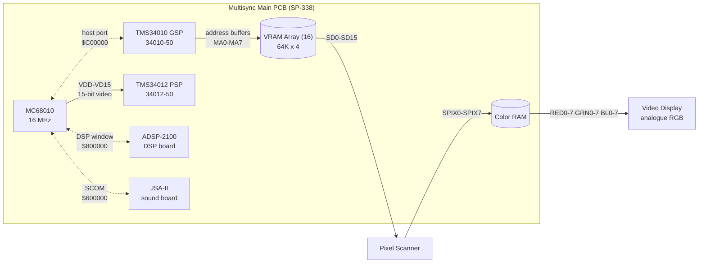
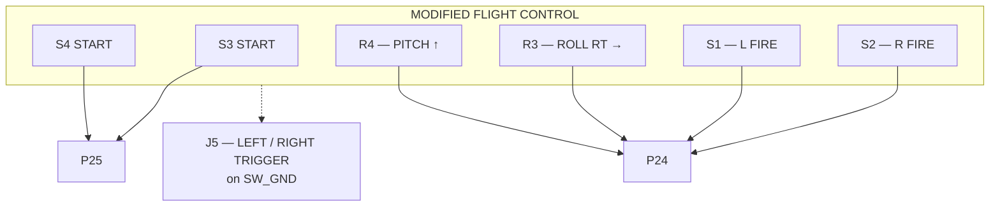
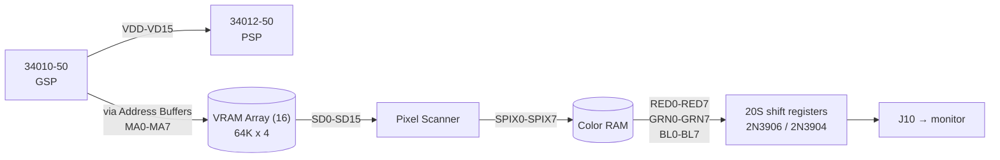
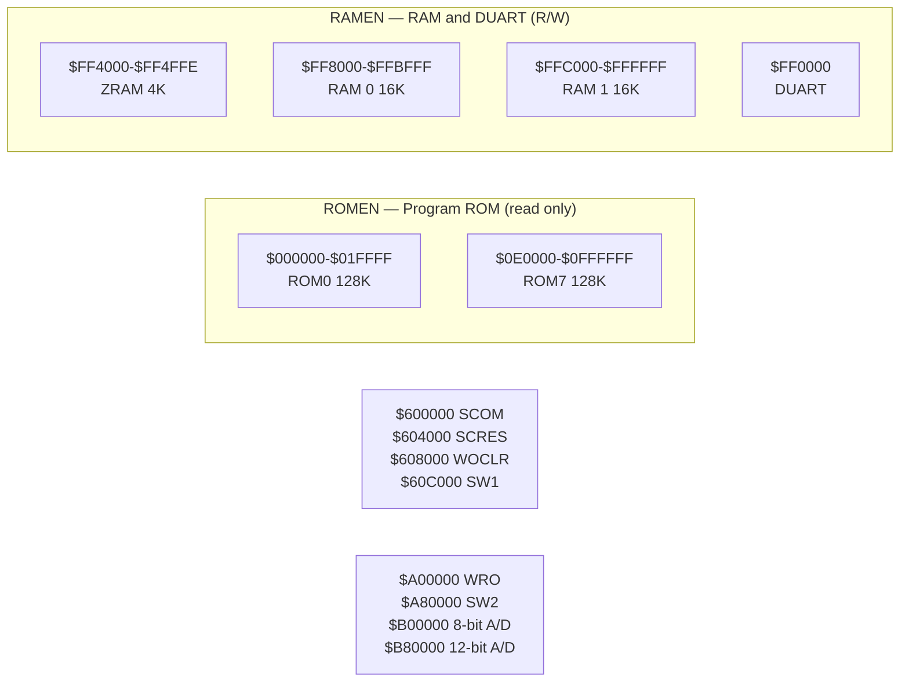
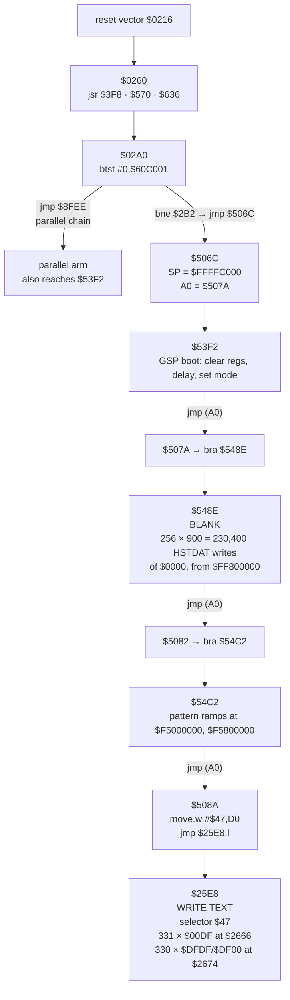
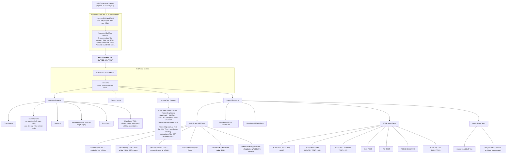

# SP-338 transcription — S.T.U.N. Runner (Atari Games TM 238)

A clean transcription made from the **rendered page images** in
`/tmp/stunrunner_pages/page-NN.png`, *not* from
`reference/manuals/stunrunner-ocr.txt`.

## Why the OCR is not used for schematics

It fails in two independent ways, and both have already cost us time:

1. **Its page markers do not bound its own text.** It credits `34010-50` to
   SP-338 Page 9; Page 9 is the ADC and shifter sheet.
2. **Tables lose their alignment and schematic text degrades to noise** —
   designators, net names and pin numbers arrive as isolated letters.

It remains useful for body prose. It is superseded for anything tabular,
schematic, or address-bearing.

## Page mapping

| What | PDF page |
|---|---|
| SP-338 Page *N* | **47 + *N*** — verified from Page 10 = 67 and Page 15 = 72 |
| Manual body pages | the manual's own numbering, offset differs by chapter — PDF 29 = page 3-5, PDF 17 = page 2-7 |

## Status

| SP-338 page | PDF | Title | State |
|---|---|---|---|
| 1 | 58 | Main Wiring Diagram | transcribed |
| 2–4 | 59–61 | — | in progress |
| 5–8 | 62–65 | — | in progress |
| 9 | 66 | Multisync Game PCB (ADC / shifter) | read, not transcribed |
| 10 | 67 | Multisync Game PCB (video) | transcribed |
| 11–14 | 68–71 | — | in progress |
| 15 | 72 | Main Board Memory Map | transcribed |

---

## 1. The board at a glance

From SP-338 Pages 1 and 10. This is the top-level picture the rest of this
document fills in.



**The single most important structural fact on this page:** the GSP writes VRAM
through address buffers and does **not** scan out. A separate TMS34012 serialises
its 15-bit video; the Pixel Scanner shifts VRAM out and Color RAM produces RGB.

That is why the MC68010 can draw text without any cooperation from the GSP: the
glyph words are composed entirely in the 68010's domain and land in VRAM over
the host port. The GSP is never asked to interpret text.

---

## 2. SP-338 Page 1 — Main Wiring Diagram (PDF 58)

Board-level interconnect: power supply, video display, coin mechanism, control
panel.

### 2.1 The modified flight control



**Two START buttons, two FIRE buttons (left and right), and two potentiometers —
one roll, one pitch.** Chapter 3's prose agrees: the handle assembly gives
vertical motion, the flight control assembly gives horizontal, which maps onto
pitch and roll.

### 2.2 Connector nets

`J5` control-panel header:

| pin | net | | pin | net |
|---|---|---|---|---|
| 1 | `TEST` | | 7 | `F IN` |
| 2 | `GND` | | 8 | `GND` |
| 3 | `AUD OUT` | | 9 | `+5V` |
| 4 | `AUD F` | | 10 | `+5V` |
| 5 | `KEY` | | 11 | `+5V` |
| 6 | `OUT` | | | |

`J9`:

| pin | net |
|---|---|
| 1 | `KEY` |
| 4 | `+5V` |
| 5 | `STEERING POT` |
| 6 | `AIM POT` |
| 11 | `GND` |

**A second analogue pair exists on `J9`**, separate from the R3/R4 pair on the
flight control. The board therefore expects at least four analogue axes before
any ADC is considered: roll, pitch, steering, aim. MAME carries two ADC axes.

`J5`, right-hand group:

| pin | net |
|---|---|
| 1 | `RIGHT TRIGGER` |
| 4 | `KEY` |
| 7 | `START` |
| 8 | `LEFT TRIGGER` |
| 10 | `SW_GND` |
| 11 | `GND` |

**`LEFT TRIGGER` and `RIGHT TRIGGER` sit on `SW_GND`, so they are switches, not
analogue.** This is the hardware confirmation, from wiring rather than prose, of
the gap in `docs/hardware-contract.md` §5: the self-test menus that the manual
says are navigated with "the right or left trigger" are driven by two of the
sixteen external switch inputs at `$A80000`, where MAME models three bits and
marks thirteen `IPT_UNUSED`.

`JSCOM` sound-board header: `TEST, GND, DATA, F IN, KEY, OUT, CLK, GND, GND, +5V, +5V`.

`P6`: `GND, SELF TEST, CON CNTR 1, CON CNTR 2, GND, KEY, CON CNTR 1, CON CNTR 2`
— two coin mechanisms with separate counters, plus an explicit `SELF TEST` line.

### 2.3 Board switches

| ref | function | where |
|---|---|---|
| `S11` | `TEST SW` — the self-test switch | on `P29`, main board |
| `R1` | `VOLUME CONTROL` | on `P29` |
| `R3`, `R4` | roll, pitch potentiometers | modified flight control |
| `P35` | `COIN COUNTER` | `P100` / `P55` coin interface |

The self-test switch is a **physical switch on the main PCB** (`S11`), routed to
`P6`'s `SELF TEST` line, and readable by the 68010 at `$60C000` bit 5. The
manual's memory map and MAME's `PORT_SERVICE(0x20)` describe the same switch;
neither is wrong.

### 2.4 Power and video

* Power supply wiring diagram `046989-01`: `+SENSE, +5V, +5V, +5V, GND, GND, -SENSE`
  — a three-wire sense arrangement, so the +5 V rail is remotely sensed.
* Video display connector: `BK, GN, BN` / `R, BK, GN` — analogue RGB to the
  monitor, separate from the digital GSP side.
* Speaker `LS1` via `P30`, driven from the sound board through `P29`.

---

## 3. SP-338 Page 10 — Video (PDF 67)

Signal flow, as printed:



**Jumper settings printed on the sheet:**

| Jumper | Setting |
|---|---|
| `Speed` | `A, B` |
| `BCLK` | `QB` |
| `VCLK` | `QB/2` |

**Clocks on this sheet:**

| Source | Value | Feeds |
|---|---|---|
| `XO-SCH` | `40MHZ` | pixel scanner |
| crystal `15.00Y 0.11431B 12` | via LS374 divider | `4 MHz` / `16 MHz` domains |
| MC68010 | `16 MHz` | main CPU |

**Output stage:** three `20S` 8-bit shift registers driven from `RRV`, `CRV` and
`BRV`, each clocked by `BCLK` / `/BLANK4`, feeding `2N3906` / `2N3904` output
stages and the `RED` / `GREEN` / `BLUE` nets to `J10`. `Q6` and `Q7` are `2N37100`
synchronous 16-bit counters for red and blue.

---

## 4. SP-338 Page 15 — Main Board Memory Map (PDF 72)

The authoritative memory map. Reproduced in full, with the MAME comparison, in
[`docs/hardware-contract.md`](hardware-contract.md) §1.



---

## 5. The boot chain, for context

Not from the manual — from our own ROM transcription, recorded here because the
manual's `$C00000` gap is the reason we care about these pages.



Measured frame ranges: blank ≈ frames 0–45; text `$47` at frames 45–47;
`$43`/`$50`/`$51`/`$52` at frames 165–167. GSP program upload frames 396–405,
release at frame 405.

---

---

## 7. Self-test screens and their order (manual pages 2-6, 2-7 — PDF 16, 17)

Table 2-4, *Summary of All Screens Appearing in the Self-Test*, transcribed in
full. This is the document that identifies what we have been decoding.



### 7.1 What this identifies in our own captures

| Our capture | Manual screen | Confidence |
|---|---|---|
| frames 45–47, selector `$47`, `PRESS*START*TO*BYPASS*SELFTEST` | the bypass prompt between the automated self-test and the test menu | exact string match |
| frames 165–167, selector `$43`, `PROGRAM*ROM*OK` | a line of the **Automated Self-Test Results** screen | string match; the manual names that screen as showing program RAM and ROM, VRAM, colour RAM, ADSP and sound results |
| frames 165–167, selectors `$51`/`$52`, `200` and `210` | unexplained | **not matched** |
| frames 165–167, selector `$50`, `Y*X*W*V*U*T*S*R` | unexplained | **not matched** |

**`Y X W V U T S R` is eight consecutive letters descending (R=18 … Y=25).** It
is not menu prose, and the test menu has four top-level items, so a one-to-one
mapping to menu entries does not exist. The nearest documented screen is the
**Control Inputs** screen, which exists precisely to verify the controls, but
nothing in the manual describes it and we have not captured it. **This stays
unidentified.** Do not let a plausible story fill the gap.

### 7.2 Three entries that bear directly on open questions

* **"Color RAM — tests the color RAM."** A named, separately testable device.
  This corroborates the Page 10 block diagram and confirms that
  `docs/gsp-display-scanout-contract.md`'s "two 1024-entry 16-bit planes" is
  describing something the hardware does not plainly have. There is a real
  Color RAM and it is testable on its own.
* **"VRAM Shift Register Test — checks the VRAM shift register."** The
  schematic's Pixel Scanner is the shift register. So the path VRAM → scanner →
  Color RAM is independently exercisable.
* **"Game Options — controls the high score table and steering in the attract
  mode."** The attract sequence has a steering-driven element, and the high
  score table is operator-editable — which is the NVRAM path we already have a
  slice for.

### 7.3 The option tables, from page 2-5 (PDF 15)

These are stored in RAM and edited through the screens, not by DIP.

**Coin options (Table 2-2)** — ◆ marks the manufacturer's recommended setting:

| Option | Settings |
|---|---|
| Coin Mode | 1 coin/1 credit · **2 coins/1 credit ◆** · 3 coins/1 credit · 4 coins/1 credit |
| Right Mech Multiplier | **1 coin counts as 1 coin ◆** · as 4 · as 5 · as 6 |
| Left Mech Multiplier | **1 coin counts as 1 coin ◆** · as 2 |
| Bonus Adder | **No bonus adder ◆** · 2→1 extra · 4→1 extra · 4→2 extra · 5→1 extra · 3→1 extra · **Free Play** |

Note the default is **two coins per credit**, so any replay harness that inserts
a single coin does not reach gameplay.

**Game options (Table 2-3)**:

| Option | Settings |
|---|---|
| Game Difficulty | Very Easy · Easy · Medium Easy · **Medium ◆** · Medium Hard · Hard · Very Hard · Nasty |
| Continue is One Coin Less Than Start | **Off ◆** · On |
| Sounds in Attract | **Yes ◆** · No |
| Auto Reset High Scores | Off · **On ◆** |
| High Score Name Censor | **Strict ◆** · Easygoing ◆ |
| T-Shirt Contest | **Disabled ◆** · Enabled ◆ |
| Continue Advances to Next Level | **After 1 Retry ◆** · After 2 Retries · Always · Never |

**Screen layout**, from Figure 2-6 (Game Options). Each option is a title line
followed by an indented value line, then a four-line footer:

```text
GAME OPTIONS
GAME DIFFICULTY
    MEDIUM
CONTINUE IS ONE COIN LESS THAN START
    OFF
...
    Hit LEFT/RIGHT Triggers to move UP/DOWN
    Hold a Coin Switch and hit Triggers to cycle through choices
    Hold a Coin Switch and press START to restore original setting
    Just press START to save this setting and exit
```

That title/value/footer shape is the layout our `$25E8` descriptors encode, and
it gives the colour convention the manual states explicitly: *an option is
enclosed in a blue box; the **default** setting of each option is **green**; other
settings are **blue** when selected and **white** when not.* Selector `$47` carries
colour byte `DF` and `$43` carries `FF`, so the descriptor colour field is a
palette index, not a brightness.

## 8. Corrections this transcription forces on the OCR-derived notes

* `FF 8000 - FF BFFF RAM 0 (16K)` and `FF C000 - FF FFFF RAM 1 (16K)`. The OCR
  reads `FE BFEF` / `FF BFEF`; the image is unambiguous.
* GSP reset is `60 400C` / `60 401C`, not `60 4006` / `60 4016` as the OCR has it.
* `60 C000` is labelled `SW1`, and the table under it covers **all sixteen bits**
  — D15–D8 option switches, D7/D6 coin switches, D5 self-test, D0 diagnostic.
  The OCR renders this as two disconnected fragments.